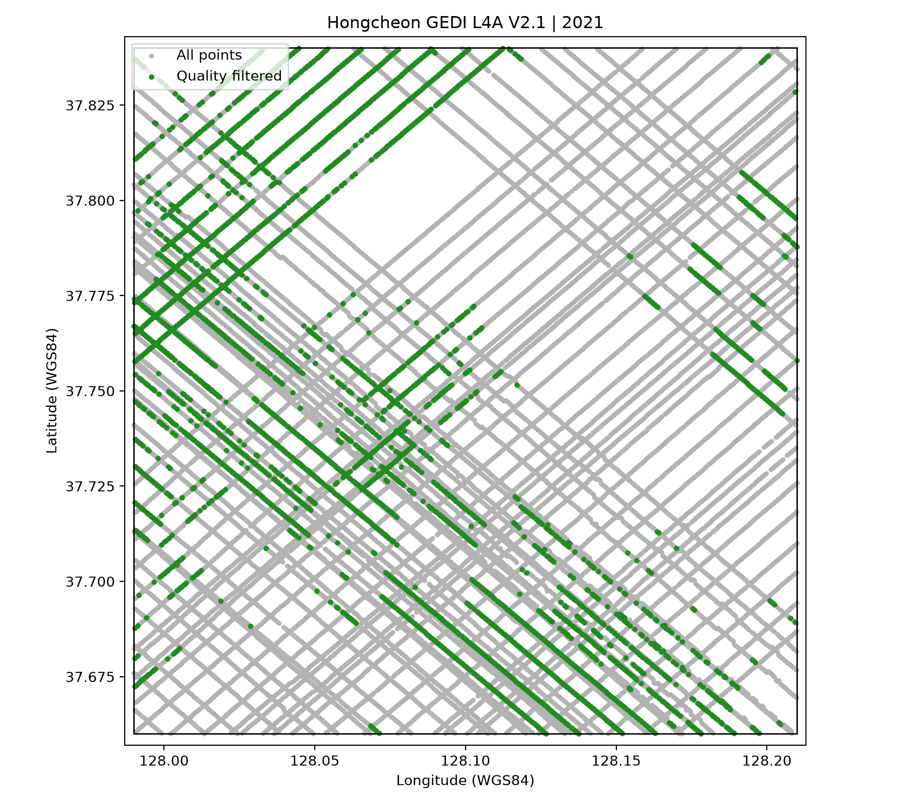
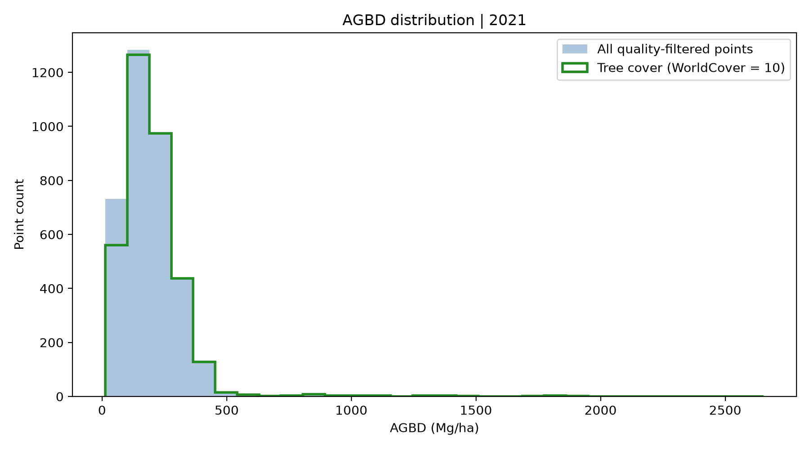
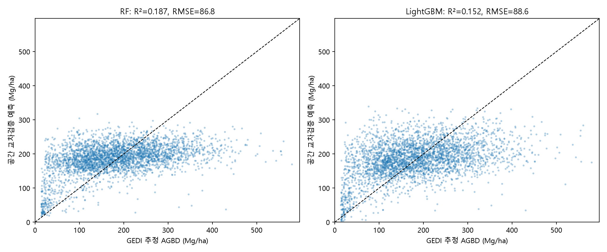
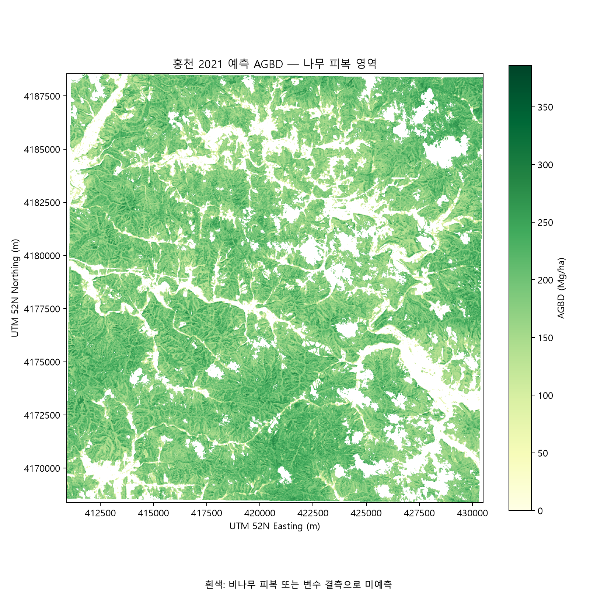
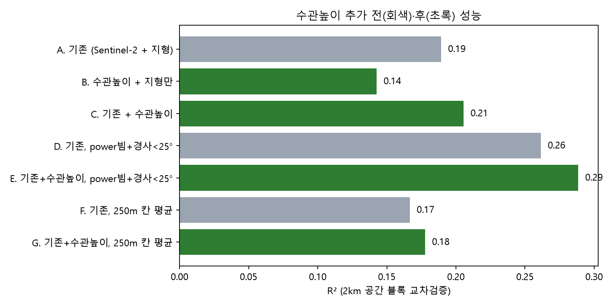
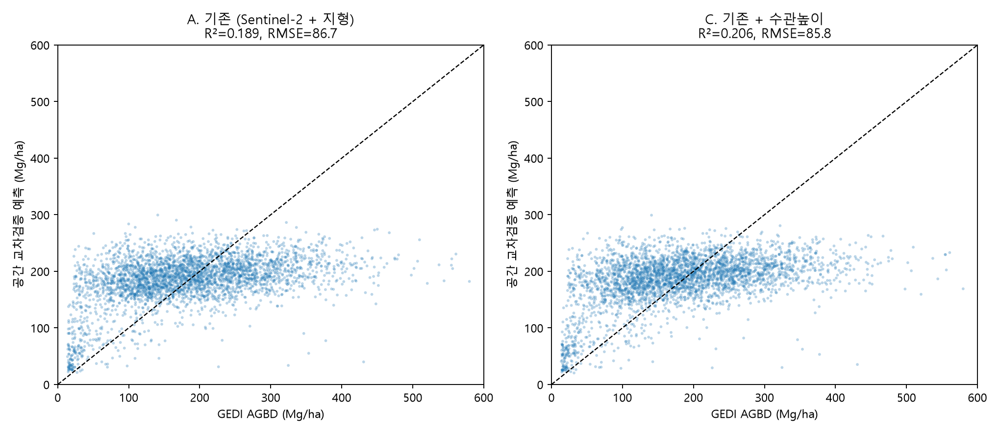
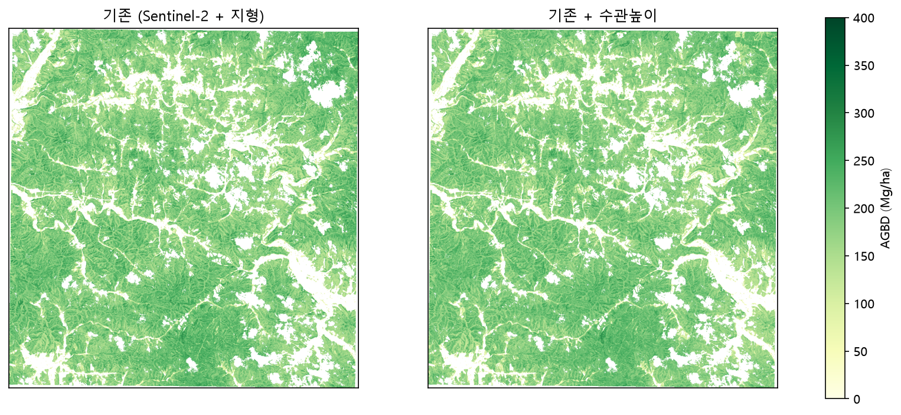

# 홍천 산림 GEDI 기반 바이오매스·탄소 추정 실험 보고서

- 작성일: 2026-10-23
- 과업: 금정산 탄소 PoC 사전 실험 (방법 검증용 시범 지역: 강원 홍천군)
- 작성: 이연지 (부산대학교, GLURI 기업체험형 인턴)
- 코드: `scripts/`, 주요 결과: `data/processed/`, 그림: `figures/` (실행 순서는 부록 A)

---

## 1. 요약

**오늘의 질문:** 국내 산림 지역에서 GEDI를 바이오매스 기준자료로 쓸 수 있는가? 쓸 수 있다면, 위성영상으로 구역 전체의 탄소량까지 추정할 수 있는가?

→ 관측점 개수는 충분하지만, GEDI 값만으로 탄소량을 확정해서는 안 된다.

| 확인한 것 | 근거 |
| --- | --- |
| GEDI 관측점은 충분함 | 20×20km, 2021년 1년 동안 품질 조건을 통과한 점 3,635개 (선행연구 308개의 약 12배) |
| 위성영상 → AGB 지도 → 탄소 총량까지 재현 가능한 흐름을 만들었음 | 탄소 저장량 약 338만 tC (잠정, IPCC 기본계수) |
| 하지만 모델 설명력이 낮음 | 공간 교차검증 R² 0.19, RMSE 87 Mg/ha |
| 낮은 원인은 모델이 아니라 기준자료(GEDI)와 광학 영상의 한계 | 같은 자리를 다른 궤도에서 잰 GEDI끼리도 차이 중앙값 87 Mg/ha / 광학 포화 |
| 수관높이 자료를 더해도 개선은 작음 | R² 0.19 → 0.21 (품질 좋은 점만 쓰면 0.29), 탄소 총량 변화 −0.8% |
| GEDI 값 자체에 치우침 존재 | 경사 15° 이하 평균 134 → 35° 이상 224 Mg/ha / power 빔 201 vs coverage 빔 157 Mg/ha |
| GEDI 최신 버전(V3)은 값이 전체적으로 약 26% 낮음 | 같은 관측점에서 V3 = V2.1 × 약 0.74 (상관 0.999) → 탄소 총량 335만 → 253만 tC |
| V3에서 쓸 수 있는 점과 일관성은 늘었지만, 상대 오차와 경사 치우침은 그대로임 | 점 3,635 → 5,612개 / 같은 자리 상관 −0.06 → 0.15 / R² 0.21 → 0.24 / 상대 RMSE 약 47% → 49% |

위성 경로(GEDI + Sentinel)는 공간 분포를 그리는 데 쓰고, 탄소 총량은 임상도 계수법과 소규모 현장 표본구로 반드시 교차 확인해야 함, 같은 GEDI라도 **버전만 바꿔도 총량이 25% 달라진다**는 점은 이 필요성을 더 분명하게 보여줌

---

## 2. 대상과 자료

### 2.1 대상 구역

- 강원 홍천군 산림 지역, 경도 127.99–128.21°, 위도 37.66–37.84° (약 20×20km, 약 39,000ha)
- 기준연도 2021년. ESA WorldCover 2021과 연도를 맞추기 위해 선택
- 산림 비율이 높은 지역이며, 방법 검증용 시범 지역

### 2.2 사용 자료

| 자료 | 버전·제품 | 용도 | 접근 |
| --- | --- | --- | --- |
| GEDI L4A | V2.1 (`GEDI_L4A_AGB_Density_V2_1_2056`), 2021년 궤도 14개 | 바이오매스 기준값 | NASA Earthdata 로그인 |
| Sentinel-2 L2A | 타일 52SDG, 2021-05-22 (S2A), 2021-10-24 (S2B) | 분광 변수 | Earth Search STAC, 로그인 불필요 |
| Copernicus DEM | GLO-30 | 고도·경사·향 | AWS 공개 |
| ESA WorldCover | 2021 v200, 타일 N36E126 | 나무 피복(분류값 10) 구분 | ESA 공개 |
| Meta 수관높이(CHM) | alsgedi_global_v6, 1m, 타일 132110312·132110330 | 보완 변수 | AWS 공개 |

**GEDI 버전 선택:** NASA에는 V3도 있지만, 선행연구(아칸소 논문)와 Google Earth Engine 자료가 V2 계열이라 1–4단계는 V2.1로 통일했다. V3와의 비교는 5단계(4.5절)에서 따로 진행

**Sentinel-2 장면 선택:** 구역을 100% 덮는 장면 중 구름이 적은 날로 선택, 구역 안의 구름·그림자 비율은 5/22 장면이 8.1%, 10/24 장면이 0.1%

---

## 3. 방법

### 3.1 GEDI 품질 필터

8개 빔(BEAM0000–BEAM1011)을 모두 읽은 뒤, 아래 조건을 순서대로 누적 적용

1. 구역 안에 있고, 관측 시각이 2021년인 점
2. AGBD가 유효한 값 (fill value 제외, 0 이상)
3. `l4_quality_flag == 1`(NASA가 바이오매스 추정 품질 괜찮음이라고 표시한 점만 남김)
4. `degrade_flag == 0`(위성 위치·자세 정보가 안정했던 시간대의 점)

`shot_number`는 정수(uint64)로 유지해 중복 여부를 확인(중복 0개)

### 3.2 학습 자료

- 이상치 제거: AGBD가 600 Mg/ha를 넘는 점 52개를 제외. 국내 산림에서 현실적으로 나오기 어려운 값(원래 한국 산림은 100~200 Mg/ha) 400과 800 Mg/ha로도 민감도를 확인했다.
- 영상 결측(구름 등)이 있는 점 237개를 제외
- **최종 학습 점: 3,346개, 2km 공간 블록 91개**

### 3.3 입력 변수 (31개, 10m 격자)

- Sentinel-2 두 시기 각각: 밴드 10개(B02–B12, 20m 밴드는 10m로 재샘플링) + NDVI, NDRE, EVI, NDMI
- 지형: 고도, 경사, 향
- 구름·그림자·눈 픽셀(SCL 3, 8, 9, 10, 11)은 결측으로 처리
- 보완 실험(4단계)에서는 수관높이 변수 5개(평균, 최대, 30m 평균, 30m 최대, 2m 이상 피복률)를 추가

### 3.4 모델과 검증

- 모델: Random Forest(트리 300개)와 LightGBM(트리 300개, 학습률 0.05)
- 검증 두 가지:
    - **무작위 5-fold**
    - **공간 5-fold:** 2km×2km 블록 단위로 나눠서, 같은 블록이 학습과 평가에 동시에 들어가지 않게 했다.
- 지표: R², RMSE, Bias, MAE (단위 Mg/ha)
- 진단·보완 실험(3–4단계)은 같은 공간 분할 기준으로 Random Forest(트리 200개)

### 3.5 탄소 환산

```
총 탄소(tC)  = Σ [나무 피복 픽셀의 AGB(Mg/ha) × 0.01ha] × (1 + R) × CF
CO₂ 환산(t) = 총 탄소 × 44/12
```

- R(뿌리 비율) = 0.25 (다섯 값의 평균) → IPCC 2006 Vol.4 Ch.4 표 4.4
- CF(탄소 비율) = 0.47 (범위 0.44–0.49) → IPCC 2006 표 4.3 기본값

두 값은 IPCC 2006 Vol.4 Ch.4 원문의 표와 대조해서 확인했다.

| IPCC 표 4.4 온대림 (R) | 지상부 바이오매스 | R (범위) |
| --- | --- | --- |
| 침엽수 | 50–150 t/ha | 0.29 (0.24–0.50) |
| 침엽수 | 150 t/ha 초과 | 0.20 (0.12–0.49) |
| 참나무류(Quercus) | 70 t/ha 초과 | 0.30 (0.20–1.16) |
| 기타 활엽수 | 75–150 t/ha | 0.23 (0.13–0.37) |
| 기타 활엽수 | 150 t/ha 초과 | 0.24 (0.17–0.44) |

| IPCC 표 4.3 (CF) | CF (범위) |
| --- | --- |
| 기본값 | 0.47 |
| 온대·북방림 전체 | 0.47 (0.47–0.49) |
| 온대·북방림 활엽수 | 0.48 (0.46–0.50) |
| 온대·북방림 침엽수 | 0.51 (0.47–0.55) |

홍천의 평균 AGB(139–185 t/ha)와 침엽수·참나무·활엽수가 섞인 숲에 해당하는 R 값은 0.20–0.30. 그래서 그 중간값인 0.25를 쓰고 0.20–0.30을 범위로 잡음

CF는 온대림 전체 값 0.47(0.47–0.49)을 사용, 수종 구분 없이 하나의 값을 쓴 것이므로, 수종 정보(임상도)가 있으면 수종별 값으로 바꿔야 함

- 범위는 두 모델 × 계수 최소·최대 조합으로 만든 **시나리오 범위**
- 통계적 신뢰구간이 아님

---

## 4. 결과

### 4.1 1단계: GEDI 관측점 확보

| 단계 | 남은 점 | 전체 대비 | 이전 단계 대비 |
| --- | --- | --- | --- |
| 구역·기간 안 전체 점 | 24,780 | 100% | — |
| AGBD 유효값 | 10,337 | 41.7% | 41.7% |
| L4 품질 = 1 | 5,733 | 23.1% | 55.5% |
| degrade = 0 (최종) | **3,635** | **14.7%** | 63.4% |
| (참고) 그중 야간 관측 | 1,755 | 7.1% | 48.3% |
| (참고) 그중 나무 피복 | 3,424 | — | 94.2% |



회색은 전체 점 24,780개, 초록은 품질을 통과한 점 3,635개 

| 월 | 전체 | 필터 통과 |
| --- | --- | --- |
| 5월 | 3,386 | 209 |
| 6월 | 13,872 | 752 |
| 9월 | 4,197 | 2,674 |
| 11월 | 3,325 | 0 |
| 그 외 | 0 | 0 |
- 관측이 4개월에 몰려 있고, 통과한 점의 74%가 9월에 나왔음
- 11월에는 3,325개가 관측됐지만 L4 품질을 통과한 점이 하나도 없음
- 구역 북동쪽(경도 128.10–128.20, 위도 37.77–37.84)에는 통과한 점이 거의 없음
- AGBD 분포: 평균 197.5, 중앙값 176.9 Mg/ha. 1,000 Mg/ha가 넘는 비현실적인 값이 26개 있고, 최대는 2,654 Mg/ha

AGBD 분포



품질을 통과한 점들의 바이오매스 값이 어떻게 퍼져 있는지 나타냄

- 대부분 100–300톤에 몰려 있음, 그래서 600톤 넘는 값을 이상치로 뺌

### 4.2 2단계: 위성 모델과 탄소 추정

| 검증 | 모델 | R² | RMSE | Bias | MAE |
| --- | --- | --- | --- | --- | --- |
| 무작위 | RF | 0.222 | 84.9 | 1.3 | 66.8 |
| 무작위 | LightGBM | 0.191 | 86.6 | −0.1 | 67.5 |
| 공간 | **RF** | **0.187** | **86.8** | 1.5 | 68.5 |
| 공간 | LightGBM | 0.152 | 88.6 | −0.2 | 69.1 |
- 공간 분할 성능이 무작위 분할보다 낮음,이상치 기준을 400, 600, 800으로 바꿔도 이 순서는 같음
    - 2주차 논문 검토의 결론(무작위 분할은 성능을 부풀릴 수 있다)을 직접 확인
- 대표 모델로는 공간 분할 성능이 더 좋은 RF를 골랐음

관측 대비 예측



가로축은 GEDI 값(정답), 세로축은 모델 예측

- 점들이 대각선을 따르지 않고 가로로 누워서 200 근처에 몰려 있음 → 정답이 50이든 400이든 200쯤이라고 답했다는 의미
- R²는 RF 0.19, LightGBM 0.15

| 탄소 추정 (RF) | 값 |
| --- | --- |
| 나무 피복 면적 | 33,773 ha |
| 예측한 면적 | 31,004 ha (91.8%, 나머지 8.2%는 구름으로 미예측) |
| 평균 AGB | 185.5 Mg/ha |
| 평균 탄소밀도 | 109.0 tC/ha |
| **탄소 저장량** | **약 337.8만 tC (약 1,238.6만 tCO₂)** |
| 시나리오 범위 | 321.7만 ~ 366.3만 tC |
| (참고) 미예측 면적에도 같은 평균 적용 시 | 약 368만 tC |

AGB 지도



모델이 예측한 홍천 구역 전체의 바이오매스 (10m 칸마다)

→ 이 지도의 칸들을 다 더해서 단소 총량(약 338만 톤)을 계산함 

### 4.3 3단계: 설명력이 낮은 원인

| 가설 | 실험 | R² | 판단 |
| --- | --- | --- | --- |
| — | 기준 | 0.189 | — |
| 25m GEDI와 10m 픽셀의 위치 불일치 | 30m·50m 주변 평균 변수 | 0.178 | 원인 아님 |
| 목표값 분포가 치우쳐 있음 | 로그 변환 | 0.129 | 원인 아님 |
| 낮은 품질의 GEDI 점 | power 빔만 / 경사 25° 미만만 | 0.220 / 0.231 | 일부 영향 |
| 야간·고감도 점만 쓰면 나아짐 | 야간만 / sensitivity ≥ 0.98 | 0.141 / 0.188 | 효과 없음 |
| 점 단위 노이즈 | 250–500m 칸 평균 | 0.12–0.17 | RMSE는 87→53–58로 감소, R²는 그대로 |

원인 1: 기준자료(GEDI)의 노이즈

- 서로 다른 궤도가 25m 안에서 같은 자리를 잰 59쌍을 비교
- 상관계수는 −0.06이었고, 차이 중앙값은 87 Mg/ha
- 모델 RMSE(87 Mg/ha)와 같은 크기. 즉 정답 자체가 이만큼 흔들리기 때문에, 어떤 모델도 이보다 크게 나아지기 어려움(단, 59쌍은 작은 표본)

원인 2: 광학 영상의 포화

| GEDI 구간 (Mg/ha) | 점 수 | 평균 관측 | 평균 예측 | 편향 |
| --- | --- | --- | --- | --- |
| 0–50 | 260 | 29.7 | 111.1 | +81.4 |
| 50–100 | 401 | 78.7 | 173.6 | +94.9 |
| 100–150 | 670 | 125.5 | 182.7 | +57.3 |
| 150–200 | 661 | 175.0 | 192.7 | +17.6 |
| 200–300 | 943 | 244.5 | 196.8 | −47.7 |
| 300–600 | 411 | 357.3 | 206.3 | −151.0 |

예측이 평균(약 190) 근처로 몰림, 칸 평균으로 노이즈를 줄여도 R²가 오르지 않는 것을 보면, 영상 변수 자체에 바이오매스 차이에 대한 정보가 부족함

원인 3: GEDI 값의 체계적 치우침

| 구분 | 평균 GEDI AGBD (Mg/ha) |
| --- | --- |
| 경사 0–15° | 134.0 |
| 경사 15–25° | 178.7 |
| 경사 25–35° | 198.0 |
| 경사 35° 이상 | 224.3 |
| coverage 빔 | 156.7 |
| power 빔 | 200.9 |

경사가 급하면 GEDI 신호가 넓게 퍼져 나무 높이를 크게 읽을 수 있음, 반대로 급경사에 오래된 숲이 실제로 많을 가능성도 있어서, 이번 실험으로는 둘을 구분하지 못함 → 이 치우침은 탄소 총량에 그대로 반영됨

### 4.4 4단계: 보완 — 수관높이(CHM) 추가 전후 비교

- 수관높이 평균은 11.1m, 상위 10%는 18.1m로 국내 산림에서 현실적인 값이다.

| 실험 | 학습점 | R² | RMSE |
| --- | --- | --- | --- |
| A. 기존 (Sentinel-2 + 지형) | 3,346 | 0.189 | 86.7 |
| B. 수관높이 + 지형만 | 3,346 | 0.143 | 89.1 |
| **C. 기존 + 수관높이** | 3,346 | **0.206** | 85.8 |
| D. 기존, power 빔 + 경사<25° | 1,074 | 0.261 | 88.1 |
| **E. 기존 + 수관높이, power 빔 + 경사<25°** | 1,074 | **0.289** | 86.5 |
| F. 기존, 250m 칸 평균 | 570 | 0.167 | 58.6 |
| G. 기존 + 수관높이, 250m 칸 평균 | 570 | 0.178 | 58.2 |

수관높이 추가 전후 R²



- 회색은 수관높이 없이, 초록은 수관높이를 넣은 실험(막대가 길수록 좋음)
- 핵심: 수관높이를 넣으면 조금씩 오름(0.19→0.21)
- 품질 좋은 점만 쓴 E가 0.29로 가장 높지만 그래도 낮은 편

수관높이 추가 전후 관측 대비 예측



두 그래프가 거의 유사 → 수관 높이를 넣어도 200 근처로 몰리는 문제가 그대로라는 의미

| 탄소 추정 | 평균 AGB | 탄소밀도 | 탄소 저장량 |
| --- | --- | --- | --- |
| 기존 (RF) | 185.5 Mg/ha | 109.0 tC/ha | 337.8만 tC |
| 수관높이 추가 (RF) | 184.0 Mg/ha | 108.1 tC/ha | 335.1만 tC (−0.8%) |

수관높이 추가 전후 AGB 지도



- R²는 올랐지만(+0.02, 깨끗한 점에서는 +0.03), 포화는 거의 그대로임(300–600 구간 편향 −151.0 → −150.4).
- 중요도 상위 변수: 10월 NDMI, 수관높이 30m 평균, 경사, 수관높이 평균, 10월 B12
- GEDI 점의 10%(322개)는 수관높이 자료상 나무가 없는 곳(2m 미만)인데, GEDI는 평균 92 Mg/ha라고 했음, 촬영 시점 차이 또는 GEDI 노이즈로 보임
- 탄소 총량이 거의 바뀌지 않음, 총량은 입력 변수보다 GEDI 평균값이 결정한다는 3단계 진단과 일치

### 4.5 5단계: GEDI V3로 바꾸면 나아지는가

**V3란 무엇인가**

V3는 GEDI L4A 제품의 세 번째 버전(Version 3) 위성이 새로 측정한 자료가 아니라, 같은 측정값을 NASA가 바뀐 계산 방법으로 다시 처리해서 낸 것

GEDI 바이오매스 값은 두 단계로 만들어진다.

```
① 레이저 신호로 나무 높이를 잰다            ← 위성의 실제 측정 (V2.1과 V3가 같음)
② 나무 높이를 공식에 넣어 바이오매스를 계산 ← NASA가 만든 추정 공식 (V3에서 바뀜)
```

①이 같기 때문에 홍천 구역의 전체 관측점 수는 두 버전 모두 24,780개로 똑같음, 바뀐 것은 ②의 공식이다. 이 공식은 실제 숲에서 잰 바이오매스와 같은 숲에서 모의한 GEDI 신호를 짝지어 만든 통계 모델

| 버전 | 공개 | 비고 |
| --- | --- | --- |
| V2 / V2.1 | 2022년 | 아칸소 논문 등 대부분의 선행연구가 사용. 이번 실험의 1–4단계 |
| V3 | 2026년 | 최신 버전. 이번 실험의 5단계 |

V3 설명서(ORNL DAAC) 기준 주요 변경점은 다음과 같음

- **추정 공식 갱신:** 공식을 만드는 데 쓴 자료가 8,587개에서 11,687개로 늘었음
늘어난 지역은 주로 북미, 아프리카, 남아시아(한국이 속한 지역의 자료가 얼마나 바뀌었는지는 확인하지 못했음)
- 품질 플래그 정비**:** `l4a_quality_flag_rel3`, 구름·안개 이상치 표시(`elev_highestreturn_outlier_flag`) 등이 새로 생김
- 기존 플래그의 버그 수정, 파일 단위를 궤도 일부(sub-orbit)로 변경
- 전체 정확도는 비슷함: 설명서상 전 지구 상대 RMSE는 V2.1 50.0%, V3 50.7%
    - 즉 더 정확해진 버전이라기보다 공식을 다시 맞춘 버전에 가까움

같은 구역·기간의 V3 자료를 다시 받아 V2.1과 비교

**① 관측점 수**

| 단계 | V2.1 | V3 |
| --- | --- | --- |
| 구역 안 전체 점 | 24,780 | 24,780 |
| AGBD 유효값 | 10,337 | 10,334 |
| L4 품질 통과 | 5,733 | 6,437 |
| degrade_flag = 0 (최종) | 3,635 | **5,612** |
| + 새 플래그(구름·안개 이상치, 학습 범위 밖, 낙엽기) 제외 | — | 5,579 |
- 늘어난 점은 주로 6월(752 → 1,881개)과 9월(2,674 → 3,427개)
- 새 플래그로 추가로 빠진 점은 33개뿐이고, 이 점들은 이상치·영상 결측 단계에서도 빠지는 점이어서 모델 결과는 같았음

**② 같은 관측점의 값 비교**

| 항목 | 값 |
| --- | --- |
| 두 버전 모두 최종 통과한 점 | 3,511개 |
| 두 버전 값의 상관계수 | 0.999 |
| 평균 AGBD | V2.1 184.5 → V3 138.7 Mg/ha |
| V3 / V2.1 비율 (중앙값) | 0.74 |

**V3는 V2.1 값을 거의 일정한 비율(약 0.74배)로 낮춘 것에 가깝다.** 점끼리의 순서나 상대적인 차이는 그대로임

**③ 같은 자리 일관성**

| 버전 | 반경 | 쌍 | 상관계수 | 차이 중앙값 (Mg/ha) |
| --- | --- | --- | --- | --- |
| V2.1 | 25m | 59 | −0.06 | 86.9 |
| V2.1 | 50m | 156 | 0.02 | 72.3 |
| V3 | 25m | 80 | 0.15 | 53.3 |
| V3 | 50m | 258 | 0.26 | 49.4 |
- 상관계수가 0 근처에서 0.15–0.26으로 올랐고 다만 여전히 낮은 수준
- 차이 중앙값이 줄어든 것의 상당 부분은 값 자체가 26% 낮아진 효과 → 87 × 0.74 ≈ 64.

**④ 모델 성능 (RF, 2km 공간 블록)**

| 정답 | 변수 | 학습점 | 평균 AGBD | R² | RMSE | 상대 RMSE |
| --- | --- | --- | --- | --- | --- | --- |
| V2.1 | 기존 | 3,346 | 184.2 | 0.189 | 86.7 | 47% |
| V2.1 | 기존 + 수관높이 | 3,346 | 184.2 | 0.206 | 85.8 | 47% |
| V3 | 기존 | 5,120 | 135.0 | 0.229 | 67.2 | 50% |
| V3 | 기존 + 수관높이 | 5,120 | 135.0 | **0.241** | 66.6 | 49% |

R²는 약간 올랐지만, RMSE를 평균으로 나눈 상대 오차는 거의 같다. RMSE가 87에서 67로 줄어든 것은 값 자체가 낮아졌기 때문

**⑤ 치우침**

| 구분 | V2.1 평균 | V3 평균 |
| --- | --- | --- |
| 경사 0–15° | 134.0 | 92.1 |
| 경사 35° 이상 | 224.3 | 171.0 |
| 급경사 / 완경사 비율 | 1.67배 | 1.86배 |
| power 빔 / coverage 빔 | 200.9 / 156.7 | 148.1 / 117.0 |

경사와 빔 종류에 따른 치우침은 V3에서도 그대로 남아 있음

**⑥ 탄소 총량 (RF + 수관높이)**

| 정답 | 평균 AGB | 탄소밀도 | 탄소 저장량 | 시나리오 범위 |
| --- | --- | --- | --- | --- |
| V2.1 | 184.0 Mg/ha | 108.1 tC/ha | 335.1만 tC | 321.7만 ~ 363.4만 |
| V3 | 139.2 Mg/ha | 81.8 tC/ha | **253.5만 tC** (−24%) | 243.3만 ~ 274.8만 |
- 버전만 바꿔도 탄소 총량이 약 25% 달라짐, 두 버전의 범위가 겹치지도 않음
    - GEDI로 계산한 총량은 어느 버전을 썼느냐에 크게 좌우되며, 어느 쪽이 실제에 가까운지는 현장자료 없이는 판단할 수 없음
- V3 평균(약 139 Mg/ha)은 2주차 리뷰 논문의 온대림 평균(137 Mg/ha)과 비슷함
    - 다만 이것만으로 V3가 맞다고 할 수는 없음
- V3는 쓸 수 있는 점이 늘고 일관성이 조금 나아짐
    - 하지만 상대 오차와 경사 치우침은 그대로라서, 3단계 진단의 결론은 바뀌지 않음

---

## 5. 한계

1. 정답이 추정치
    - 모든 성능은 “GEDI를 얼마나 재현했나”를 뜻함, 실제 탄소량에 대한 정확도는 현장자료 없이는 알 수 없음
2. GEDI 값이 버전과 조건에 따라 크게 달라짐
    - V2.1 평균은 185, V3 평균은 139 Mg/ha이고, 둘 다 경사에 따라 치우쳐 있음
    - 국내 산림 통계와 비교해서 확인해야 함
3. 탄소 계수가 잠정값
    - IPCC 기본값을 썼고, R은 원문 대조가 필요함, 국립산림과학원의 수종별 계수로 바꿔야 함
4. 입력 자료가 제한적임
    - Sentinel-2 영상 2장만 썼고, 구름 때문에 나무 피복의 8.2%를 예측하지 못함, Sentinel-1 레이더는 쓰지 않았음
5. 관측이 시기와 공간에 치우쳐 있음
    - 4개월에만 관측됐고, 북동쪽은 비어 있음
6. 수관높이 자료가 독립적이지 않음
    - Meta 수관높이는 GEDI를 일부 학습에 써서 만든 자료이고, 촬영 시점도 지역마다 다름
7. 나무 피복은 법적 산림 경계가 아님
    - WorldCover 분류값 10 사용
8. 표본이 작은 진단이 있음
    - GEDI끼리 비교한 쌍은 V2.1 59–156개, V3 80–258개다.
9. V3 비교에서는 진단 실험을 다시 하지 않았음
    - 칸 평균, 품질 부분집합 실험은 V2.1에서만 진행

---

## 6. 금정산 적용 방향

| 경로 | 방법 | 이번 실험에서 배운 점 |
| --- | --- | --- |
| A. 위성 모델 | GEDI + Sentinel + 수관높이 → AGB 지도 | 흐름은 그대로 재사용 가능. 다만 총량을 결정하는 근거로는 약하다. 공간 분포용으로 씀 |
| B. 임상도 계수법 | 임상도(수종·영급·경급) → 재적 → 국가 계수 | GEDI의 치우침을 견제할 독립 추정으로 반드시 필요함 |
| C. 현장 표본구 | 흉고직경·수고 → 수종별 상대생장식 | 실제 정확도를 확인할 유일한 방법. 10–20개라도 필요함 |

금정산에 적용할 때 바꿀 점은 다음과 같음

- 2019–2025년 GEDI를 모두 쓴다. 금정산 범위를 지나는 궤도 파일이 72개 있는 것을 확인함
- GEDI 버전은 V3를 기본으로 쓰되, V2.1 결과도 함께 보고해서 버전에 따른 차이를 드러냄
- power 빔과 경사 조건을 기본 필터에 포함함
- 이상치 기준과 빔·경사 치우침을 보고서에 명시함
- 탄소 계수는 국립산림과학원 수종별 값을 씀
- 금정산은 도심형 국립공원이라 시가지 경계를 처리해야 하고, 사유지 비율이 높아 현장 조사에 출입 협조가 필요함

---

## 부록 A. 실행 순서

Python 3.12 기준. 이 폴더에서 가상환경을 만든 뒤 순서대로 실행한다.

```powershell
python -m venv .venv
.\.venv\Scripts\python.exe -m pip install -r requirements-lock.txt
```

| 순서 | 스크립트 | 내용 | 소요 |
| --- | --- | --- | --- |
| 1 | `scripts/run_analysis.py` | GEDI 다운로드(Earthdata 인증 필요), 필터, WorldCover | 약 20분 (3–4GB) |
| 2 | `scripts/step2_model.py` | Sentinel-2·DEM, 변수, RF/LightGBM, 지도, 탄소 | 약 40분 |
| 3 | `scripts/step3_diagnose.py` | 원인 진단 실험 | 약 2분 |
| 4 | `scripts/step3b_aggregate.py` | 칸 평균 실험 | 약 1분 |
| 5 | `scripts/step4_chm.py` | 수관높이 추가, 비교 실험, 지도·탄소 재계산 | 약 35분 |
| 6 | `scripts/step5_v3.py` | GEDI V3 다운로드(Earthdata 인증 필요), V2.1과 비교, V3 기준 지도·탄소 | 약 10분 (3.1GB) |

- 검증: `scripts/verify_pipeline.py`(필터·정밀도 단위 테스트), `scripts/verify_step2_outputs.py`(2단계 결과 일관성)
- Earthdata 인증은 환경변수 `EARTHDATA_USERNAME`, `EARTHDATA_PASSWORD` 또는 사용자 홈의 `_netrc`로 읽는다. 인증 정보는 코드와 결과 파일에 저장하지 않는다.

## 부록 B. 폴더 구성

| 경로 | 내용 |
| --- | --- |
| `data/processed/filter_summary.csv`, `monthly_counts.csv`, `gedi_l4a_2021_filtered.csv`, `beam_read_log.json` | 1단계: GEDI 필터 단계별 개수, 월별 개수, 품질 통과 점, 빔 읽기 기록 |
| `data/processed/model_cv.csv`, `feature_importance.csv`, `carbon_totals.csv`, `scene_quality.csv`, `s2_scene_manifest.json` | 2단계: 모델·검증·이상치 기준별 성능, 변수 중요도, 탄소 추정, 영상 품질 |
| `data/processed/step3_*` | 3단계: 원인 진단 결과 |
| `data/processed/step4_*` | 4단계: 수관높이 비교 결과 |
| `data/processed/step5_*` | 5단계: GEDI V3 비교 결과 |
| `figures/` | 보고서 그림 |
| `docs/` | 1·2단계 실행 시 자동 생성된 요약 |

용량 때문에 원본 GEDI(HDF5)·Sentinel-2 영상, 전체 관측점 CSV, 학습 표본, 교차검증 예측값, AGB 지도 GeoTIFF(각 10MB)는 올리지 않았다. 위 스크립트로 다시 만들 수 있다.

CSV의 `shot_number`는 Excel에서 열면 숫자가 깨질 수 있다. pandas에서 `dtype={'shot_number': 'uint64'}`로 읽는다.

## 부록 C. 출처

- GEDI L4A V2.1: https://doi.org/10.3334/ORNLDAAC/2056
- GEDI L4A V3: https://doi.org/10.3334/ORNLDAAC/2508
- ORNL DAAC GEDI 실습: https://ornldaac.github.io/gedi_tutorials/
- ESA WorldCover: https://esa-worldcover.org/en/data-access
- Sentinel-2 L2A (Earth Search): https://earth-search.aws.element84.com/v1
- Copernicus DEM GLO-30: https://registry.opendata.aws/copernicus-dem/
- Meta 전 지구 수관높이: https://registry.opendata.aws/dataforgood-fb-forests/
- IPCC 2006 Vol.4 Ch.4: https://www.ipcc-nggip.iges.or.jp/public/2006gl/pdf/4_Volume4/V4_04_Ch4_Forest_Land.pdf
