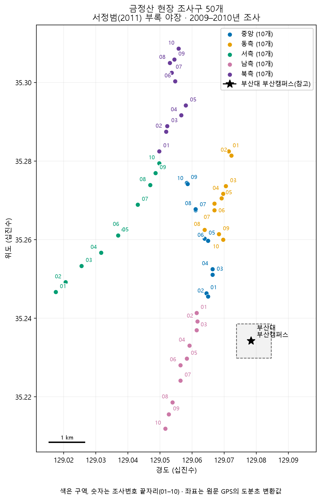
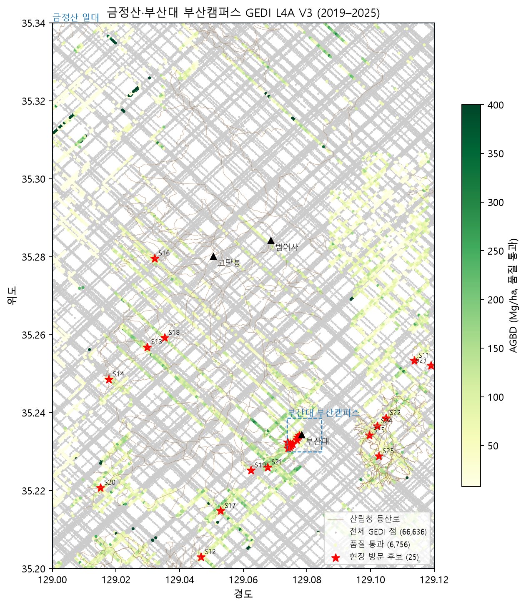
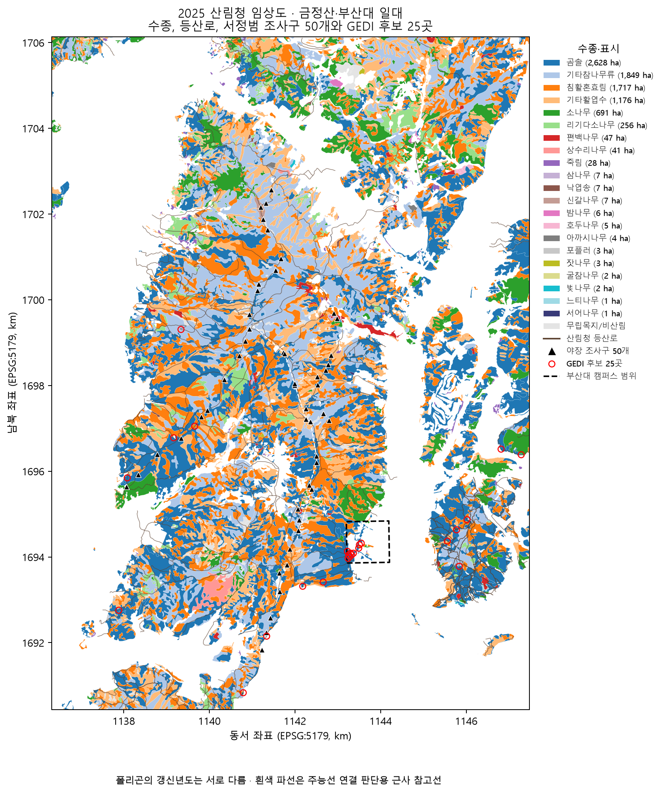
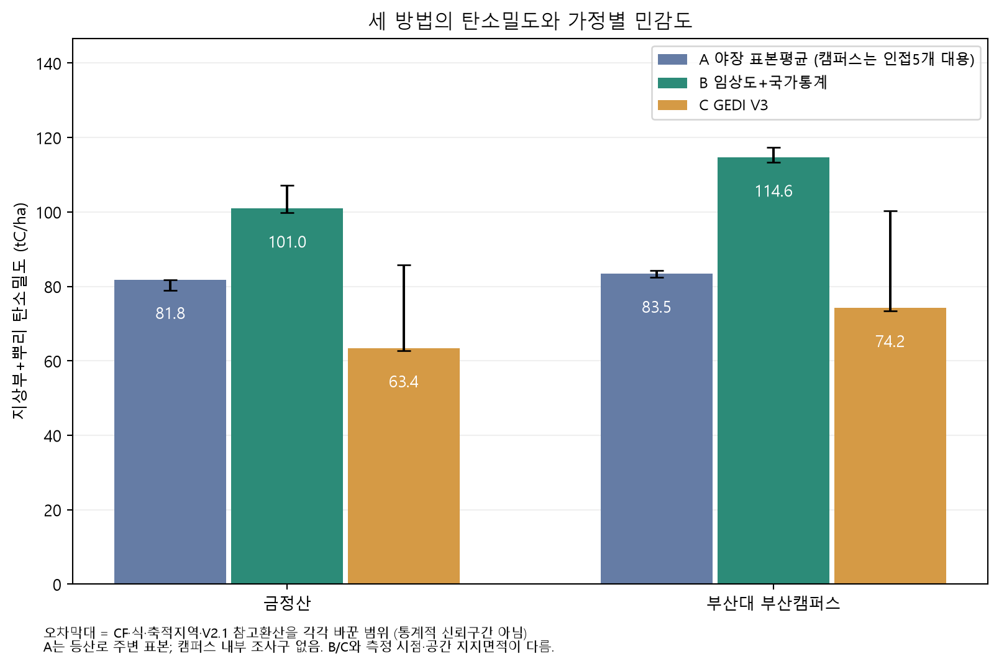
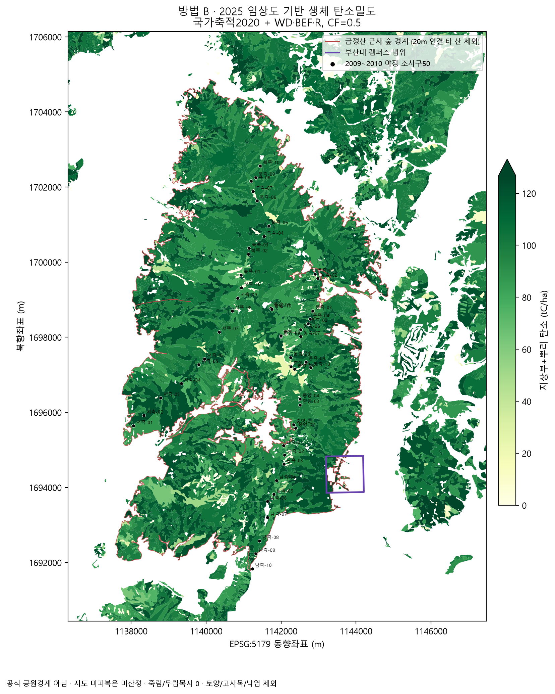
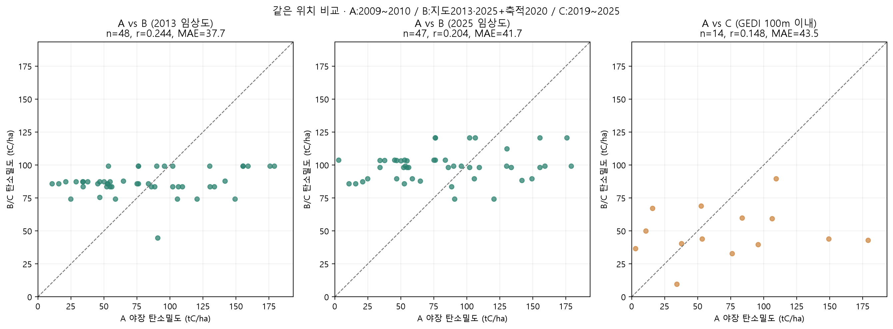

# 금정산·부산대 캠퍼스 산림 탄소 추정 (4주차)

- 작성일: 2026-10-30
- 작성: 이연지 (부산대학교, GLURI 기업체험형 인턴)
- 코드: `scripts/`, 결과·그림: `outputs/`, 계수표: `data/reference/` (실행 순서는 맨 아래)

## 1. 출발점

**지난주 결론**

- 홍천 실험에서 GEDI 위성 자료만으로는 탄소량을 확정할 수 없다는 것을 확인
- GEDI 버전만 바꿔도(V2.1 → V3) 탄소 총량이 약 25% 달라짐
- 그래서 독립적인 다른 방법으로 교차 확인이 필요하다고 판단함

**오전 미팅 피드백**

1. 부산대 산림 관련 학과·학술림, 졸업논문 등에서 쓸 수 있는 자료 찾기
2. GEDI가 금정산뿐 아니라 부산대 캠퍼스와 그 근처에도 잡히는지 확인하기
3. 금정산 숲을 직접 가서 볼 수 있도록 위치 알려주기
4. 공개 데이터 우선, 가능하면 부산대 내부 자료도 확인하기
5. 연구에 매몰되지 말고 기업·고객 시선에서 필요한지 생각하기

**오늘의 질문**
금정산과 부산대 캠퍼스 숲에 탄소가 얼마나 있는가? 그리고 그 값을 무엇으로 확인할 수 있는가?

> 지난주에는 위성만으로는 부족하다는 결론을 냈음, 오늘은 피드백대로 부산대와 금정산 자료를 먼저 찾았고, 그 결과 현장에서 직접 잰 자료를 확보해서 세 가지 방법으로 금정산 탄소량을 계산해 비교 진행
> 

---

## 2. 결론부터

| 질문 | 답 |
| --- | --- |
| 금정산 숲(약 5,336ha) 탄소저장량은? | 방법에 따라 **약 34만 ~ 54만 tC** (CO₂ 약 124만 ~ 198만 t) |
| 국가 통계 방식으로는? | **약 54만 tC (101 tC/ha)** |
| 부산대 캠퍼스 범위 숲(약 21ha)은? | **약 1,600 ~ 2,400 tC** |
| GEDI가 캠퍼스에도 있나? | **있음 →** 품질 통과 관측점 83개 |
| 직접 가서 볼 수 있는 위치는? | **통합 방문 목록 75곳.** 그중 실측·위성·현재를 한자리에서 비교할 수 있는 곳 **15곳** |
| 가장 큰 수확은? | **2009년 금정산 현장조사 자료(조사구 50개, 나무 1,750그루, GPS 좌표 포함)를 찾은 것** |

> 금정산 숲의 탄소저장량은 계산 방법에 따라 약 34만에서 54만 톤이고, 국가 통계와 같은 방식으로는 약 54만 톤, 오늘 가장 큰 수확은 2009년에 금정산 나무를 한 그루씩 잰 현장 자료를 찾은 것
> 

---

## 3. 자료 확보

### 3.1 부산대 자료

| 찾아본 곳 | 결과 |
| --- | --- |
| 부산대 학술림 (기장군 철마면) | 2021년 학술림 계획 보고서 확인. **장전 캠퍼스 식생 자료는 없음** |
| 부산대 캠퍼스 수목·식생 학위논문 | RISS에서 부산대 계정으로 검색. **해당 논문 없음** |
| 부산대 학위논문 중 금정산 관련 | Lim Eun Ji (2026, 과학교육학과): 금정산 소나무림·참나무림·혼효림 6개 지점 조사 → 현장 후보로 참고 예정 |

### 3.2 금정산 현장조사 자료

서정범 (2011), 「금정산의 식물군집구조와 생태적 특성에 관한 연구」, 동아대 박사논문

- 부록에 현장 야장(조사 기록)이 그대로 실려 있음
- 조사 시기: 2009년 5월 ~ 2010년 9월
- 조사구: 20m × 20m × 50개 (중앙능선, 동·서·남·북 사면 각 10개)
- 조사구마다 GPS 좌표, 해발고도, 경사
- 나무마다 수종, 흉고직경, 수고 → **총 1,750그루**
- 남측 조사구 5개는 장전동, 부산대 캠퍼스 바로 뒤 금정산 자락에 있음



### 3.3 공개 데이터

| 자료 | 출처 | 용도 |
| --- | --- | --- |
| 임상도 1:5,000 (2013년, 2025년) | 산림청 산림공간정보 (금정구·북구·양산시) | 숲 구역별 수종, 굵기, 나이, 높이 |
| 등산로 | 산림청 | 현장 방문 동선 |
| 수종별 상대생장식, 탄소배출계수 | 국립산림과학원 (2014) | 흉고직경 → 나무 무게 |
| 수종별 탄소전환계수 | 국립산림과학원 (2010) | 나무 무게 → 탄소 |
| 임상·영급별 1ha당 임목축적 | 산림청 국가산림자원조사 (2020, KOSIS) | 임상도 구역 → 나무 부피 |
| GEDI L4A V3 (2019 ~ 2025) | NASA | 위성 바이오매스 |

---

## 4. GEDI 위성 관측점

| 구역 | 전체 점 | 품질 통과 | 숲 위 | 숲 평균 바이오매스 | 관측 연도 |
| --- | --- | --- | --- | --- | --- |
| 금정산 일대 | 66,248 | 6,673 | 3,991 | 90.1 Mg/ha | 2019 ~ 2025 |
| **부산대 부산캠퍼스** | 388 | **83** | 32 | 106.2 Mg/ha | 2019 ~ 2025 |
- 바이오매스 값이 있고, V3 품질 플래그가 1이며, 위성 위치 이상이 없는 경우가 품질 통과
- 캠퍼스에도 품질 통과한 관측점 존재→ 대부분 **캠퍼스 서쪽, 금정산과 맞닿은 숲 가장자리**에 있다.
- 2019 ~ 2025년 GEDI V3 궤도 파일 83개 확인



---

## 5. 현장 방문 후보

| 목록 | 개수 | 내용 |
| --- | --- | --- |
| 금정산 GEDI 후보 | 7곳 | 금정산 주능선과 이어진 숲, 등산로 150m 이내 (윤산·백양산 등 다른 산 후보는 제외) |
| 캠퍼스 GEDI 후보 | 10곳 | 캠퍼스 범위 안 숲 |
| 2009년 야장 조사구 | 50곳 | GPS 좌표로 재방문 가능 |
| **야장 + GEDI 동시 비교 가능** | **15곳** | 야장 조사구에서 100m 안에 GEDI 점이 있는 곳 |
| 통합 방문 목록 | 75곳 | 구글 지도(KML), 휴대폰 등산 앱(GPX)용 파일로 제공 |
- 15곳이 가장 중요, 한자리에서 2009년 실측, 2019 ~ 2025년 위성, 2026년 현재 현장을 모두 비교할 수 있음
- 같은 조사구를 다시 재면 15년 동안 나무가 얼마나 자랐는지(=탄소를 얼마나 흡수했는지)도 알 수 있음



> 직접 가볼 수 있는 곳을 75곳으로 정리해서 휴대폰 지도에 바로 넣을 수 있게 만듦,그중 15곳은 2009년 실측 조사구 근처에 위성 관측점도 있어서, 한 번 가서 세 가지를 모두 비교할 수 있는 곳
> 

---

## 6. 탄소 계산

|  | A. 현장 야장 | B. 임상도 + 국가통계 | C. GEDI 위성 |
| --- | --- | --- | --- |
| 기준 시점 | 2009 ~ 2010 | 2025 임상도 + 2020 통계 | 2019 ~ 2025 |
| 계산 방식 | 나무마다 흉고직경 → 수종별 공식 → 무게 → 탄소 | 숲 구역마다 임상·영급 → 1ha당 부피 → 수종별 계수 → 탄소 | 위성 바이오매스 평균 × 숲 면적 → 탄소 |
|  | 무게(kg) = a × 흉고직경^b
수종별 공식은 줄기, 가지, 잎, 뿌리마다 따로 있음  | 금정산을 수천 개의 숲 구역(폴리곤)으로 나눔, 구역마다 평균값으로 계산
임상도 + 국가산림자원조사의 부산 평균 부피 + 국립산림과학원 수종별 계수 | GEDI는 지상부 무게뿐이라 뿌리는 B의 비율을 빌려 씀 + 버전에 따라 값이 달라짐(현재는 V3 공식) |
| 장점 | 실제로 잰 값 | 국가 온실가스 통계와 같은 방식, 산 전체 | 산 전체, 반복 관측 |
| 약점 | 15년 전, 등산로 주변 50곳뿐, 조사구 50개의 평균이 금정산 전체에도 맞다고 가정한 값 | 부산 평균값을 씀, 개별 지점 차이 반영 못 함 | 노이즈 큼, 버전에 따라 값이 바뀜 |

**공통 공식**

```
탄소(tC) = (지상부 바이오매스 + 뿌리 바이오매스) × 탄소전환계수 0.5
```

- 다른 점은 바이오매스를 구하는 방법의 차이
- 탄소전환계수 0.5는 국내 인벤토리(국가 온실가스 인벤토리) 관행, 국내 수종별 실측값(0.47 ~ 0.51)으로 바꿔도 결과는 2 ~ 3%만 바뀌므로 동일하게 0.5로 진행
    - "탄소함량비는 IPCC가 제시한 0.5를 이용하고 있으며, 국제적으로도 통상 이용하는 값이다.”

---

## 7. 결과

| 구역 | 방법 | 지상부 (t/ha) | 탄소밀도 (tC/ha) | 탄소총량 (tC) | CO₂ 환산 (t) |
| --- | --- | --- | --- | --- | --- |
| 금정산 (5,336ha) | A 야장 ¹ | 125.8 | 81.8 | 약 43.6만 | 약 160만 |
|  | **B 임상도 + 국가통계** | 153.4 | **101.0** | **약 53.9만** | **약 198만** |
|  | C GEDI V3 | 96.2 | 63.4 | 약 33.8만 | 약 124만 |
| 부산대 캠퍼스 (21ha) | A 인접 야장 ² | 126.4 | 83.5 | 약 1,770 | 약 6,500 |
|  | B 임상도 + 국가통계 | 177.4 | 114.6 | 약 2,430 | 약 8,900 |
|  | C GEDI V3 | 114.8 | 74.2 | 약 1,570 | 약 5,800 |

¹ 조사구 50개 평균을 숲 면적에 곱한 참고값
² 캠퍼스 안 조사구가 없어 장전동 쪽 조사구 5개로 대신함



금정산 보다 장전 캠퍼스의 탄소 밀도 값이 더 크게 나온 이유는, 캠퍼스 숲의 78%가 나이 든 곰솔 침엽수림이기 때문, 부산 동계에서 침엽수림은 활엽수림보다 1ha당 부피가 크게 잡혀 있어서 그 영향을 받았고, 실제로도 그런지는 현장에서 확인이 필요

아래 그림은 방법 B로 계산한 금정산 일대 탄소밀도 지도



가정을 바꿨을 때의 범위 (탄소전환계수, 공식 종류, 축적 지역, GEDI 버전)

| 구역 | A | B | C |
| --- | --- | --- | --- |
| 금정산 | 42.1만 ~ 43.6만 tC | 53.2만 ~ 57.2만 tC | 33.4만 ~ 45.7만 tC |
- A, B는 가정을 바꿔도 ±5 ~ 7% 안에서 움직임, 가장 큰 차이는 “어떤 방법을 쓰느냐”에서 나옴
    - 탄수전환계수를 모든 나무에 0.5로 적용 → 수종별 실측값(신갈나무 0.488, 곰솔 0.493 등. 실측값이 없는 수종은 0.5 유지)
    - 상대생장식 종류를 흉고직경만 쓰는 식에서 흉고직경 + 수고 식을 쓰는 경우
- C는 GEDI 버전(V3 → V2.1 환산)에 따라 35% 바뀜

> 금정산 숲의 탄소는 방법에 따라 34만에서 54만 톤으로, 1.6배 정도의 차이 발생, 계수 같은 세부 가정은 결과를 5% 정도밖에 안 바꾸고, 결국 어떤 방법을 쓰느냐가 가장 큰 차이를 만듦
> 

---

## 8. 무엇을 확인했나: 같은 위치 비교



| 비교 | 조사구 수 | 상관계수 | 평균 절대오차 |
| --- | --- | --- | --- |
| A 야장 vs B (2013 임상도) | 48 | 0.24 | 37.7 tC/ha |
| A 야장 vs B (2025 임상도) | 47 | 0.20 | 41.7 tC/ha |
| A 야장 vs C GEDI (100m 이내) | 14 | 0.15 | 43.5 tC/ha |

**해석**

1. 지점 하나하나는 잘 안 맞음. 하지만 이건 비교하는 크기가 다르기 때문임, 야장은 20m × 20m 한 칸이라 큰 나무 몇 그루에 크게 흔들리고, B는 “부산 침엽수림 5영급 평균”처럼 넓은 평균값을 씀
2. 평균으로 보면 야장(82)이 B(101)와 C(63) 사이에 존재
3. 야장은 15년 전 값 → 그 사이 나무가 자랐으므로 지금 다시 재면 더 높게 나올 것으로 예상. B에 가까워질 수 있다는 가설이고, 재측정으로 확인 필요
4. 임상도와 현장 비교 (오늘 앞단계 결과)
    - 나무 굵기 등급 일치율: 시기가 같은 2013년 지도 65%, 2025년 지도 40% → 15년 동안 나무가 굵어졌다고 보면 자연스러움
    - 수종 일치율 50%: 임상도는 신갈나무를 “기타참나무류”로 묶어서 이름이 직접 비교되지 않음

---

## 9. 한계

1. 실측 자료가 15년 전. 2009 ~ 2010년 이후의 성장, 벌채, 병해충 변화가 반영되지 않음
2. 야장 조사구는 등산로 주변 50곳뿐, 금정산 전체를 대표한다고 보기 어려움
3. 금정산 범위는 근사치, 공식 국립공원 경계 파일이 없어, 주능선과 이어진 숲 덩어리로 정의함
4. 부산대 캠퍼스 안에는 실측 자료가 없어 장전동 쪽 금정산 조사구로 대신함
5. B는 부산 평균 축적을 씀. 수종이 아니라 침엽수림·활엽수림·혼효림 세 가지로만 나뉘고, 금정산 숲의 실제 부피를 잰 것이 아님
6. 수종 공식이 없는 나무도 존재, 때죽나무 등 기타 활엽수는 평균 공식을 썼고, 이 부분이 야장 탄소의 약 10%
7. GEDI는 버전에 따라 값이 크게 바뀜, 금정산은 V3만 받았고, V2.1 값은 홍천 비율로 환산한 참고값
8. 토양, 낙엽, 고사목 탄소는 빠져 있음, 살아 있는 나무(지상부 + 뿌리)만 계산

---

## 10. 다음 단계

| 순서 | 할 일 | 필요한 지원 |
| --- | --- | --- |
| 1 | **현장 재측정** — 야장 + GEDI 동시 비교 가능 15곳 중 부산대 인접 장전동 쪽부터 | 현장 조사 가능 여부, 장비(줄자, 측고기), 사유지 출입 확인 |
| 2 | 금정산국립공원 공식 경계로 다시 계산 | 부산시에 경계 파일 요청 |
| 3 | 국가 통계 방식(B)을 수종 단위로 정교화 | — |
| 4 | Lim Eun Ji(2026) 논문 6개 지점 확인 → 현장 후보 보강 | 연구실 문의 |
| 5 | 연간 흡수량(변화량) 계산 방법 설계 | 2013 → 2025 임상도 비교 결과 활용 |

---

## 부록. 질의응답

**Q. 34만 톤과 54만 톤 중 뭐가 맞나?**
A. 아직 판단할 수 없다. 현장 실측(82 tC/ha)이 그 사이에 있지만 15년 전 값이다. 같은 조사구를 재측정하면 판단할 수 있다.

**Q. 흉고직경 공식은 어디서 가져왔나?**
A. 국립산림과학원 「한국 주요 수종별 탄소배출계수 및 바이오매스 상대생장식」(2014)에 있는 22개 수종 공식이다. 신갈나무, 소나무, 곰솔처럼 야장에 많은 수종은 자기 공식이 있다.

**Q. 탄소전환계수 0.5는 근거가 있나?**
A. 국립산림과학원(2010)이 국내 12개 수종을 실측한 결과 0.47 ~ 0.51로 0.5와 거의 같았고, 국내 인벤토리도 0.5를 쓴다.

**Q. 흉고직경 공식 범위(6 ~ 40cm)를 벗어난 나무는?**
A. 6cm 미만 47그루(무게 비중 약 0.06%)는 제외했다. 40cm 초과 8그루 중 7그루는 소나무라, 적용 범위가 70cm인 강원지방소나무 공식으로 계산했다.

**Q. 임상도의 1ha당 부피는 어디서 왔나?**
A. 산림청 국가산림자원조사(2020)의 부산광역시 임상·영급별 평균 축적이다. 예: 부산 침엽수림 5영급 255.4 m³/ha.

**Q. 왜 개별 조사구가 잘 안 맞나?**
A. 20m × 20m 한 칸과 지역 평균을 비교하기 때문이다. 큰 나무 한두 그루로 한 칸의 값이 크게 바뀐다. 전체 평균으로 비교하는 게 맞다.

---

## 실행 순서

pandas·rasterio·GDAL 없이 numpy, h5py, scipy, shapely, pyproj, pyshp, matplotlib, pypdf, earthaccess만 쓴다 (`requirements.txt`).

| 순서 | 스크립트 | 내용 | 필요한 입력 |
| --- | --- | --- | --- |
| 1 | `scripts/find_gedi_sites.py --workers 8` | GEDI L4A V3 2019–2025 관측점 추출(원격 부분 읽기), 구역 분류, 현장 방문 후보 | Earthdata 인증, `data/forest_map/등산로/` |
| 2 | `scripts/extract_seo2011_fieldnotes.py` | 서정범(2011) 부록 야장 → 조사구·나무 표 | 원문 PDF (`data/literature/`, 미포함) |
| 3 | `scripts/analyze_forest_maps.py` | 임상도 2013·2025 잘라내기, 야장과 비교, 변화, 방문 목록 통합 | 산림청 임상도 SHP (`data/forest_map/`, 미포함) |
| 4 | `scripts/calculate_carbon.py` | 방법 A(야장)·B(임상도+국가통계)·C(GEDI) 탄소 계산과 비교, 민감도 | 1–3 결과, `data/reference/` |

- 검증: `validate_pipeline.py`(1단계 전 오프라인 테스트), `validate_outputs.py`(1단계), `validate_seo2011_tables.py`(2단계), `validate_forest_analysis.py`(3단계), `carbon_independent_checks.py`(4단계를 파이프라인과 별도로 재계산)
- `check_environment.py`: 패키지 import 확인. Earthdata 인증은 환경변수 `EARTHDATA_USERNAME`, `EARTHDATA_PASSWORD`로만 읽는다.

## 올리지 않은 자료

| 자료 | 이유 | 구하는 곳 |
| --- | --- | --- |
| 서정범(2011) 학위논문 원문과 나무 단위 추출표(1,750그루) | 학위논문 저작권. 조사구 단위 결과(`outputs/carbon_A_plots.csv`, `seo2011_plots.kml`)만 포함 | RISS |
| 국립산림과학원 보고서 원문(2010, 2014) | 원문 재배포 대신 필요한 계수만 표로 정리 (`data/reference/`) | ScienceON TRKO201200009610, TRKO201500013796 |
| 임상도 1:5,000 SHP(2013, 2025), 등산로 SHP | 용량(약 340MB), 원 배포처에서 받는 것이 정확 | 산림청 산림공간정보 / [공공데이터포털](https://www.data.go.kr/data/15093362/fileData.do) |
| GEDI 전체 관측점(21MB), 임상도 구역별 탄소 계산표 | 용량. 스크립트로 재생성 가능 | — |
