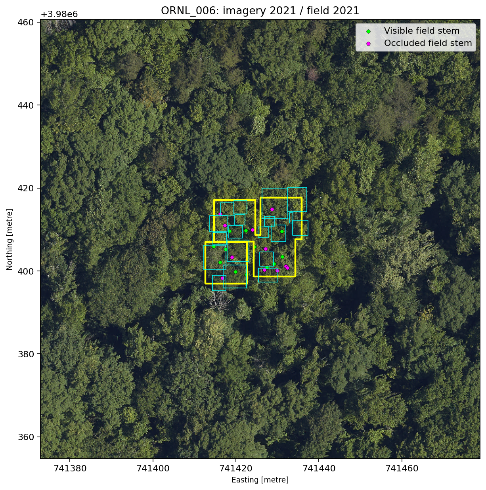
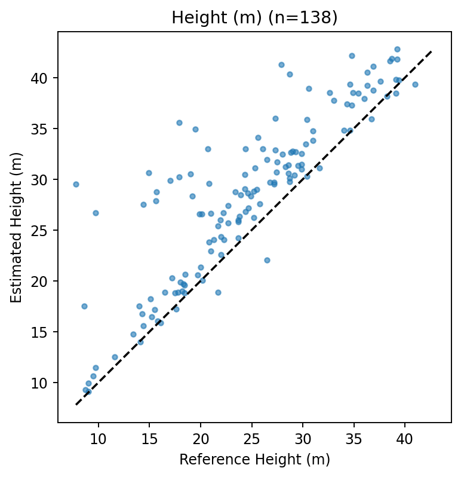
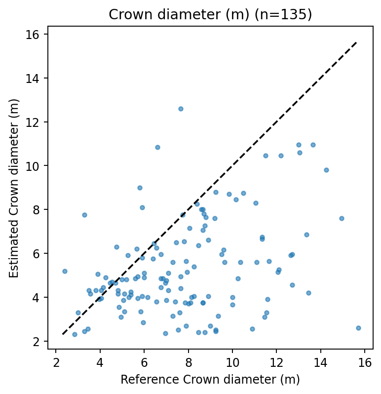
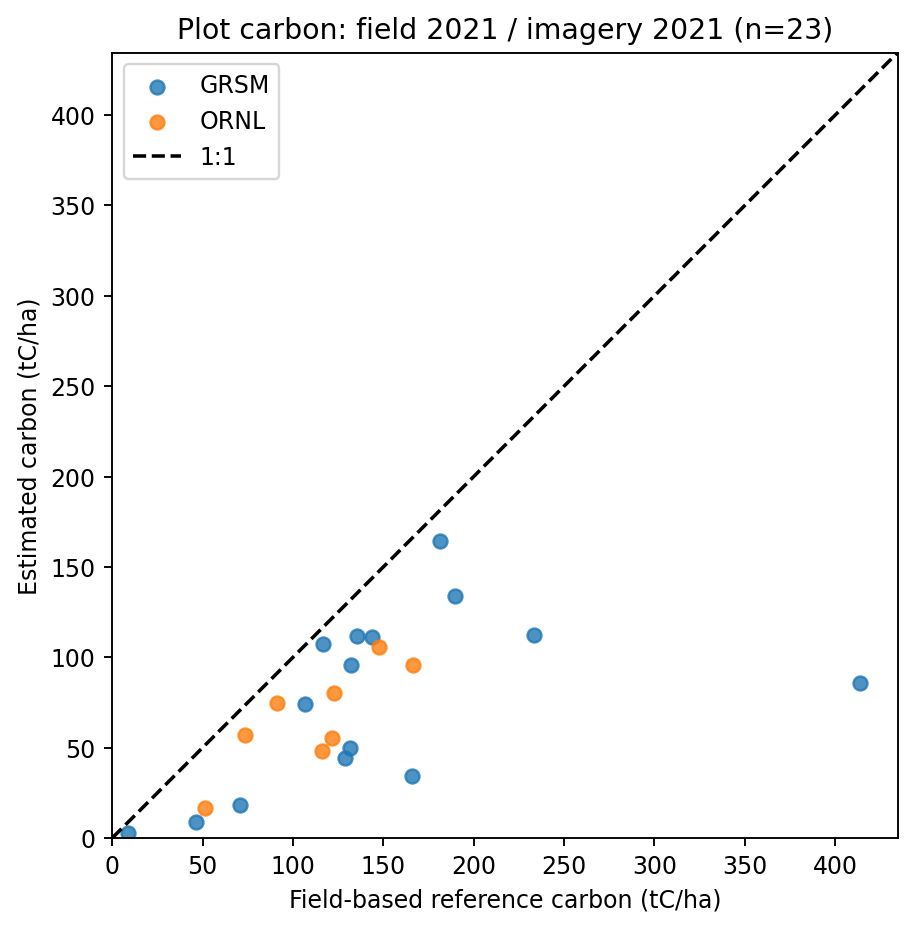
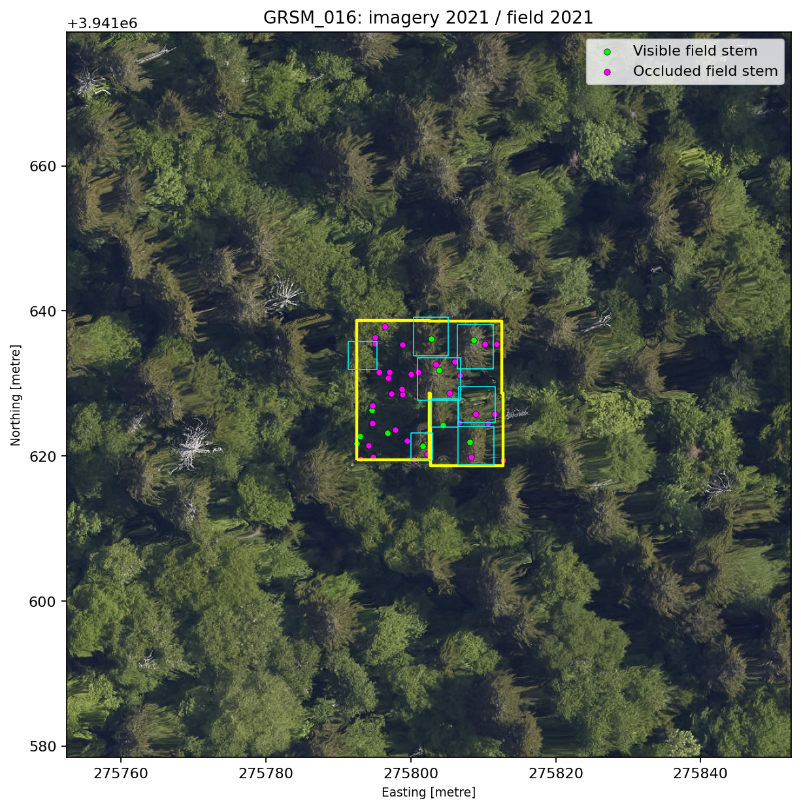
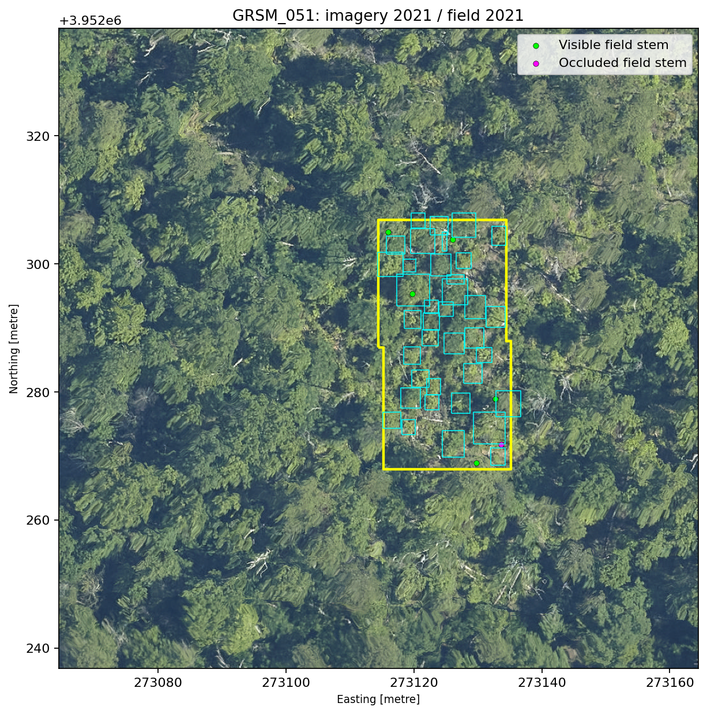
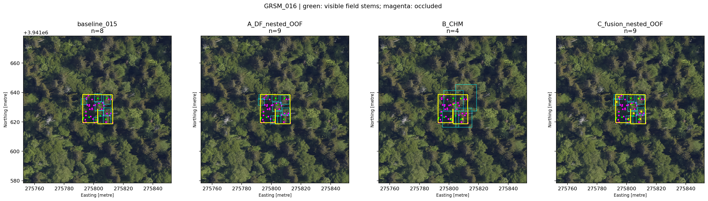
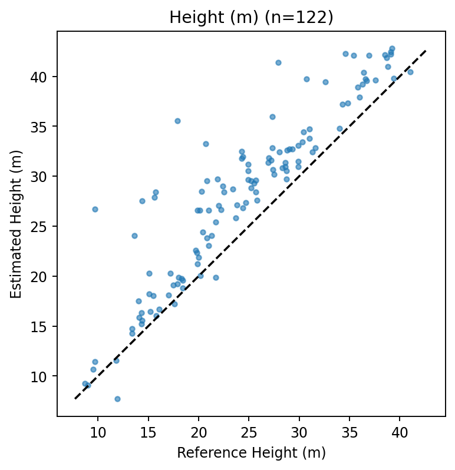
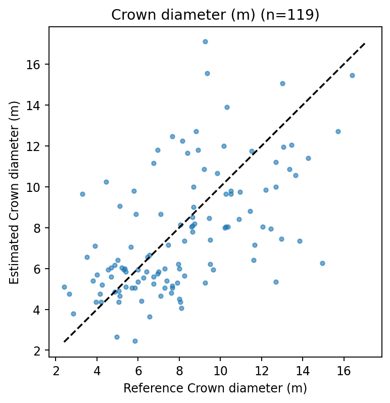
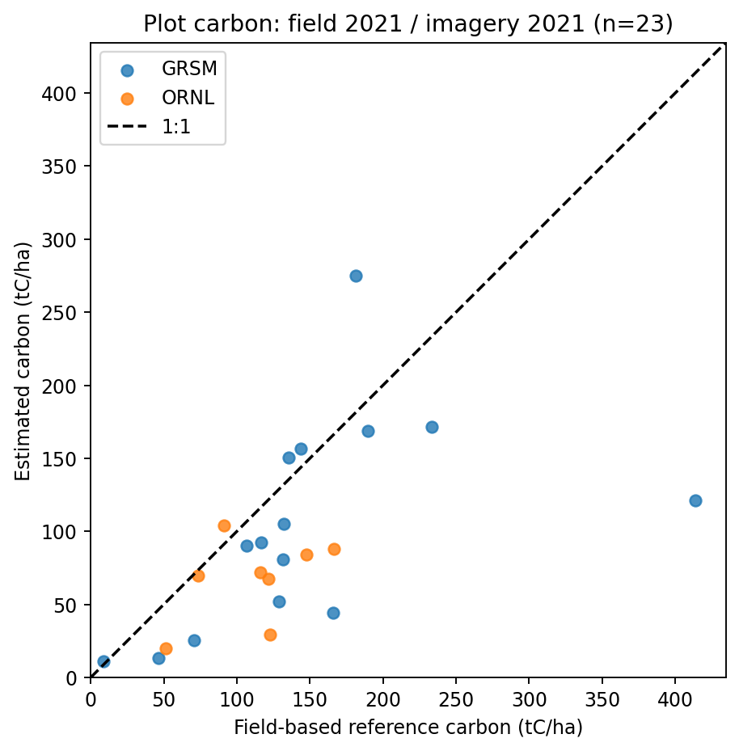

# 5주차: NEON 항공사진·LiDAR로 나무를 찾아 탄소 추정, 실측 기반 값과 비교

- 작성일: 2026-11-06
- 작성: 이연지 (부산대학교, GLURI 기업체험형 인턴)
- 코드: `notebooks/` (Google Colab, T4 GPU), 최종 결과(A 방법): `outputs/`, 기존 설정 결과: `outputs_baseline/`, 자료 조사: `docs/`

---

#### 1. 지난주 피드백과 이번 주 목표

**지난주 피드백**

- 모델 성능 낮음 & 각 방법이 어떻게 계산됐는지 근거가 부족(추정치)

**이번 주 목표**

- 항공사진에서 나무를 한 그루씩 찾고, LiDAR로 높이를 재고, 공식으로 흉고직경 → 바이오매스 → 탄소를 계산함
- 같은 해 실측 기반 값과 단계별로 비교해서 어느 단계에서 얼마나 틀리는지 확인함
- 각 단계에 쓴 공식과 출처를 모두 명시
- 최종적으로는 이 방법을 국내 지역에 적용하는 것까지가 목표(다음주)

---

#### 2. NEON 자료 이유

**국내 상황**

- 실측값 + 항공사진/LiDAR가 같이 공개된 국내 지역은 거의 없음
- 국가산림자원조사(NFI): 전국 약 4,500개 실측 조사구가 있지만 원자료와 좌표는 비공개, 산림청 신청 필요
- AI Hub 식생 탄소 데이터: 탄소 라벨이 실측이 아니라 공식으로 계산한 값이라 정답으로 쓰기 어려움
- 금정산은 서정범(2011) 실측 조사구가 있으나 영상과 시기 차이가 큼 → 국내 적용 단계에서 검증용으로 사용 예정

**NEON (미국 국가생태관측망)**

- 미국 정부가 운영하는 생태 관측망. 같은 장소에서 항공사진(10cm), LiDAR 높이 지도(1m), 나무별 실측값을 모두 무료 공개
- 나무마다 흉고직경·높이·수관 크기·수종·위치가 기록돼 있음
    - 미국 전역에 81개 관측지

**선택한 지역: GRSM, ORNL (2021년)**

| 사이트 | 위치 | 위도 | 숲 종류 |
| --- | --- | --- | --- |
| GRSM | 그레이트스모키산맥 국립공원 | 35.7°N | 동부 온대 활엽수·혼효림 |
| ORNL | 오크리지 (테네시) | 36.0°N | 동부 온대 활엽수림 |
- 한국(부산 35.2°N)과 위도가 비슷하고, 둘 다 대륙 동쪽 해안 기후라 여름 덥고 습한 기후가 비슷함
- 참나무·단풍나무 등 같은 속(屬)의 나무가 많음
- 2021년에 사진·LiDAR·실측이 모두 있는 조합이라 시기 차이 없이 비교 가능

분석의 조사구 수 

- GRSM에는 2021년 실측 조사구가 21개 있었는데, 6개가 항공 촬영 범위 밖이라 빠져서 15개 사용
- ORNL은 8개 모두 사용
- 그래서 처음 29개 중 23개로 비교

---

#### 3. 계산 흐름

```
항공사진(10cm) ──▶ ① 나무 찾기 (DeepForest)
                         │  나무 1그루 = 상자 1개
LiDAR 높이 지도 ──▶ ② 높이(H) = 상자 안 최대 높이
                    ③ 수관 직경(CD) = 상자 크기 평균
                         │
                    ④ 흉고직경 = Jucker 국제 공식 (H, CD 사용)
                         │
                    ⑤ 바이오매스 = Chojnacky 미국 표준 공식 (흉고직경 사용)
                         │
                    ⑥ 탄소 = 바이오매스 × 0.5
                         │
                    ⑦ 조사구별 합계(tC/ha) ──▶ 실측 기반 값과 비교
```



- 노란 선: 사람이 직접 들어가 나무를 잰 조사구 경계
- 민트색 상자: 모델이 사진에서 찾은 나무 1그루
- 초록 점: 실측 나무 중 위에서 보이는 나무 (사진으로 찾을 수 있음)
- 분홍 점: 실측 나무 중 더 큰 나무에 가려진 나무 (사진으로는 찾을 수 없음)
- 점 위치는 나무 줄기 위치이고, 상자는 위에서 본 수관이라 둘이 정확히 겹치지 않을 수 있음

DeepForest가 반환하는 것

| 값 | 뜻 |
| --- | --- |
| xmin, ymin, xmax, ymax | 상자의 왼쪽 위, 오른쪽 아래 좌표 (사진 픽셀 단위) |
| score | "이게 나무일 확률" 같은 자신감 점수 (0~1) |
| label | 항상 “Tree” |

**단계별 사용 공식과 출처**

| 단계 | 방법 | 식 | 출처 |
| --- | --- | --- | --- |
| ① 나무 찾기 | DeepForest (딥러닝 객체 탐지, NEON 사진으로 학습된 공개 모델) | — | Weinstein et al. 2019, 2020 |
| ② 높이 | LiDAR 높이 지도에서 상자 안 최대값 | — | NEON DP3.30015.001 |
| ④ 흉고직경 | 높이와 수관 크기로 흉고직경 추정 | DBH = 0.367 × (H × CD)^0.887 | Jucker et al. 2017, *Global Change Biology* (전 세계 약 10만 그루 기반, 북미 온대 활엽수 계수) |
| ⑤ 바이오매스 | 흉고직경으로 나무 무게 계산 | AGB = exp(−2.2118 + 2.4133 × ln DBH) | Chojnacky et al. 2014, *Forestry* (미국 표준, 일반 활엽수 계수) |
| ⑥ 탄소 | 바이오매스의 절반 | C = AGB × 0.5 | IPCC 기본값. 국립산림과학원(2010)도 국내 실측 0.47~0.51로 0.5 사용 가능하다고 결론 |
- 사진만으로는 수종을 모르기 때문에 ⑤에서는 **일반 활엽수 계수**를 사용함
- 수종을 알 때의 계수로도 따로 계산해서 차이를 확인함 (5장)

나무 １그루 계산 예시

| 단계 | 계산 | 값 |
| --- | --- | --- |
| 상자 크기 | 가로 5.2m, 세로 5.0m |  |
| 수관 직경 (CD) | 가로·세로 평균 | **5.1 m** |
| 높이 (H) | 상자 안 LiDAR 높이 지도의 최대값 | **9.27 m** |
| 흉고직경 | 0.367 × (9.27 × 5.1)^0.887 = 0.367 × 47.3^0.887 | **11.2 cm** |
| 바이오매스 | exp(−2.2118 + 2.4133 × ln 11.2) | **37.5 kg** |
| 탄소 | 37.5 × 0.5 | **18.7 kg** |

---

#### 4. 정답으로 쓴 값

- NEONForestAGB (Atkins et al. 2025, 논문과 함께 공개된 데이터셋)
- NEON 직원이 직접 잰 흉고직경에 수종별 미국 표준 공식(Chojnacky)을 적용해 나무별 바이오매스를 계산한 값
- 즉 ④까지는 실제로 잰 값, ⑤ 공식은 같으므로 비교 차이 = 사진·LiDAR로 추정한 부분의 오차로 볼 수 있음

**한계**

- 나무를 베어서 무게를 잰 값은 아님. 공식 자체의 오차는 이 비교에서 드러나지 않음
- 비교 대상: 조사구 안의 살아 있는 흉고직경 10cm 이상 나무

**사용 자료 규모**

|  | GRSM | ORNL | 합계 |
| --- | --- | --- | --- |
| 조사구 | 15개 | 8개 | 23개 |
| 실측 나무 | 400그루 | 217그루 | 617그루 |
| 영상 촬영 | 2021년 6월 | 2021년 6월 (잠정 자료) |  |

---

#### 5. 결과 ① — 단계별 정확도 (기존 설정 기준)

사진에서 찾은 나무와 실측 나무를 위치로 1그루씩 짝지어(138쌍) 단계마다 비교함

| 단계 | 평균 오차 | 치우침 | 상관 | 한 줄 해석 |
| --- | --- | --- | --- | --- |
| ② 높이 | 4.1 m | **+3.9 m** (높게) | **0.86** | 가장 잘 맞는 단계. 옆의 큰 나무 높이를 같이 읽어서 높게 나옴 |
| ③ 수관 직경 | 2.9 m | **−2.5 m** (작게) | 0.35 | 사진 상자가 실제 수관보다 작음 |
| ④ 흉고직경 (Jucker) | 14.1 cm | **−9.2 cm** (작게) | 0.51 | 수관이 작게 잡힌 영향이 그대로 이어짐 |
| ④’ 흉고직경 (현지 실측으로 보정) | 10.6 cm | +0.2 cm | 0.58 | 현지 실측으로 보정하면 치우침이 거의 사라짐 |
| ⑤ 나무 1그루 바이오매스 | 754 kg | −512 kg (작게) | 0.45 |  |

높이 비교





추가 확인

- 수종을 알 때 vs 모를 때: 바이오매스 차이 약 5% → 수종보다 나무 찾기·수관 크기가 더 중요함
    - 사진으로는 수종을 모르니까, 바이오매스 공식에 모든 나무를 일반 활엽수로 취급
    - 짝지어진 나무는 실측 기록에 수종이 있으니, 같은 흉고직경에 그 수종 전용 계수를 넣어 다시 계산함
- 높이 민감도: 높이가 10% 틀리면 탄소는 약 20% 바뀜 → 높이 측정 정확도가 중요함
    - 상자는 그대로 두고 높이만 일부러 ±10%, ±20% 바꿔서 탄소를 다시 계산함
- 탄소 비율 0.47(IPCC 온대 활엽수 값) 사용 시: 모든 값 6% 감소

---

#### 6. 결과 ② — 조사구 탄소 (기존 설정 기준)

조사구 안의 모든 나무를 합쳐서 비교함

| 사이트 | 추정 평균 | 실측 기반 평균 | 추정 / 실측 | 상관 |
| --- | --- | --- | --- | --- |
| GRSM | 77 tC/ha | 147 tC/ha | 0.52 | 0.49 |
| ORNL | 67 tC/ha | 111 tC/ha | 0.60 | 0.82 |
| **전체** | **73 tC/ha** | **135 tC/ha** | **0.55** | 0.53 |

조사구 탄소 비교 (기존 설정)



- 점이 대부분 대각선 아래 → 거의 모든 조사구에서 적게 추정함
- 쉽게 말하면 실제 탄소의 약 절반만 잡힘

왜 적게 나오는지, 차이(−61 tC/ha)를 원인별로 나눔

| 원인 | 영향 |
| --- | --- |
| 사진에서 **못 찾은 나무** | **−52 tC/ha** ← 가장 큼 |
| 위치 기록이 없어 짝을 못 지은 실측 나무 | −14 tC/ha |
| 찾은 나무를 작게 계산 (수관·흉고직경 과소) | −18 tC/ha |
| 헛탐지 (실제로 없는 나무 + 위치 혼동) | +23 tC/ha |
| **합계** | **−61 tC/ha** |

→ 오차의 대부분은 공식이 아니라 “나무를 못 찾는 것”에서 나옴



분홍 점(가려진 나무)이 대부분이라 43그루 중 8그루만 찾음 → 못 찾은 나무가 −52 tC/ha의 원인



실측 7그루인데 37개를 찾음 → 헛탐지 (+23 tC/ha의 원인)

- 헛탐지의 원인 중 하나는 큰 나무 하나를 여러 상자로 쪼갬

---

#### 7. 개선 시도 → 나무 찾기 방법 4가지 비교

| 방법 | 내용 |
| --- | --- |
| 기존 | DeepForest, 기준값 0.15 |
| **A. 기준값 조정** | DeepForest 기준값(0.1~0.5)과 사진 자르는 크기(300/400/600픽셀)를 바꿔가며 가장 잘 맞는 조합 선택 → 기준값 0.2, 600픽셀 |
| B. LiDAR 꼭대기 찾기 | 높이 지도에서 주변보다 높은 점 = 나무 꼭대기로 보고 찾음 (Popescu & Wynne 2004) |
| C. 결합 | A로 찾은 나무 + 사진에서 놓친 LiDAR 꼭대기 추가 |
- A·C의 설정은 조사구를 나눠서, 평가에 쓰지 않은 조사구로만 골랐음 (정답을 보고 맞추지 않음)

결과 (23개 조사구)

| 방법 | 찾은 나무 수 | 나무 찾기 F1 | 탄소 추정/실측 | 조사구별 상관 | 평균 오차(RMSE) |
| --- | --- | --- | --- | --- | --- |
| 기존 | 480 | 0.38 | 0.55 | 0.53 | 90 tC/ha |
| **A. 기준값 조정** ✅ | 203 | **0.55** | **0.68** | **0.53** | **81 tC/ha** |
| B. LiDAR 꼭대기 | 92 | 0.46 | 1.70 | 0.21 | 249 tC/ha |
| C. 결합 | 215 | 0.57 | 0.97 | 0.27 | 113 tC/ha |

+) F1은 모델이 나무라고 한 것 중 진짜 나무는 몇 프로인지, 진짜 나무 중 모델이 찾은건 몇 프로인지를 합친 점수임

방법별 나무 찾기 (GRSM_016)



**해석**

- A: 오차가 가장 작음
    - 헛탐지가 크게 줄었음 (찾은 것 중 진짜 비율 29% → 60%)
    - 상자가 실제 수관 크기에 가까워졌음 (수관 치우침 −2.5m → −0.4m, 흉고직경 −9cm → +2cm)
    - 과소 추정 45% → 32%로 개선
- B: 1m 높이 지도에서는 붙어 있는 나무 여러 그루가 한 그루로 합쳐짐 → 수관이 6m 크게 잡혀 1.7배 과대 추정
- C: 평균은 0.97로 거의 맞지만 조사구별 상관이 0.27로 낮음 → 많이 틀린 곳끼리 서로 상쇄돼서 평균만 맞은 것이라 신뢰하기 어려움

단계별·조사구 탄소 비교 (A 방법)







---

#### 8. 한계

- 위에서 가려진 아래층 나무는 사진으로 찾을 수 없음
    - 개선 후에도 전체 실측 나무 중 찾은 비율은 약 30%
    - 큰 나무가 몰린 조사구는 크게 틀림 (예: GRSM_012 실측 기반 414 → 추정 121 tC/ha)
- 높이가 약 4m 높게 나옴: 옆의 더 큰 나무 높이를 같이 읽음
- 정답값도 공식 기반: 나무를 베어 잰 값이 아니므로 공식 자체 오차는 확인 못 함
- 조사구 23개로 설정값을 고르고 평가: 다른 지역에서 같은 성능이 나온다는 보장은 없음
- ORNL 2021 영상은 NEON 잠정 자료: 추후 값이 조금 바뀔 수 있음

---

#### 9. 결론과 다음 단계

**결론**

- 사진+LiDAR로 나무를 찾아 탄소를 계산하는 흐름을 단계별 공식·출처와 함께 구성했음
- 높이는 잘 맞지만, 못 찾는 나무 때문에 탄소가 실측 기반 대비 약 30~45% 적게 추정됨
- 나무 찾기 설정 조정으로 F1 0.38 → 0.55, 과소 추정 45% → 32%로 개선했음
- 이 방법을 그대로 쓰면 과소 추정 → 실측 조사구로 보정하는 단계가 반드시 필요

국내 적용 계획 (금정산)

| 단계 | NEON | 국내 적용 |
| --- | --- | --- |
| 항공사진 | NEON 10cm | 국토지리정보원 항공사진 (25cm) 또는 AI Hub 항공영상 |
| 높이 | NEON LiDAR 1m | Meta 1m 높이 지도 (국내 LiDAR 공개 자료 부족) |
| 흉고직경 | Jucker 북미 계수 | Jucker 동아시아(구북구) 온대 계수 (활엽수 0.694·0.73, 침엽수 1.004·0.73) |
| 바이오매스 | Chojnacky 미국 공식 | 국립산림과학원(2014) 국내 수종별 공식, 수종은 임상도에서 가져옴 |
| 검증 | NEONForestAGB | 서정범(2011) 금정산 실측 조사구 |
- 예상 어려움: 국내 사진 해상도가 낮음(25cm vs 10cm), Meta 높이 지도는 NEON LiDAR보다 부정확함, 실측 시기(2011)와 영상 시기 차이

**필요한 것**

- 국토지리정보원 금정산 항공사진 확보
- NFI 원자료 신청 검토 (산림청 산림빅데이터팀) → 국내 보정용 실측 조사구 확보
- 사진 해상도가 낮을 때 DeepForest 성능 확인 필요

---

참고문헌

- Atkins, J. W. et al. (2025). NEONForestAGB. *JGR Biogeosciences*. 데이터: doi.org/10.6084/m9.figshare.25625352
- Chojnacky, D. C., Heath, L. S., & Jenkins, J. C. (2014). Updated generalized biomass equations for North American tree species. *Forestry*, 87(1), 129–151.
- Jucker, T. et al. (2017). Allometric equations for integrating remote sensing imagery into forest monitoring programmes. *Global Change Biology*, 23, 177–190.
- Popescu, S. C., & Wynne, R. H. (2004). Seeing the trees in the forest. *Photogrammetric Engineering & Remote Sensing*, 70(5), 589–604.
- Weinstein, B. G. et al. (2019, 2020). DeepForest: individual tree-crown detection in RGB imagery. *Remote Sensing*; *Methods in Ecology and Evolution*.
- 국립산림과학원 (2010). 산림 온실가스 인벤토리를 위한 주요 수종별 탄소배출계수.
- 국립산림과학원 (2014). 한국 주요 수종별 탄소배출계수 및 바이오매스 상대생장식.
- NEON (National Ecological Observatory Network). DP1.10098.001 식생 구조, DP3.30010.001 항공사진, DP3.30015.001 높이 지도.

## 발표 후 피드백


한 단계 더 나아가서 데이터 값을 더 넣는 것 p-band나 l-bad, sar 같은 데이터 들을 더 써봐라
각 나무의 라벨값이 있는지도 더 확인해보고 ,esa cci 값을 넣었을 때 값이 얼마나 차이나느지도 궁금함

---

## 실행 방법

`notebooks/NEON_DeepForest_AGB_2021.ipynb`를 Google Colab(T4 GPU)에서 위에서 아래로 실행한다. 자세한 순서는 [notebooks/README_colab.md](notebooks/README_colab.md).

- NEON API 토큰은 Colab 보안 비밀 `NEON_TOKEN`이나 숨김 입력창으로만 받고, 저장하지 않는다.
- 노트북은 `notebooks/build_notebook.py`로 생성하고 `validate_notebook.py`로 구조를 검사한다. 파이프라인 함수는 `neon_pipeline.py`, 나무 찾기 개선(A/B/C)은 `detection_improvements.py`.
- 결과 해석 순서: `outputs/report.md` → `outputs/method_comparison.csv` → `outputs/plot_comparison.csv`

## 폴더 구성

| 경로 | 내용 |
| --- | --- |
| `outputs/` | 3차 실행(최종, A 방법: 점수 0.2, 사진 600픽셀). 방법 비교, 단계별 오차, 조사구별 비교, 교차검증 분할 기록 |
| `outputs/methods/` | 나무 찾기 4가지(기존·A·B·C) 각각의 탐지·짝짓기·조사구 결과 |
| `outputs/raw_predictions/` | 조사구별 DeepForest 원래 출력(상자, 점수) |
| `outputs_baseline/` | 2차 실행(기존 설정, 점수 0.15). 발표 5·6장 숫자 |
| `docs/` | 국내 자료, 탄소배출권, 해외 지역, 모델 조사 정리 |

## 올리지 않은 자료

- NEON 원본 항공사진·LiDAR 타일, NEONForestAGBv2.csv(152MB): 노트북 실행 시 자동으로 받는다. NEONForestAGB: https://doi.org/10.6084/m9.figshare.25625352
- 조사구 overlay 그림 23장(장당 약 3MB): 본문에 쓴 4장(GRSM_012, GRSM_016, GRSM_051, ORNL_006)만 포함
- 1차 실행 결과(GRSM만, 조사구 비교 누락): 2·3차 결과로 대체
