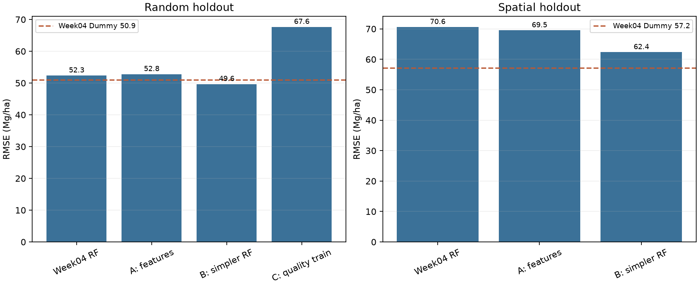

# Week05 모델 개선 실험 비교

동일 분할의 **평가점**에서 계산했다. RF 기준·Dummy는 Week04 지표와 예측값을 재현 확인했다. A·B 후보 선택에는 평가점 AGBD를 사용하지 않았고, 각 학습 집합의 500m easting 그룹별 3-fold 교차검증 RMSE만 사용했다. C는 사전 지정한 학습점 품질 조건이며 모델 선택 실험이 아니다. 모든 수치는 탐색적이다.

| 검증 | 실험 | 학습 n | 평가 n | R² | RMSE | MAE | Week04 RF 대비 RMSE 변화 |
|---|---|---:|---:|---:|---:|---:|---:|
| Random | Week04 RF | 72 | 18 | -0.139 | 52.34 | 42.87 | 기준 |
| Random | Week04 Dummy | 72 | 18 | -0.080 | 50.94 | 43.34 | -1.39 |
| Random | A 추가 입력 | 72 | 18 | -0.159 | 52.78 | 43.03 | +0.44 |
| Random | B 복잡도 축소 | 72 | 18 | -0.025 | 49.65 | 41.17 | **-2.69** |
| Random | C sensitivity≥0.95 학습만 | 39 | 18 | -0.902 | 67.62 | 54.35 | +15.29 |
| Random | C 학습점 기준 Dummy | 39 | 18 | -0.712 | 64.15 | 52.59 | 비교 기준 변경 |
| Spatial | Week04 RF | 55 | 20 | -2.165 | 70.61 | 57.71 | 기준 |
| Spatial | Week04 Dummy | 55 | 20 | -1.074 | 57.16 | 48.07 | -13.45 |
| Spatial | A 추가 입력 | 55 | 20 | -2.069 | 69.52 | 56.27 | -1.08 |
| Spatial | B 복잡도 축소 | 55 | 20 | -1.468 | 62.35 | 50.47 | **-8.26** |

RMSE·MAE 단위는 Mg/ha, 음의 RMSE 변화는 오류 감소다. 원값은 [`experiment_results.csv`](experiment_results.csv)에 있다. 모든 A·B 행은 해당 검증의 Week04 RF·Dummy와 **동일한 학습·평가점**을 사용한다. C는 평가점 18개가 동일하지만 학습점이 72개에서 39개로 줄어 **학습 모집단이 다르다**. Spatial C는 품질 조건을 만족하는 학습점이 10개뿐이어서 실행하지 않았다.

## 선택된 구성과 학습 내부 점수

| 검증 | 비교 | 선택된 구성 | 내부 CV RMSE |
|---|---|---|---:|
| Random | 기존 3지수 RF 참고 | `ndvi,evi,ndmi`; 깊이·잎 수 제한 없음 | 79.90 |
| Random | A | 기존 3지수 + NBR(raw ratio) + 원시 B03·B12 | 76.84 |
| Random | B | `max_depth=3`, `min_samples_leaf=4`, `max_features=1.0` | 76.59 |
| Spatial | 기존 3지수 RF 참고 | `ndvi,evi,ndmi`; 깊이·잎 수 제한 없음 | 84.57 |
| Spatial | A | 기존 3지수 + 원시 B03·B12 | 79.92 |
| Spatial | B | `max_depth=6`, `min_samples_leaf=3`, `max_features=0.67` | 82.00 |

모든 RF는 Week04와 동일하게 나무 100개, `random_state=42`, `n_jobs=1`이다. A·B 후보 목록과 fold 크기는 [`inner_cv_results.csv`](inner_cv_results.csv), [`experiment_design.json`](experiment_design.json)에 있다. 내부 CV는 공간 그룹을 분리하지만 **fold 사이에 500m 버퍼를 두지 않는다**. Spatial 학습에는 지리적으로 불균형한 그룹이 남아 있어 내부 점수를 일반화 성능으로 해석하지 않는다.

