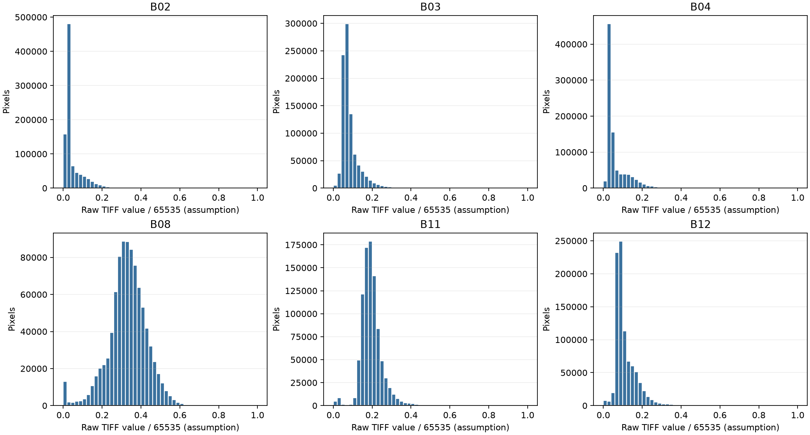
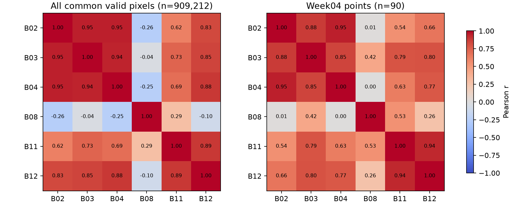

# Week05 Step2 — Sentinel-2 입력 신뢰성 평가

이번 감사는 원본 2025 TIFF와 Week03–Week04 처리 기록을 읽기 전용으로 검토했다. 세부 계보는 [처리 과정 추적](process_trace.md), 변환식과 공식 문서 대조는 [반사율 검증](reflectance_validation.md)에 있다. 모델 재학습, 입력 변수 추가, 원본·Step1 파일 수정은 하지 않았다.

## 입력 품질 결과

- 2025 밴드 6개의 `uint16` 첫 밴드와 0/1 마스크를 직접 읽었다. 유효 픽셀은 각각 909,212개이고 마스크 제외 픽셀은 152개다. 원시 밴드의 최솟값·최댓값·평균·중앙값, 0·65535·32767 초과 개수는 [band_quality.csv](band_quality.csv)에 있다. Week04 기존 통계와 대조해 일치했다.
- 최종 90점의 NDVI 범위 0.301–0.909, EVI 0.145–0.772, NDMI 0.050–0.493이다. 90점에서 NDVI·NDMI의 [-1,1] 이탈과 |EVI|>2는 없다([index_quality.csv](index_quality.csv)). 범위 통과는 반사율 단위 검증이 아니다.
- 밴드 상관관계는 전체 공통 유효 픽셀 909,212개와 최종 90점에 대해 **별도로** 계산했다([band_correlations.csv](band_correlations.csv)). 예를 들어 B02–B04 Pearson r은 전체 0.951, 90점 0.947이고 B04–B08은 전체 −0.249, 90점 0.001이다. 표본 선택에 따라 관계가 달라지므로 상관관계만으로 보정 정확도를 판정하지 않는다.
- 90점은 모두 원본 20m SCL과 정렬된 10m SCL에서 클래스 4(식생)이다. SCL상 구름·그림자와 경계 불일치는 0점이다. SCL은 자동 분류여서 잔여 구름·그림자 가능성을 완전히 제거하지 않는다. 근거: `week03/validate_scl_2025.py:91-115,184-205`, `week03/outputs/sentinel_2025/scl_validation/scl_quality_report.json`, `audit_metadata.json`.
- 여섯 TIFF가 동일한 EPSG:32652 격자이고 저장된 90점 행·열이 현재 TIFF 변환으로 재계산한 값과 모두 일치한다. 중복 추출 픽셀은 0개, 점–픽셀 중심 거리는 0.36–6.90m(중앙 3.91m)다. 결합 좌표 차이 기록의 최댓값은 0m다(`audit_metadata.json`). 이는 **점 중심을 포함한 한 픽셀 추출**의 정합성이지 GEDI footprint 전체와 10m 픽셀의 완전한 공간 대표성을 뜻하지 않는다.
- GEDI는 2025-04-25 UTC이고 TIFF 파일명의 요청 날짜는 2025-04-28이므로 잠정 시차는 3일이다. SCL JP2의 촬영 시각은 2025-04-28 02:07:11 UTC로 파일명에 있으나 TIFF와 같은 제품임을 독립 확인하지 못했다(`week03/README_SCL_2025.md:11`, `audit_metadata.json`).

## 문제 및 개선 우선순위

| 구분·우선순위 | 문제 또는 검증 내용과 근거 | 예측에 미칠 수 있는 영향 | 권장 조치 | 추가 자료 |
|---|---|---|---|---|
| **B · 1** | `/65535`는 잠정 변환이다. TIFF scale/offset은 1/0이고 물리 단위·evalscript 태그가 없다. `reflectance_validation.md`; `week03/analyze_sentinel_2025.py:36` | EVI가 배율에 민감하다. 밴드별 offset이나 클리핑이 있으면 NDVI·NDMI도 왜곡될 수 있다. | 다운로드 설정·evalscript 또는 검증된 FLOAT32 반사율을 확보해 동일 픽셀의 원시값과 대조한다. 확인 전 지수를 수정하지 않는다. | Browser 요청 설정·evalscript·응답 정보 또는 같은 제품의 FLOAT32 출력 |
| **D · 1** | TIFF의 제품 ID·정확한 촬영 시각·처리 기준과 SCL JP2의 동일 제품 여부는 독립 검증 불가. `audit_metadata.json`; `scl_quality_report.json`의 `tiff_association` | SCL이 다른 촬영 장면이면 구름 선별과 3일 시차의 근거가 약해진다. | 두 자료의 제품 ID, tile, sensing time을 대조한다. | 원본 SAFE/제품 XML, Browser 장면·요청 기록 |
| **A · 2 (기록)** | 코드가 요청 날짜 `nominal_date`를 `sentinel_acquisition_date` 컬럼에 기록한다. TIFF 내 촬영 시각은 미확인. `week03/analyze_sentinel_2025.py:291`; `week03/merge_sentinel_gedi.py:139-143` | 현재 RF 입력에는 날짜가 없어 수치 예측에는 직접 영향이 없다. 시간 일치 해석에는 과신 위험이 있다. | 후속 보고에서 해당 값을 **요청 날짜 기준**으로 표시하고 검증 상태를 병기한다. 기존 CSV는 수정하지 않는다. | 제품 촬영 시각/ID |
| **B · 2** | 유효 영상 픽셀에 65535가 있고 90점 중 한 점에 원시 0이 있다. `band_quality.csv`, `audit_metadata.json` | 상한 제한·0 처리의 원인에 따라 지수값이 왜곡될 수 있다. 현재 90점에 65535는 없다. | 0 픽셀의 원본 장면·QA를 점검하고, 65535 픽셀은 출력 클리핑 여부를 확인한다. 임의 제거하지 않는다. | evalscript, 원제품 품질 밴드, FLOAT32 비교 출력 |
| **C · 3** | dataMask=0 픽셀은 처리 코드에서 제외하며 90점은 모두 마스크 유효. 최종 90점의 SCL은 양쪽 격자에서 클래스 4다. `week03/src/preprocess.py:73-112`; `week03/validate_scl_2025.py:91-115`; `audit_metadata.json` | 확인된 마스크·SCL 처리 오류는 없다. 자동 SCL의 오분류 가능성은 남는다. | 현재 품질 상태를 유지하고 필요 시 시각 검토한다. | 고해상도 영상·추가 구름 QA(선택) |
| **C · 3** | 원본 밴드 격자와 GEDI 점의 행·열 매핑이 일치하고 중복 픽셀은 없다. `audit_metadata.json`; `week03/merge_sentinel_gedi.py:96-135` | 좌표 변환·픽셀 선택의 명백한 오류는 발견되지 않았다. footprint와 픽셀 크기 차이는 별도 한계다. | footprint 크기를 고려한 공간 대표성 평가를 후속 작업으로 진행한다. | GEDI footprint 형상 또는 반경 정보 |

**A는 확인된 처리·기록 오류, B는 오류 가능성이 있으나 추가 검증 필요, C는 확인 범위에서 정상 처리, D는 현재 자료로 검증 불가**를 뜻한다. A로 분류한 것은 반사율 수치 오류가 아니라 날짜의 검증 상태를 나타내는 기록 문제다. **확인된 반사율 변환 오류는 아직 없다.**

## 모델 재학습 전 필요한 일

1. **가장 먼저** 2025 TIFF 생성 당시의 단위(`REFLECTANCE`/`DN`), `sampleType`, `harmonizeValues`, evalscript의 반환식·배율·offset을 확보한다. 동일 장면의 검증된 FLOAT32 반사율과 공통 픽셀을 대조하면 `/65535`의 타당성을 판단할 수 있다.
2. SAFE/제품 XML 또는 Browser 요청 기록으로 TIFF와 SCL의 동일 장면 여부, 촬영 시각, 처리 기준, 원제품 `BOA_ADD_OFFSET`·`QUANTIFICATION_VALUE`를 확인한다. 원제품 공식은 Browser 출력 TIFF에 자동 적용하지 않는다.
3. 확인된 변환식으로 **별도 버전**의 지수와 점 추출 결과를 생성하고 기존 90점과 차이를 기록한다. NoData·클리핑·SCL·공간 정합을 다시 검사한 뒤에야 모델 재학습 여부를 결정한다.

## 결론

1. **`/65535`가 올바른가?** 현재 자료로 **검증 불가**다. 계산 재현은 확인되지만, 공식 L2A 원제품 DN 변환식과 동일하지 않고 Browser 출력 설정도 남아 있지 않다.
2. **현재 입력을 신뢰할 수 있는가?** 좌표 결합, 마스크, SCL 선별의 구현은 확인 범위에서 일관된다. **보정된 물리 반사율로서의 신뢰성은 미확정**이므로 현재 모델 입력은 탐색적 분석 수준으로 해석해야 한다.
3. **가장 먼저 해결할 문제는?** 2025 TIFF의 방사 보정·출력 변환 이력 확보와 검증이다.
4. **재학습 전 작업은?** 변환식과 제품·촬영 출처 확인, 동일 픽셀의 검증된 반사율 비교, 새 데이터 버전의 지수·마스크·정합 재검사다.

## 재현

프로젝트 루트에서 `week03/.venv/Scripts/python.exe week05/step2/audit_inputs.py`를 실행한다. 스크립트는 2025 원본 TIFF를 읽어 이 디렉터리의 `band_quality.csv`, `band_correlations.csv`, `index_quality.csv`, `audit_metadata.json`과 PNG 두 장만 생성한다. 기존 Week03–Week04 및 Step1 파일은 수정하지 않는다.
