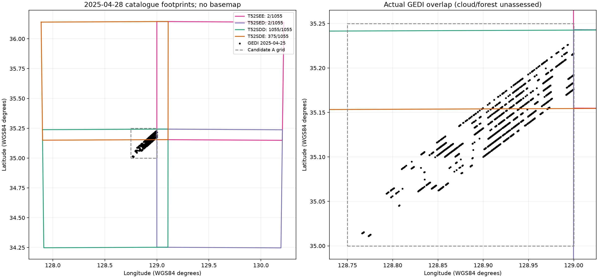

# Week06 Step 3 — 후보 A의 Sentinel-2 L2A 확보 가능성

조사일: 2026-11-13 (Asia/Seoul). 공개 카탈로그 및 공개 디렉터리 **JSON 메타데이터만** 조회했다. 영상·JP2·원제품 XML 내용은 다운로드하지 않았다. 로그인·토큰·API 키를 생성하거나 사용하지 않았으며 모델 학습, Week03–05 수정은 하지 않았다.

## 1. 대상 GEDI 확인

`../step2/recommended_candidate_points.csv`에서 region_id=G025_515_140, observation_date_utc=2025-04-25를 선택했다. 고유 point_id **1,055점**, 8 BEAM, 궤도 O36071이며 모두 기존 영상 사각형 밖이다.

- 실제 경도: **128.766124583–128.999912750°E**
- 실제 위도: **35.010957187–35.226267955°N**
- GEDI 실제 관측시각: **2025-04-25 17:10:36.172006–17:10:40.746408 UTC**
- 후보 A 격자: 128.75–129.00°E / 35.00–35.25°N
- 이번 날짜의 실제 점 bbox + 사방 0.01°: **[128.756125, 35.000957, 129.009913, 35.236268]**

Step2 계획의 북쪽 35.259930°는 후보 A의 여러 GEDI 날짜를 합한 범위에서 계산되어 이번 날짜 전용 범위보다 넓다. 공개 제품 검색에는 사용자 지정 **A 격자 전체**를 사용했다. 이번 날짜 1,055점에 대한 포함 여부는 별도로 계산했다. 후보 전체가 산림이라는 가정은 하지 않았다.

## 2. 공식 카탈로그 검색 결과와 재현성

CDSE OData 공개 검색 GET 요청은 **HTTP 200**, 일치 **16개 제품**, 다음 페이지 없음으로 완료됐다. 검색 시각은 `catalogue_query.json`에 UTC로 기록했다. 모든 제품은 조회 시 Online=true다. 이는 카탈로그상 온라인 상태이며 인증된 실제 다운로드 성공이나 픽셀 유효성을 확인한 것은 아니다.

- 컬렉션: SENTINEL-2; 제품명 MSIL2A
- 공간: A 격자 polygon과 Intersects
- 시간: **2025-04-18 00:00 UTC 이상, 2025-05-03 00:00 UTC 미만** (5월 2일 전체 포함)
- 구름 제한: 적용하지 않음. 낮은 구름 제품만 남겨 공간·시차 비교가 누락되지 않도록 함
- $expand=Attributes, $top=1000, 시간순 정렬, $count=true
- 근거: `catalogue_odata_page_01.json` 원응답, `catalogue_query.json` 인코딩 URL·요청 조건

카탈로그 제품 ID는 아래 실제 응답에서만 가져왔다. **4개 관측 날짜 × 4개 타일**이며 4월 25일 자체의 일치 제품은 없었다. 다른 기간·다른 카탈로그 전체에 대한 부재를 주장하는 것은 아니다.

| catalogue_sensing_start_utc | tile_id | cloud_cover_percent_tile | gedi_points_in_catalogue_footprint |
| --- | --- | --- | --- |
| 2025-04-18T02:07:11.025000Z | T52SDD | 4.897048 | 1055 |
| 2025-04-18T02:07:11.025000Z | T52SDE | 4.359425 | 375 |
| 2025-04-18T02:07:11.025000Z | T52SED | 20.781185 | 2 |
| 2025-04-18T02:07:11.025000Z | T52SEE | 20.001118 | 2 |
| 2025-04-20T02:11:21.024000Z | T52SDD | 99.990475 | 1055 |
| 2025-04-20T02:11:21.024000Z | T52SDE | 99.527866 | 375 |
| 2025-04-20T02:11:21.024000Z | T52SED | 99.999595 | 2 |
| 2025-04-20T02:11:21.024000Z | T52SEE | 99.991876 | 2 |
| 2025-04-23T02:06:49.024000Z | T52SDD | 83.852935 | 1055 |
| 2025-04-23T02:06:49.024000Z | T52SDE | 94.249207 | 375 |
| 2025-04-23T02:06:49.024000Z | T52SED | 94.858158 | 2 |
| 2025-04-23T02:06:49.024000Z | T52SEE | 96.574873 | 2 |
| 2025-04-28T02:07:11.025000Z | T52SDD | 26.468134 | 1055 |
| 2025-04-28T02:07:11.025000Z | T52SDE | 1.636663 | 375 |
| 2025-04-28T02:07:11.025000Z | T52SED | 91.85071 | 2 |
| 2025-04-28T02:07:11.025000Z | T52SEE | 25.027701 | 2 |

전체 제품 UUID와 SAFE 제품명:

| product_uuid | product_name |
| --- | --- |
| c806f4d7-4f58-485d-9545-91579be0bf44 | S2C_MSIL2A_20250418T020711_N0511_R103_T52SDD_20250418T054204.SAFE |
| a1551aa0-670d-4938-b2d5-4a79c08fd891 | S2C_MSIL2A_20250418T020711_N0511_R103_T52SDE_20250418T054204.SAFE |
| 4b077240-fc92-431a-9880-2b9c831bcf29 | S2C_MSIL2A_20250418T020711_N0511_R103_T52SED_20250418T054204.SAFE |
| 3289db86-3b68-4039-a718-20cb941f2f7b | S2C_MSIL2A_20250418T020711_N0511_R103_T52SEE_20250418T054204.SAFE |
| e6e96cbd-3995-485a-aae8-4bee7af25594 | S2A_MSIL2A_20250420T021121_N0511_R103_T52SDD_20250420T061311.SAFE |
| cacf732c-4488-4c2c-8167-d0596b57ac24 | S2A_MSIL2A_20250420T021121_N0511_R103_T52SDE_20250420T061311.SAFE |
| 0837b05f-6bed-432d-8ec6-4930cea9d98d | S2A_MSIL2A_20250420T021121_N0511_R103_T52SED_20250420T061311.SAFE |
| c1dae722-373a-41e0-8339-e3ef1d64b73b | S2A_MSIL2A_20250420T021121_N0511_R103_T52SEE_20250420T061311.SAFE |
| 637dd48d-b68d-449e-9c8f-e49d3f3abea4 | S2B_MSIL2A_20250423T020649_N0511_R103_T52SDD_20250423T034329.SAFE |
| 9415a752-b444-4190-8a5b-e01fae090e11 | S2B_MSIL2A_20250423T020649_N0511_R103_T52SDE_20250423T034329.SAFE |
| ecb63710-82f7-4d0b-be99-2607c49b8503 | S2B_MSIL2A_20250423T020649_N0511_R103_T52SED_20250423T034329.SAFE |
| 28228532-ced8-4d4c-97f1-d56ca4d9614e | S2B_MSIL2A_20250423T020649_N0511_R103_T52SEE_20250423T034329.SAFE |
| 6c4173d8-59e8-41f8-b339-c49620900f8f | S2C_MSIL2A_20250428T020711_N0511_R103_T52SDD_20250428T054014.SAFE |
| 72c304c4-88ea-497c-bead-5a6554f296a2 | S2C_MSIL2A_20250428T020711_N0511_R103_T52SDE_20250428T054014.SAFE |
| 69e7057e-9ba5-4cdd-ae2f-66f48ff895e3 | S2C_MSIL2A_20250428T020711_N0511_R103_T52SED_20250428T054014.SAFE |
| 31139c0c-1ba5-4105-bb6a-9b8d7eccbf01 | S2C_MSIL2A_20250428T020711_N0511_R103_T52SEE_20250428T054014.SAFE |

공식 [OData 문서](https://documentation.dataspace.copernicus.eu/APIs/OData.html)는 공간·시간 검색, Attributes 확장, 공개 Nodes 목록, 제품 다운로드 방식을 설명한다. 이번 요청은 인증 없이 실제 응답을 받았다. [CDSE STAC](https://documentation.dataspace.copernicus.eu/APIs/STAC.html)도 검색 대안이지만 이번 실제 제품 목록의 출처는 OData다. STAC 결과와 대조했다고 주장하지 않는다.

## 3. 촬영시각·구름 비율·공간 중첩의 해석

표의 시각은 **카탈로그 ContentDate/Start 촬영 기준시각**이다. SAFE 이름·시작 시각은 제품/datatake 기준이며 GEDI 위치의 정확한 개별 픽셀 촬영시각과 동일하다고 단정하지 않는다. 4월 28일 T52SDD 실제 granule 디렉터리는 `L2A_T52SDD_A003362_20250428T021046`이다. 타일 MTD_TL.xml 내용은 아직 읽지 않아 세부 SENSING_TIME은 미검증이다. `sentinel2_candidates.csv`에는 카탈로그 시각 기준 GEDI와의 부호 있는 실제 경과시간 범위를 보존했다.

cloudCover는 **제품/타일 전체의 구름 비율**이다. A 영역의 구름 비율이나 1,055점 중 사용할 수 있는 비율이 아니다. 바다·도시·농경지·산림의 비율도 이번에 판정하지 않았다. [공식 L2A 문서](https://documentation.dataspace.copernicus.eu/APIs/SentinelHub/Data/S2L2A.html)는 타일 구름량이 작은 AOI를 대표하지 않을 수 있음을 명시한다.

GeoFootprint의 WGS84 polygon에 각 GEDI 중심점이 포함되는지 경계 포함 방식으로 검사했다. 독립적인 두 점-다각형 구현을 대조했고 bbox 포함만으로 판정하지 않았다. 점 1,055개×제품 16개 규모이며 거리행렬을 사용하지 않았다. 원시 polygon은 `product_footprints.geojson`, 점별 판정은 `point_product_overlap.csv`에 있다.

- **T52SDD: 실제 GEDI 1,055/1,055점 (100%)**. 다만 후보 A 격자 북쪽 일부는 포함하지 않아 **격자 사각형 전체 포함과는 다르다**. 이번 대상점이 그 미포함 구간에 없으므로 모든 대상점은 포함된다.
- **T52SDE: 375/1,055점 (35.545%)**. 전체 영역을 대신할 수 없다.
- **T52SED·T52SEE: 각각 2/1,055점 (0.190%)**. 동쪽 경계 근처의 작은 중첩으로 검색됐으며 기본 다운로드 우선순위에서 제외했다.
- 타일 간 포함점은 중복된다. 1,055+375+2+2를 고유 표본 수로 합산하면 안 된다.
- 카탈로그 polygon 포함은 **기하학적 확보 가능성**일 뿐, DN NoData·밴드별 품질·구름·SCL 식생·산림 필터 통과가 아니다. 최종 학습 가능점 수는 여전히 미확정이다.



## 4. 추천 제품과 선정 이유

1. **전체 영역 우선 후보: 2025-04-28 T52SDD**
   - 제품: `S2C_MSIL2A_20250428T020711_N0511_R103_T52SDD_20250428T054014.SAFE`
   - UUID: `6c4173d8-59e8-41f8-b339-c49620900f8f`
   - 카탈로그 시각: 2025-04-28 02:07:11.025 UTC; GEDI 후 약 **56.94시간(2.37일)**
   - 구름 **26.468134%**, 기하학적 포함 **1,055점**
   - 대상 전체 포함과 가까운 시기를 우선한 잠정 추천이다. 4월 23일은 더 가깝지만 T52SDD 구름이 83.85%여서 후순위다. 실제 A 지점의 SCL을 확인한 뒤 최종 선정한다.

2. **같은 날 저구름 보조·Week05 교차검증: 2025-04-28 T52SDE**
   - `S2C_MSIL2A_20250428T020711_N0511_R103_T52SDE_20250428T054014.SAFE`
   - UUID `72c304c4-88ea-497c-bead-5a6554f296a2`; 구름 **1.636663%**, 포함 **375점**
   - 기존 SCL 기록의 날짜·타일·처리 기준과 일치하는 실제 제품 후보가 확인됐다. 그러나 이 사실만으로 기존 Analytical TIFF가 바로 이 제품에서 생성됐다고 입증하지는 못한다.
   - SDD와의 겹침 영역에서 제품별 SCL·마스크를 비교할 수 있다. 최종 밴드와 SCL은 점마다 같은 선택 제품에서 가져오며, 타일별 구름 비율만으로 픽셀을 자동 선택하지 않는다.

3. **저구름 전체 영역 대안: 2025-04-18 T52SDD**
   - `S2C_MSIL2A_20250418T020711_N0511_R103_T52SDD_20250418T054204.SAFE`
   - UUID `c806f4d7-4f58-485d-9545-91579be0bf44`; 구름 **4.897048%**, 포함 **1,055점**
   - GEDI보다 약 **183.06시간(7.63일)** 전이다. 달력 기준 -7일이므로 요청한 날짜 구간에는 포함되지만, 엄격한 실제 경과시간 ±168시간 조건에는 들어오지 않는다. 허용 시차를 달력 날짜와 경과시간 중 무엇으로 정의할지 다음 단계에서 확정한다.

4월 20일은 SDD 구름 99.99%, 4월 23일은 83.85%로 우선순위가 낮다. 구름 비율만으로 해당 날짜의 모든 GEDI 점이 불가능하다고 확정하지는 않는다.

## 5. 확보 방식과 인증 경계

권장 방식은 **공식 L2A SAFE의 원본 JP2 + 제품/타일 XML + 품질 파일**을 함께 확보하는 것이다. 제품·처리 기준·변환식·마스크의 계보를 명확히 유지할 수 있다. [SentiWiki 제품 설명](https://sentiwiki.copernicus.eu/web/s2-products)은 SAFE의 영상·메타데이터·품질 정보를 설명한다.

- CDSE Browser 제품 검색에서 위 SAFE 이름을 확인한 뒤 해당 제품을 선택하거나, OData UUID로 원제품에 접근한다.
- **원제품 다운로드는 CDSE 사용자 인증/토큰이 필요**하다([공식 문서](https://documentation.dataspace.copernicus.eu/APIs/OData.html#product-download)). S3 파일별 접근은 **별도 S3 access/secret 자격증명**이 필요하다([S3 문서](https://documentation.dataspace.copernicus.eu/APIs/S3.html)). 이번에 로그인·토큰 요청·키 생성·자격증명 탐색은 하지 않았다.
- 공개 Nodes **디렉터리 목록은 인증 없이 조회 가능**했고 실제로 HTTP 200을 받았다. 4월 28일 SDD에 대해 11개 디렉터리 요청으로 69개 파일 항목을 확인했다. 이 숫자는 탐색한 하위 폴더 범위의 목록이며 전체 SAFE 파일 수라고 단정하지 않는다.
- `nodes_query.json`과 `nodes_response_*.json`은 목록 응답이다. 파일 바이트나 XML 내용을 받은 것이 아니다. 원본 다운로드 성공 여부·XML의 실제 보정 계수는 아직 검증하지 않았다.

대안은 인증된 Sentinel Hub Process API의 명시적 `units=REFLECTANCE`, `sampleType=FLOAT32` 출력이다. 요청·evalscript·응답 scenes·제품 ID·격자·리샘플링·harmonizeValues를 보존해야 한다. 제품이 섞이지 않도록 단일 장면 검증과 provenance 검사를 먼저 한다. API 인증·호출은 수행하지 않았다. `reflectance_evalscript_DRAFT.js`는 미실행 설계 예제이며 실제 제품 고정 및 선택 규칙을 완성해야 한다.

## 6. /65535 문제 해결과 반사율 검증 계획

Week05의 판정은 **기존 2025 Analytical TIFF /65535 근거 부족**이었다. 이번 메타데이터 조사만으로 이 판정을 바꾸지 않는다. 새 데이터는 출력 TIFF의 uint16 타입에서 변환식을 추측하지 않는다.

**우선 경로: 원본 SAFE**

```text
rho_band = (DN_band + BOA_ADD_OFFSET_band) / BOA_QUANTIFICATION_VALUE
```

제품 `MTD_MSIL2A.xml`의 실제 밴드별 offset, quantification 값, Special_Values를 읽는다. **DN=0 NoData를 먼저 마스킹**하며 SCL·QI 마스크는 별도 품질 처리한다. PB05.11 제품이라고 계수를 코드에 추정 고정하지 않는다. 식과 메타데이터 위치는 [공식 S2 제품 설명](https://sentiwiki.copernicus.eu/web/s2-products)에 근거한다. 보정은 float32/64로 수행하고 음수·1 초과 반사율을 사전 검토 없이 자르지 않는다.

**교차검증 경로: 명시적 FLOAT32 REFLECTANCE**

같은 제품·밴드·픽셀에서 원본 DN+XML로 계산한 반사율과 독립 FLOAT32 출력을 비교한다. 서비스 사용 시 `harmonizeValues=false`를 명시해 원본 보정 반사율의 음수를 임의로 0으로 자르는 효과를 분리하고, 서비스가 선택한 실제 scenes와 처리 기준을 기록한다. 단순 서비스 DN/10000과 원본 SAFE DN/10000을 혼동하지 않는다. [공식 harmonizeValues 설명](https://documentation.dataspace.copernicus.eu/APIs/SentinelHub/Data/S2L2A.html#harmonize-values)을 따른다.

원시 native-grid 비교부터 수행하고, B11/B12 20m→10m 정렬에 따른 오차는 방사 변환 오차와 분리한다. 연속 반사율은 정한 리샘플링을 기록하고 **SCL·범주형 품질 마스크는 최근린**으로 정렬한다. `dataMask`는 Sentinel Hub가 출력 픽셀별 계산하는 유효성 마스크이며 SAFE에 같은 이름의 파일이 반드시 있는 것이 아니다([공식 Data Mask 문서](https://documentation.dataspace.copernicus.eu/APIs/SentinelHub/UserGuides/Datamask.html)). SAFE에서는 DN NoData와 품질·detector footprint 등으로 유효 마스크를 구성한다. dataMask=1은 구름 없음이나 산림을 보증하지 않는다.

기존 Week03–05를 검증하려면 **4월 28일 T52SDE**의 알려진 제품 반사율과 기존 Analytical TIFF를 같은 위치·출력 격자로 비교한다. 기존 생성 요청·evalscript 또는 제품 연결을 확보하고, 클라우드·NoData·포화·경계 픽셀을 분리한 뒤 밴드별 bias/MAE/RMSE·기울기·절편·최대 차이를 저장한다. 기존 TIFF의 정확한 제품 또는 생성식 연결이 여전히 없으면 수치 유사성만으로 출처를 확정하지 않는다. 변환이 확정되면 EVI를 반드시 재계산하며 offset·밴드별 차이가 있으면 NDVI·NDMI도 재계산한다. 이번에는 어떤 영상 픽셀 비교나 지수 재계산도 수행하지 않았다.

## 7. 다음 단계 다운로드 파일 목록

우선 제품은 **2025-04-28 T52SDD**다. 실제 공개 Nodes 목록에서 필수 6밴드·SCL·메타데이터의 존재를 확인했다. 정확한 SAFE 내부 경로와 S3 객체 경로·바이트 수·근거 응답 파일은 `download_manifest_primary.csv`에 저장했다.

| filename | role | bytes |
| --- | --- | --- |
| T52SDD_20250428T020711_B02_10m.jp2 | reflectance_source_DN | 109124302 |
| T52SDD_20250428T020711_B03_10m.jp2 | reflectance_source_DN | 108154954 |
| T52SDD_20250428T020711_B04_10m.jp2 | reflectance_source_DN | 102767620 |
| T52SDD_20250428T020711_B08_10m.jp2 | reflectance_source_DN | 108460309 |
| T52SDD_20250428T020711_B11_20m.jp2 | reflectance_source_DN | 26211536 |
| T52SDD_20250428T020711_B12_20m.jp2 | reflectance_source_DN | 25756554 |
| MTD_TL.xml | required_metadata | 626117 |
| MTD_MSIL2A.xml | required_metadata | 58568 |
| manifest.safe | required_metadata | 68910 |
| T52SDD_20250428T020711_SCL_20m.jp2 | scene_classification | 1411539 |

추가 품질 파일은 `QI_DATA/MSK_QUALIT_{B02,B03,B04,B08,B11,B12}.jp2`, `MSK_DETFOO_{동일 6밴드}.jp2`, `MSK_CLASSI_B00.jp2`, `MSK_CLDPRB_20m.jp2`, `MSK_SNWPRB_20m.jp2`다. 이들의 존재도 실제 목록에서 확인했다. 마스크 밴드의 의미는 제품 명세·XML에 맞춰 해석하며 다른 마스크와 dataMask를 동일시하지 않는다.

계획 목록은 **25개 파일**, 목록상 합계 **485,041,677 bytes**다. 실제 다운로드량·압축 SAFE 크기와 동일하다고 단정하지 않는다. 전체 SAFE로 받으면 이 목록의 파일이 함께 포함되는지 확인한다. DATASTRIP/MTD_DS.xml 등 추가 provenance는 전체 SAFE 수집 시 보존할 수 있다. 보조 SDE와 4월 18일 SDD는 제품 ID까지 확인했지만 내부 파일 목록은 이번에 별도로 탐색하지 않았으므로 SDD의 granule 경로를 문자열 치환해 사용하지 않는다.

권장 실행 순서: 다운로드 인증 방식 확정 → 4월 28일 SDD 원제품/필수 파일 확보 → XML 보정·공간 격자 확인 → 1,055점의 밴드 유효성·SCL·구름 및 산림 조건 집계 → 필요시 같은 날 SDE 보완 및 4월 18일 대안 검토 → 최종 고유 학습점 수 산정. 각 점의 밴드·SCL·마스크는 동일 선택 제품에서 읽고 날짜·타일을 provenance 컬럼으로 남긴다.

## 8. 산출물과 검증

| 파일 | 내용 |
| --- | --- |
| candidate_a_20250425_gedi_points.csv / gedi_summary.json | 실제 대상 1,055점·좌표·BEAM·UTC 시각 |
| catalogue_query.json / catalogue_odata_page_01.json | 실제 GET 조건·조회 시각·HTTP 상태·원응답 |
| sentinel2_candidates.csv | 실제 16개 제품 UUID·전체 이름·시각·타일·구름·점 포함 수·footprint bbox |
| recommended_products.csv | 추천 3개 제품과 역할·선정 근거 |
| product_footprints.geojson / point_product_overlap.csv | 실제 카탈로그 polygon 및 점별 포함 결과 |
| spatial_overlap.png | 타일 전체와 대상 영역 확대도; 지리적 중첩만 표시 |
| nodes_query.json / nodes_response_*.json | 공개 SAFE 디렉터리 메타데이터 조회 증거 |
| listed_product_files.json / download_manifest_primary.csv | 확인한 파일 목록과 다음 단계 25개 수집 계획 |
| reflectance_evalscript_DRAFT.js | 미실행 FLOAT32 반사율 출력 설계 예제 |
| validation.json | 응답 수·중복·공간 판정·필수 파일 수 검증 |

검증: 카탈로그 count=실제 행 수=고유 UUID 16개, 검색 페이지 완료, GEDI 고유 1,055점, 두 polygon 구현 일치, 전체 포함 SDD 1,055점·부분 SDE 375점, 파일 목록 필수 6밴드+SCL+메타데이터 일치, Step2 입력 SHA-256 불변을 확인했다. **최종 학습 가능점 수는 null**로 남겼다.

재현: `search_catalogue.py`는 공개 JSON 검색만, `list_product_nodes.py`는 공개 디렉터리 목록만 요청한다. `analyze_availability.py`는 저장된 응답을 읽는 오프라인 분석이다. 네트워크 스크립트를 재실행하면 공개 카탈로그 변경으로 결과가 달라질 수 있으므로 이번 원응답을 보존한다.
