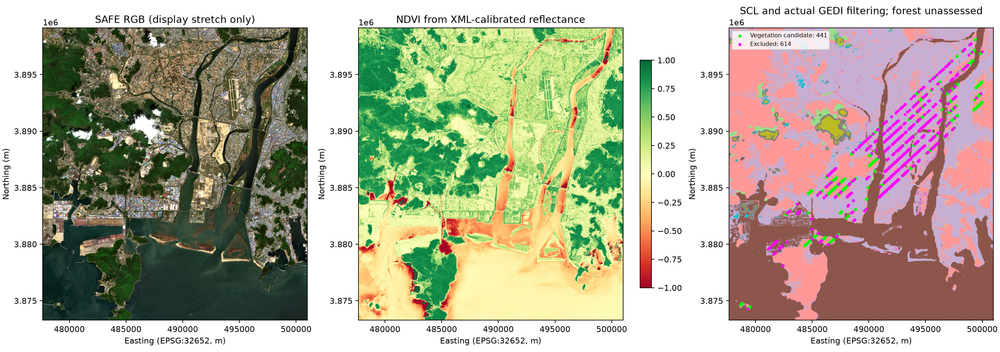

# Week06 Step 5 — 후보 A 영상 전처리 및 GEDI 결합

원본 SAFE ZIP을 보존하고 새 `source/`에 안전하게 압축 해제했다. 다운로드·API 인증·모델 학습은 하지 않았고 Week03~05 및 이전 단계 입력을 수정하지 않았다.

## 결과

- GEDI 품질 통과 입력: **1,055점**
- 여섯 밴드 유효: **1,055점**
- 구름·그림자·무효 SCL 등을 제외한 지수 후보: **1,049점**
- 두 SCL 격자에서 모두 식생인 후보: **441점**, 고유 10m 픽셀 **441개**
- **산림으로 확정한 추가 학습점 수는 미확정**이다. SCL=4는 식생이며 산림 경계가 아니다.

## 단계별 필터

| stage | remaining | excluded_at_stage |
| --- | --- | --- |
| gedi_quality_input | 1055 | 0 |
| all_six_bands_valid | 1055 | 0 |
| finite_indices | 1055 | 0 |
| ndvi_ndmi_range | 1055 | 0 |
| time_gap_within_168h | 1055 | 0 |
| clear_surface_both_scl_grids | 1049 | 6 |
| classi_clear | 1049 | 0 |
| vegetation_both_grids | 441 | 608 |

단계별 수는 누적 조건이다. 개별 제외 사유는 서로 중복될 수 있으므로 합산하지 않는다. 전체 1,055점의 값·품질·탈락 사유는 `gedi_sentinel_all_points.csv`에 보존했다. 식생 후보는 `vegetation_candidates.csv`에 별도 저장했다. 같은 픽셀의 여러 GEDI 샷은 자동 평균하거나 삭제하지 않고 duplicate_pixel로 표시했다.

## 반사율과 격자

제품은 `S2C_MSIL2A_20250428T020711_N0511_R103_T52SDD_20250428T054014.SAFE`다. 원본 XML에서 quantification=10000.0, 여섯 밴드 offset=-1000을 읽었으며 **(DN-1000)/10000**으로 보정했다. DN=0 NoData와 65535 포화를 먼저 제외했다. 음수와 1 초과 반사율을 임의로 자르지 않았다. 이는 새 SAFE 원제품의 변환이며 기존 Browser TIFF의 /65535 검증을 완료했다는 뜻은 아니다.

B04 원본 10m 격자를 기준으로 GEDI 좌표 범위에 사방 1km 여유를 둔 영역만 처리했다. CRS는 EPSG:32652, 크기는 2334×2586 픽셀이다. 타일 밖 요청 영역은 타일 경계에서 자른다. 전체 110km 타일을 메모리에 적재하지 않는다.

B11/B12는 원본 20m에서 반사율을 보정하고 품질 불량 픽셀을 제거한 뒤 bilinear로 10m에 정렬했다. 보간에 기여한 원본 픽셀이 모두 유효한 경우만 인정했다. SCL·품질·검출기 마스크는 최근린으로 정렬했다. 20m 밴드를 10m로 바꿔도 실제 관측 해상도가 높아지는 것은 아니다.

기존 Week03 `vegetation_indices.py`의 순수 계산 함수를 재사용하여 NDVI·EVI·NDMI를 계산했다. 모든 여섯 밴드가 유효한 영역을 분석 마스크로 사용했다. NDVI·NDMI 범위 이탈은 후보에서 제외하고, EVI는 유한값만 요구하며 범위 밖 값과 작은 분모는 진단 플래그로 남겼다. 원본 계산 결과를 클리핑하지 않았다.

## 품질 마스크와 SCL

여섯 밴드 각각 MSK_QUALIT의 8개 층을 검사했다: ancillary lost/degraded, MSI lost/degraded, defective, NoData, partially corrected crosstalk, saturated. 하나라도 1이면 제외하는 보수적 기준을 적용했다. MSK_DETFOO는 검출기 ID 1~12만 허용했다. 정의는 [공식 S2 Processing 마스크 설명](https://sentiwiki.copernicus.eu/web/s2-processing)에 근거한다.

SCL 원본 20m와 정렬된 10m를 모두 샘플링했다. 두 격자 모두 4·5·6인 점만 명확한 표면 후보로 보고 2(그늘), 3(구름 그림자), 8·9·10(구름), 0·1·7·11을 제외했다. 최종 식생 후보는 두 격자 모두 4인 점이다. 원본/정렬 클래스 불일치 0점이며, 어느 격자에서든 구름·그림자인 점은 0점이다.

범주형 마스크의 재투영 NoData는 255로 예약해 정상 플래그 0을 보존했다. 정상 0 플래그 및 bilinear 유효성 지원 영역 보존 회귀 검사 두 개를 통과했다.

MSK_CLASSI의 opaque·cirrus·snow 층도 확인하여 세 층 모두 0인 경우만 통과시켰다. 그 외 점은 0점이다. CLDPRB·SNWPRB는 수치만 기록하고 임의 확률 임계값을 추가하지 않았다. 모든 밴드·SCL·마스크는 동일한 제품에서 가져왔다.

| scl_class | native_20m_points | aligned_10m_points |
| --- | --- | --- |
| 0 | 0 | 0 |
| 1 | 0 | 0 |
| 2 | 0 | 0 |
| 3 | 0 | 0 |
| 4 | 441 | 441 |
| 5 | 589 | 589 |
| 6 | 19 | 19 |
| 7 | 6 | 6 |
| 8 | 0 | 0 |
| 9 | 0 | 0 |
| 10 | 0 | 0 |
| 11 | 0 | 0 |

## 관측시각

카탈로그 시작 시각은 2025-04-28T02:07:11.025Z이고 **실제 MTD_TL.xml의 SENSING_TIME은 2025-04-28T02:18:18.132585Z**이다. 서로 다른 메타데이터 필드이므로 함께 보존했다. 타일 메타데이터 시각 기준 GEDI와의 경과시간은 57.1271~57.1283시간이다. 이는 개별 GEDI 위치의 픽셀별 정밀 촬영시각을 독립 검증했다는 의미는 아니다.

이번 데이터에 실제 경과시간 168시간 이내 조건을 적용했다. 관측점은 중심 위치가 속한 단일 지수 픽셀에서 추출했으며 GEDI footprint 면적 평균은 계산하지 않았다.

## 산출물 및 검증

| 파일 | 내용 |
| --- | --- |
| summary.json / validation.json | 품질 집계·처리 설정·입력 보존 및 검증 |
| gedi_sentinel_all_points.csv | 1,055점 전부의 반사율·지수·SCL·품질·제외 사유 |
| clear_valid_index_candidates.csv | 구름 등 제외 후 지수 후보 |
| vegetation_candidates.csv | SCL 식생 후보; 산림 학습점으로 확정하지 않음 |
| filter_counts.csv / scl_counts.csv | 누적 필터 및 SCL 분포 |
| band_statistics.csv / quality_mask_counts.csv | 반사율 범위와 밴드별 품질 플래그 수 |
| rasters/ | 여섯 반사율·세 지수·SCL GeoTIFF, 원본 좌표 격자 기반 |
| quality_overview.png | RGB·NDVI·SCL과 GEDI 판정 지도 |

저장된 지수 GeoTIFF를 다시 열어 1,055점 모두에서 CSV 값과 일치함을 확인했다. 식생 후보의 필수 지수·AGBD 결측이 없고, 누적 필터와 최종 선택 수가 일치하며 기존 90점 CSV·입력 CSV·원본 ZIP을 보존했다.

## 다음 단계

식생 후보 지도와 분포를 검토한 뒤 산림 경계·토지피복 자료로 산림 표본을 구분한다. 그 후 기존 90점과 지역·궤도·날짜·반사율 계보를 맞춰 통합하고 공간 버퍼와 미사용 지역 홀드아웃을 설계한다. 새 SAFE와 기존 Analytical TIFF는 반사율 근거가 다르므로 확인 없이 합쳐 학습하지 않는다. 모델 학습은 이번 범위에 포함하지 않았다.
