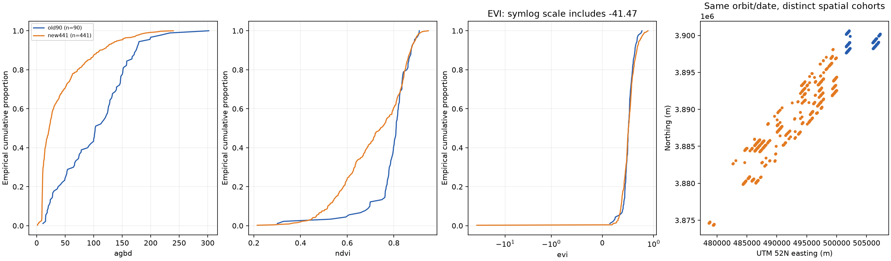
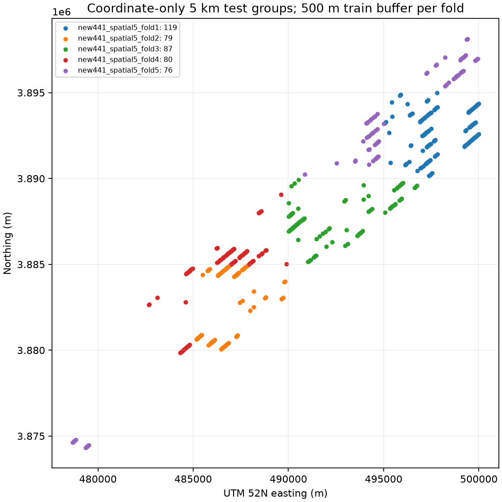

# Week06 Step 7 — 확대 데이터 모델 평가 준비

## 연구 범위와 진행 상태

사용자 결정에 따라 EGIS 확보와 산림 검증은 후속 연구로 남긴다. 연구 대상을 **Sentinel-2 SCL 식생 분류를 통과한 GEDI L4A 추정 AGBD 표본**으로 정의한다. 산림 표본 또는 현장 실측 AGBD 정답이라고 표현하지 않는다. WorldCover도 이번에는 조회·다운로드·적용하지 않았다.

이번에는 구조·결측·중복·분포 비교, 고정된 분할 ID와 RF 평가 계획만 만들었다. **학습·예측·성능 점수 계산은 하지 않았다.** 원본 Week03~05 및 Step5 CSV는 수정하지 않았다.

## 표본 및 중복 검사

- 기존 90점: 원본 70열. agbd·agbd_se·gedi_file 사용.
- 신규 441점: 원본 133열. agbd_Mg_ha·agbd_se_Mg_ha·source_file 사용.
- 공통 컬럼으로 명시 매핑한 비교표는 **531행**이다. shot_number는 정밀도 손실 방지를 위해 문자열로 읽었다.
- 필수 지수·AGBD·표준오차·좌표의 결측·비유한값은 **0개**다.
- point_id, granule+BEAM+shot, 정확한 좌표, 공통 UTM 10m 셀의 두 집합 간 중복은 **모두 0개**다.
- 두 집합의 최소 중심점 거리는 **1799.85m**다. 원본 영상 격자가 서로 다르므로 공통 10m 셀 검사는 같은 원본 픽셀이라는 뜻과 구분한다.

## 지역·날짜·궤도 분포

**531점 모두 같은 GEDI granule·2025-04-25·궤도 O36071이다.** 신규 지역을 추가했지만 독립 관측일 또는 궤도를 추가한 것은 아니다. 따라서 궤도 홀드아웃 및 시간 일반화 평가는 현재 불가능하다. cohort·날짜·BEAM 및 5km 격자 수는 별도 CSV로 남겼다.

## 데이터 분포와 주의점

| cohort | variable | mean | median | min | max |
| --- | --- | --- | --- | --- | --- |
| old90 | agbd | 103.942644 | 103.080875 | 10.998292 | 301.965942 |
| old90 | ndvi | 0.792063 | 0.809847 | 0.300647 | 0.908877 |
| old90 | evi | 0.510876 | 0.509229 | 0.144882 | 0.772258 |
| old90 | ndmi | 0.359618 | 0.386534 | 0.049592 | 0.493005 |
| new441 | agbd | 42.749687 | 22.132545 | 1.494783 | 239.693268 |
| new441 | ndvi | 0.716449 | 0.743658 | 0.214212 | 0.947907 |
| new441 | evi | 0.420769 | 0.506885 | -41.465836 | 0.890798 |
| new441 | ndmi | 0.260117 | 0.264948 | -0.133946 | 0.560799 |

신규 AGBD 평균은 약 42.75 Mg/ha로 기존 약 103.94 Mg/ha보다 낮다. 이는 실제 표본 구성이 다르다는 기술통계이며 원인을 산림 유형 하나로 확정하지 않는다. 표준편차·분위수·AGBD 구간별 수도 보존했다. 이번 비교로 통계적 유의성이나 인과관계를 주장하지 않는다.

신규 표본 **1점의 EVI가 약 -41.47**이다. SAFE 반사율로 계산한 분모가 약 -0.0133으로 작아 발생한다. SCL=4라도 지수의 안정성이 보장되는 것은 아니다. `evi_review_points.csv`에 식별자를 남겼으며 441점 원본을 삭제하거나 EVI를 클리핑하지 않았다. 진단 규칙은 abs(EVI)>2 또는 abs(분모)<0.05로 명시했으며 물리적 오류를 확정하는 보편 기준이 아니다.

주평가에는 441점을 유지하고, 고정 분할을 그대로 둔 채 이 1점을 제외한 민감도 분석을 추가하는 계획을 준비했다. 각 역할에서 해당 점만 제외하고 바뀐 학습·평가 수를 보고한다. 모든 모델은 조건별 동일 평가점을 사용하며 성능이 좋은 조건만 골라 보고하지 않는다.

## 두 자료를 곧바로 합쳐 학습하지 않는 이유

기존 90점은 Browser TIFF의 /65535 가정으로 계산한 지수이며 2025년 변환식·장면 연결이 미검증이다. 신규 441점은 원본 SAFE XML로 offset=-1000, quantification=10000을 확인했다. 특히 EVI는 공통 배율에도 변하고 offset은 NDVI·NDMI에도 영향을 준다.

기존 90점은 SCL 양 격자 식생을 통과했지만 신규는 MSK_QUALIT·검출기·CLASSI까지 추가 적용했다. 엄격한 품질 기준도 다르다. 따라서 `comparison_table_531_not_harmonized.csv`는 **비교용**이며 방사·품질 기준을 맞춘 학습표가 아니다. 531점 혼합 학습은 기존 자료의 재처리 또는 검증 후로 보류한다.

## 학습·평가 분할 설계

**주평가: 신규 441점의 공간 5-fold CV.** EPSG:32652 원점 0 기준 5km×5km 격자로 나누고, 격자별 표본 수 내림차순·격자 ID 순으로 5개 fold에 표본 수가 균형을 이루도록 배정했다. 좌표와 표본 수만 사용하며 AGBD·지수·성능으로 분할을 선택하지 않았다. 각 fold 평가점에서 500m 미만인 다른 격자 점은 학습에서 제외한다. 모든 441점은 정확히 한 번 평가점이 된다.

| split_id | train_n | test_n | buffer_excluded_n | buffer_m | minimum_train_test_distance_m | primary | train_evi_review_n | test_evi_review_n |
| --- | --- | --- | --- | --- | --- | --- | --- | --- |
| new441_spatial5_fold1 | 321 | 119 | 1 | 500 | 513.52 | True | 1 | 0 |
| new441_spatial5_fold2 | 349 | 79 | 13 | 500 | 513.415 | True | 0 | 1 |
| new441_spatial5_fold3 | 353 | 87 | 1 | 500 | 634.977 | True | 1 | 0 |
| new441_spatial5_fold4 | 344 | 80 | 17 | 500 | 513.696 | True | 1 | 0 |
| new441_spatial5_fold5 | 362 | 76 | 3 | 500 | 571.242 | True | 1 | 0 |
| new441_random80_20_seed42 | 352 | 89 | 0 | 0 | 54.323 | False | 0 | 1 |
| legacy90_to_new441_exploratory | 90 | 441 | 0 | 500 | 1799.847 | False | 0 | 1 |

5km·500m는 탐색 연구를 위한 사전 지정값이며 공간 독립성을 보장하는 추정 자기상관 거리로 해석하지 않는다. 5개 fold도 독립된 신규 궤도나 최종 외부 검증이 아니다. 실제 분할은 `split_assignments.csv`로 고정했다.

무작위 80/20은 seed42의 비교용 보조 평가다. 가까운 점이 양쪽에 들어갈 수 있으므로 주 성능으로 삼지 않는다. 기존90→신규441 지역 전이 분할도 만들었으나 **방사 변환·품질·공간 분포 차이가 함께 섞이는 탐색 평가**다. 여기서 나온 차이를 순수 지역 일반화 효과로 해석하지 않는다. 기존 평가점이 Week04~05에서 반복 사용된 이력도 명시한다.

## 모델 재평가 준비

공통 입력은 ndvi·evi·ndmi, 목표는 agbd(Mg/ha)다. 주 비교는 학습 평균 Dummy, 기존 RF(100 trees, seed42), Week05 Spatial B의 고정 설정(max_depth=6, min_samples_leaf=3, max_features=0.67)이다. Week05 Random B 설정(depth3·leaf4·features1.0)은 보조 비교용으로 기록했다.

Week05의 설정은 **과거 자료에서 선택된 파라미터**를 고정 재사용하는 것이며 신규 자료에서 튜닝된 개선 모델이라고 부르지 않는다. 기존 학습 코드가 90행을 강제 검사하므로 그대로 신규441점에 실행하지 않는다. 저장된 모델 객체를 불러오거나 예측한 작업도 없으며, 다음 단계는 지정된 train ID로 모델을 새로 적합하는 재평가다.

RMSE·MAE·R²를 동일 test ID에서 계산하고, 주 공간 CV는 각 점의 단 한 번의 홀드아웃 예측을 모아 pooled 지표와 fold별 지표를 함께 보고하도록 계획했다. fold별 R² 평균을 pooled R²로 대체하지 않는다. 전체 자료의 평균 대체·변수 선택·튜닝은 하지 않는다. 추후 튜닝이 필요하면 outer train 내부에서 버퍼를 둔 공간 분할을 별도로 만들어야 한다.

## 주요 산출물

| 파일 | 용도 |
| --- | --- |
| comparison_table_531_not_harmonized.csv | 출처·방사 상태를 보존한 531점 비교표 |
| new441_evaluation_input.csv | 신규441점 공통 모델 컬럼과 EVI 검토 플래그 |
| schema_mapping.csv / required_quality.csv | 컬럼 대응 및 결측 검사 |
| duplicate_and_distance_audit.json | 중복과 두 집합의 거리 |
| distribution_comparison.csv / agbd_bin_counts.csv | 변수·AGBD 분포 |
| counts_cohort_date_orbit_beam.csv / counts_spatial_groups.csv | 지역·날짜·궤도·BEAM·격자 집계 |
| evi_review_points.csv | 원본 유지한 지수 검토 대상 |
| split_assignments.csv / split_summary.csv | 고정 학습·평가·버퍼 제외 ID와 수 |
| evaluation_plan.json | 모델 파라미터·지표·민감도·금지 해석 |
| summary.json / validation.json | 입력 해시·집계 및 분할 검증 |

다음 단계에서는 이 고정 계획으로 신규441점의 RF·Dummy 평가와 EVI 민감도를 실행할 수 있다. 산림 검증을 하지 않았다는 한계와 단일 궤도·관측일 제약은 보고서와 모델 결과에 계속 명시한다.
