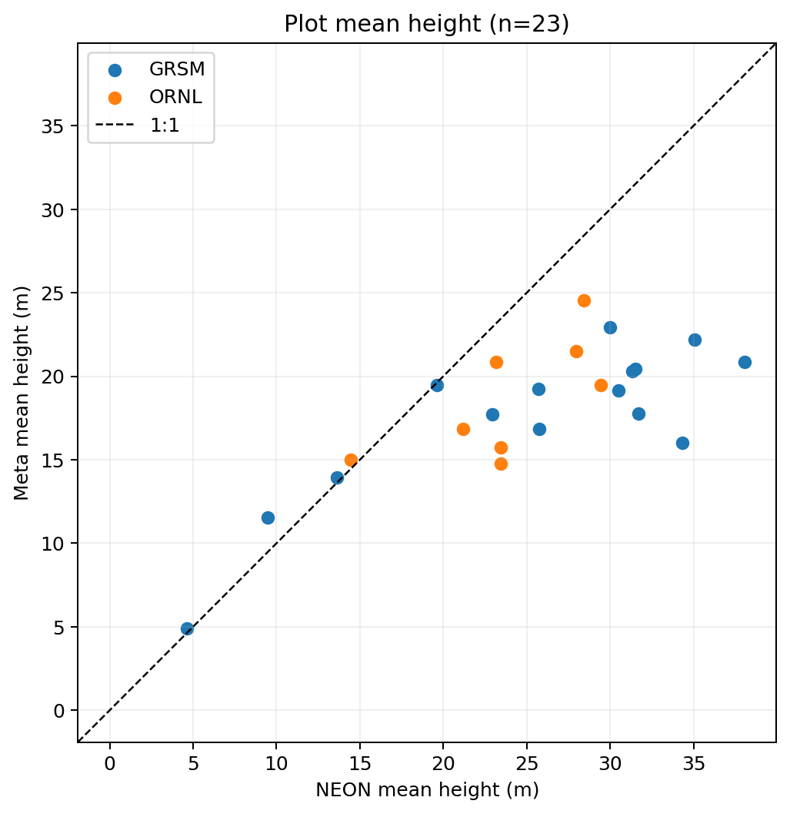
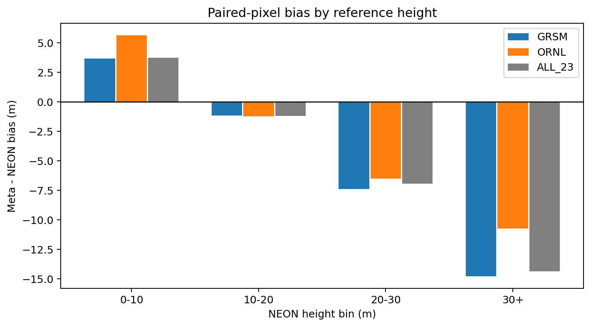

# Meta 높이 지도 vs NEON 라이다 높이 — 같은 조사구 비교

- 작성자: 이연지 · 2026-11-13
- 코드: [experiments/20261113_meta_vs_neon_chm](../meta_vs_neon_chm/) · 전체 결과: Drive `02_분석결과/20261113_Meta_NEON높이비교_v01`
- 출발점: [20261112_NEON_면적기반_CHM회귀_결과.md](../../week06/docs/20261112_NEON_면적기반_CHM회귀_결과.md)의 다음 단계 ② "국내 적용 전에 Meta 높이 지도의 정확도를 먼저 확인"
  - 금정산 적용([20261110_금정산_국내적용_결과.md](../../week06/docs/20261110_금정산_국내적용_결과.md))에서 나무 높이로 Meta v1을 썼지만, 국내에는 공개 라이다가 없어 정확도를 확인하지 못했음

## 1. 질문
위성사진 + AI로 만든 Meta 높이 지도는 실제 라이다 높이와 얼마나 다른가? 그 차이가 6주차 면적 회귀의 AGB 추정에 얼마나 영향을 주는가?

## 2. 방법
- 자료: 6주차와 같은 NEON 23개 조사구(GRSM 15, ORNL 8), 2021년 LiDAR 수관높이(1m), 같은 조사구 경계와 기준 AGB
- 비교 대상: Meta/WRI Global Canopy Height **v1** (금정산에서 쓴 것과 같은 제품). 조사구 주변만 원격으로 부분 읽기(23 MiB)
- 정렬: Meta(EPSG:3857, 1.19m)를 NEON 1m 격자로 bilinear 재투영 1회. 설정 탐색 없음
- 비교 1 (주 결과): 조사구별 평균 높이, p95 높이, 2m 이상 피복률
- 비교 2 (보조): 픽셀 쌍 비교와 NEON 높이 구간별 편향
- 비교 3 (AGB 영향): 6주차 회귀 계수를 그대로 두고 입력만 NEON → Meta로 바꿈. 재학습·보정 없음
- NEON 특징은 6주차 값과 같게 재현되는 것을 먼저 확인했음

## 3. 결과

**조사구 평균 높이 (Meta − NEON, 단위 m)**

| 범위 | 편향 | RMSE | r | Meta ÷ NEON |
| --- | ---: | ---: | ---: | ---: |
| GRSM 15 | −8.1 | 10.2 | 0.83 | 0.69 |
| ORNL 8 | −5.4 | 6.3 | 0.69 | 0.78 |
| 통합 23 | **−7.1** | **9.1** | 0.78 | **0.72** |

- 상위 높이(p95)는 더 낮게 나옴: 통합 편향 −10.1m, 비율 0.67
- 2m 이상 피복률은 둘 다 거의 1.0이라 차이를 판단할 수 없음

**NEON 높이 구간별 편향 (픽셀 1.3만 쌍)**

| NEON 높이 | 0–10m | 10–20m | 20–30m | 30m 이상 |
| --- | ---: | ---: | ---: | ---: |
| Meta 편향 (m) | +3.7 | **−1.2** | −6.9 | **−14.4** |

**6주차 계수 그대로, 입력만 바꾼 AGB (단위 Mg/ha)**

| 범위 | 입력 | RMSE | 편향 | 추정÷기준 |
| --- | --- | ---: | ---: | ---: |
| GRSM 15 | NEON | 158 | −57 | 0.81 |
| | Meta | 199 | −126 | 0.57 |
| ORNL 8 | NEON | 89 | +67 | 1.30 |
| | Meta | 61 | +18 | 1.08 |
| 통합 23 | NEON | **138** | −14 | 0.95 |
| | Meta | **165** | −76 | 0.72 |

## 4. 해석
**확인한 것**
- Meta는 높이를 평균 7.1m(약 28%) 낮게 잡음. 23개 중 19개 조사구에서 NEON보다 낮음
- **20m까지는 잘 맞음** (10–20m 구간 편향 −1.2m). 그 위에서는 Meta 값이 20~25m에서 더 올라가지 않아, 30m 이상 숲에서 −14m까지 차이남
- Meta 지도는 수관 하나하나가 보이지 않고 평활화되어 있음 (예시 지도 GRSM_058)
- 6주차 회귀에 Meta 높이를 그대로 넣으면 AGB를 약 28% 적게 추정하고 오차도 커짐(RMSE 138 → 165)

**주의할 것**
- ORNL에서 Meta 입력이 더 좋아 보이는 것은, 원래 모델의 과대추정(+67)을 Meta의 낮은 높이가 상쇄한 우연임
- 기준 AGB가 아주 큰 GRSM_012(828 Mg/ha)는 입력과 관계없이 크게 틀림

**말할 수 없는 것**
- **국내 정확도로 해석하지 않음.** 미국 동부 활엽수림 23개 조사구의 결과임
- Meta 모델은 NEON 라이다로 학습했으므로, GRSM·ORNL이 학습에 쓰였다면 실제보다 좋게 나온 결과임. 국내는 더 나쁠 수 있음
- Meta 영상 촬영일 미확인(명목 2018–2020 전후). NEON은 2021년. 차이에 실제 생장·교란이 섞일 수 있음
- 재투영 평활화·위치 정합 오차·센서 차이가 함께 섞여 순수한 모델 오차를 분리할 수 없음

## 5. 다음 단계 판단 (초안 — 본인 검토 후 수정)
- **국내 적용 판단:** Meta 높이를 그대로 탄소 계산에 쓰지 않음. 높은 숲에서 저장량을 과소 추정할 위험이 확인됨
- **판단 근거:** 20m 이하에서는 편향이 작지만, 그 이상에서는 높이가 포화되어 크게 낮아짐
- **다음 자료·실험:** ① Meta 관측일 확인(`metadata/<quadkey>.geojson`, 이번에는 크기 한도로 읽지 않음), ② 금정산 조사구(서정범 2011) 높이 분포가 20m 이하인지 확인, ③ 20m 이상이 많으면 높이 구간별 보정 또는 다른 높이 자료 검토

## 6. 범위
가이드에 따라 기존 자료 + Meta 부분 읽기로 작은 비교 실험 1개만 수행함. 국내 전체 재계산, 새 대용량 자료 취득, 모델 재학습·보정, Meta v2 비교는 하지 않음
