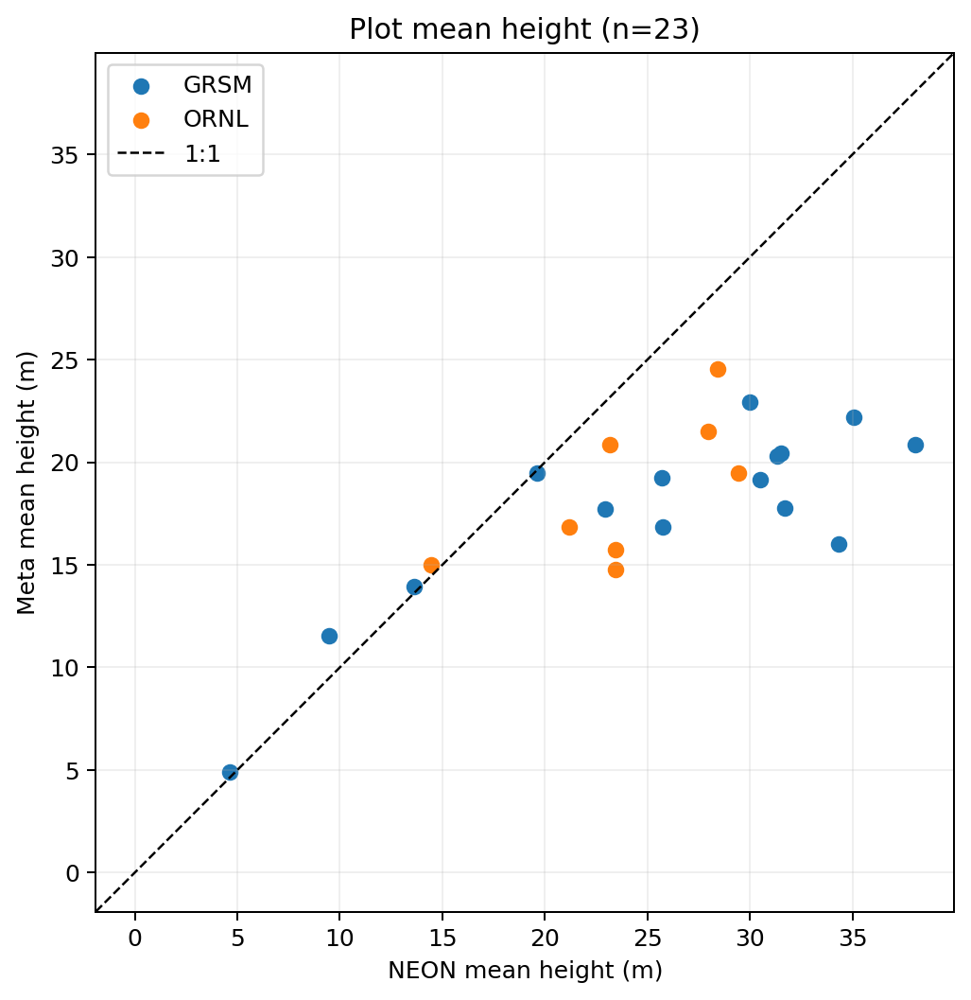
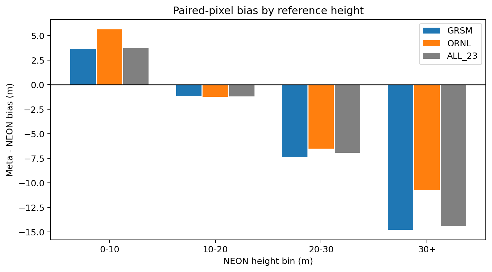
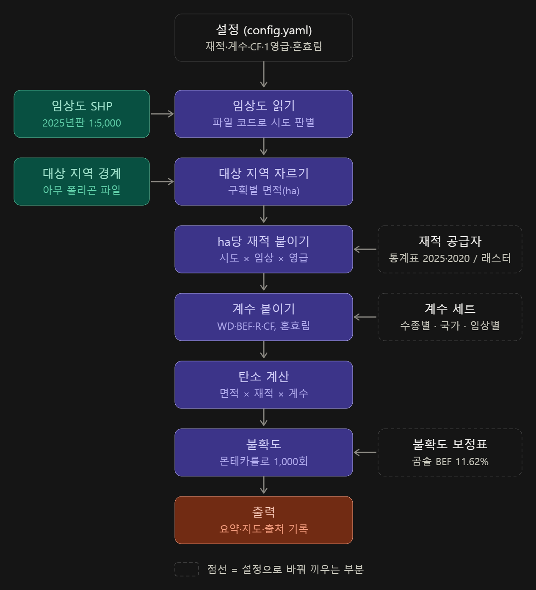
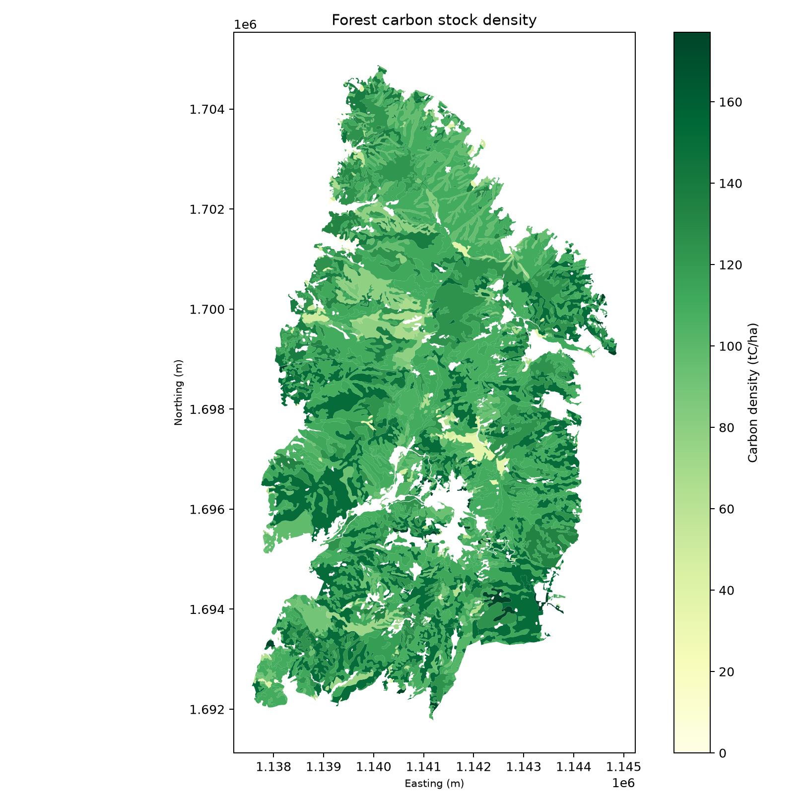

# 이연지

# Meta 높이 지도 검증과 국가기준 탄소 저장량 파이프라인

결론

- Meta 높이 지도는 미국 라이다 대비 20m까지는 잘 맞았지만, 그보다 큰 숲에서는 20~25m에서 멈춰 실제보다 작게 추정했음
- 팀마다 달랐던 계산 기준을 국가 자료 기준으로 통일하고, 국내 어디든 같은 방식으로 저장량을 계산하는 파이프라인을 만들었음. 금정산은 2025년 국가기준으로 약 63.2만 tC였음

---

## 1. 지금까지의 흐름

| 주차 | 한 일 | 결과 |
| --- | --- | --- |
| 4주차 | 금정산 탄소를 야장·임상도·GEDI 세 방법으로 계산 | 방법에 따라 34만~54만 tC |
| 5주차 | 미국 NEON에서 사진으로 나무 찾기 → 탄소 계산 | 실측 기반의 0.68배 |
| 6주차 | 금정산 적용, 해상도 실험, 조사구 평균 높이로 AGB 회귀 | 국내 사진으로는 나무 찾기 어려움. 높이 기반 회귀가 더 나음(RMSE 138 vs 162 Mg/ha) |
| 7주차 | ① Meta 높이를 NEON 라이다와 비교 ② 국가기준 저장량 파이프라인 구축 | 이번 발표 2~3장 |
- 6주차 높이 기반 회귀는 미국 라이다 높이를 썼음. 국내에는 공개 라이다가 없어서 국내에서 쓸 수 있는 높이는 Meta 높이 지도뿐임
- 그래서 Meta 높이가 얼마나 맞는지를 먼저 확인했음 (2장)
- 동시에 팀마다 달랐던 계산 기준을 통일하고, 그 기준대로 계산하는 파이프라인을 만들었음 (3장)

---

## 2. 실험 1

NEON 라이다 vs Meta 높이 지도 (미국)

### 2-1. 목적

- Meta 높이 지도는 위성사진(Maxar)으로 AI가 추정한 1m 높이 지도임
- 금정산에는 비교할 라이다가 없어서, 정답 라이다가 있는 미국 NEON에서 먼저 확인했음
- 질문: Meta 높이는 라이다 대비 얼마나 틀리는가? 그 차이가 6주차 회귀식의 AGB에 얼마나 영향을 주는가?

### 2-2. 방법

- 6주차와 같은 NEON 23개 조사구(GRSM 15, ORNL 8), 2021년 라이다 수관높이(1m)
- Meta v1 (금정산에서 쓴 것과 같은 제품)을 조사구 주변만 원격으로 읽음 (전송량 23MB)
- Meta를 라이다와 같은 1m 격자로 맞춘 뒤, 조사구별 평균 높이·상위 높이(p95)와 픽셀별 높이를 비교
- 6주차 회귀식은 그대로 두고 입력 높이만 라이다 → Meta로 바꿔 AGB 오차를 비교

### 2-3. 결과

**조사구 평균 높이 (Meta − 라이다)**

| 범위 | 편향 | RMSE | 상관 | Meta ÷ 라이다 |
| --- | --- | --- | --- | --- |
| GRSM 15 | −8.1m | 10.2m | 0.83 | 0.69 |
| ORNL 8 | −5.4m | 6.3m | 0.69 | 0.78 |
| **통합 23** | **−7.1m** | **9.1m** | 0.78 | **0.72** |
- 23개 중 19개 조사구에서 Meta가 낮았음. 상위 높이(p95)는 더 낮았음 (편향 −10.1m, 비율 0.67)

**라이다 높이 구간별 편향 (픽셀 1.3만 쌍)**

| 라이다 높이 | 0–10m | 10–20m | 20–30m | 30m 이상 |
| --- | --- | --- | --- | --- |
| Meta 편향 | +3.7m | **−1.2m** | −6.9m | **−14.4m** |

**AGB 영향 (Mg/ha, 6주차 회귀식 그대로)**

| 범위 | 라이다 입력 RMSE | Meta 입력 RMSE | Meta 입력 편향 |
| --- | --- | --- | --- |
| GRSM 15 | 158 | 199 | −126 |
| ORNL 8 | 89 | 61 | +18 |
| **통합 23** | **138** | **165** | **−76** |

### 2-4. 해석

- **20m까지는 잘 맞음** (10–20m 편향 −1.2m). 그보다 큰 숲에서는 Meta 값이 20~25m에서 더 올라가지 않아, 나무가 클수록 더 작게 추정했음
- 10m 이하는 오히려 크게 추정함 → Meta 값이 가운데로 모이는 경향
- 6주차 회귀식에 Meta 높이를 넣으면 AGB를 약 28% 적게 추정했음 (평균비 0.95 → 0.72)
- ORNL이 좋아진 것은 원래 모델의 과대추정(+67)을 Meta의 낮은 높이가 상쇄한 우연임
- Meta 높이로 회귀를 다시 학습해도 통합 RMSE 159로, 라이다(138)보다 나아지지 않았음 (방법 A 162). 조사구가 23개뿐이라 지금 재학습은 의미가 작다고 판단함
- 국내에 주는 의미: 국내 주요 수종 평균 수고는 12~16m(8차 NFI 보고서)이고, 7차 NFI 실측 수고의 95%가 20.3m 이하임 → Meta가 잘 맞은 구간에 해당함. 국내 자료로 직접 확인하는 것은 다음 단계

### 2-5. 한계

- Meta 모델은 NEON 라이다로 학습해서 이 조사구가 학습에 쓰였을 수 있음 → 실제보다 좋게 나왔을 수 있음
- Meta 영상 촬영일 미확인 (라이다는 2021년)
- 미국 동부 활엽수림 23개 조사구의 내부 비교임

---

## 3. 실험 2

국가기준 탄소 저장량 파이프라인 구축 및 테스트

### 3-1. 목적

- 각자 다른 계수·자료(GEDI, CCI, 수종별 계수 등)로 계산해서 결과를 바로 비교하기 어려웠음
- 그래서 국가 기관 자료 기준으로 계산 기준을 통일하는 문서(「국내 산림탄소 산정기준」)를 만들고, 그 기준대로 계산하는 파이프라인을 만들었음

### 3-2. 통일한 기준 (국가 자료 최신판)

| 항목 | 기준 | 출처 |
| --- | --- | --- |
| 산림 면적·임상 | 1:5,000 임상도 2차 현행화판 | 산림청 (2020~2024) |
| ha당 재적 | 시도 × 임상 × 영급 면적·축적 | 2025년 산림기본통계 (산림청, 2026-10 공표, 8차 NFI) |
| 계수 | 수종별 목재기본밀도·확장계수·뿌리함량비 / 국가 인벤토리 2개 임상 계수 | 국립산림과학원 2014 / NID 2025 표 6-9 |
| 탄소전환계수 | IPCC 기본값 (침엽 0.51, 활엽 0.48) | NID 2025 |
| 혼효림 | 재적을 침엽·활엽에 50%씩 배분 | NID 2025 |
| 탄소 풀 | 입목 지상부 + 뿌리만 (고사목·낙엽층·토양 제외) | 국가 인벤토리도 입목만 산정 |
| 국내 검증 기준 | 7차 NFI 표본점 (좌표 약 10m) | 산림청 마이크로데이터 |

### 3-3. 파이프라인 구조

- 임상도 읽기 → 대상 지역 자르기 → ha당 재적 붙이기 → 계수 붙이기 → 탄소 계산 → 불확도 → 출력
- 금정산 전용이 아님. 대상 지역 경계와 그 지역 임상도만 바꾸면 국내 어디든 같은 방식으로 계산함
- 재적 단계는 교체 가능하게 만들었음 (지금은 국가통계표, 나중에 위성·Meta 기반 재적 지도를 같은 자리에 넣어 비교)
- 계수 세트도 설정으로 고름 (수종별 22개 / 국가 인벤토리 2개 임상 / 임상별 3개)

+) 곰솔 BEF 11.62%: 원본 표를 고친 값

- BEF(바이오매스 확장계수)는 줄기 부피에서 가지와 잎까지 포함한 나무 전체 무게로 늘려 주는 계수로, 곰솔은 1.524
- 국립산림과학원 2014 표에는 곰솔 BEF 불확도가 112.782%로 적혀 있었음, 다른 수종은 대부분 3~25%인데 혼자 100%가 넘는 상황
- 이 값을 그대로 쓰면 몬테카를로에서 곰솔 BEF가 0에 가까운 값부터 3이 넘는 값까지 마구 뽑히게 됨, 곰솔은 금정산 탄소의 35%라서, 범위가 45.5만~85.1만 tC로 비정상적으로 넓어짐
- 그런데 국가 인벤토리 보고서(NID 2025 BOX 1)를 보면 곰솔을 포함한 침엽수의 BEF 불확도는 5.97~11.62%, 그래서 112.782%는 11.2782%를 잘못 옮긴 오타로 판단함
- 원본 표는 그대로 두고, 보정표에 "곰솔 BEF 불확도는 11.62%(국가 보고서 범위의 최댓값)로 쓴다"고 따로 적어서 적용했음. 그러자 범위가 60.2만~66.3만 tC로 정상화됨

### 3-4. 테스트 결과

| 시험 | 설정 | 면적 | 탄소 저장량 |
| --- | --- | --- | --- |
| 1. 4주차 재현 | 2020 재적표, CF 0.5 | 5,336ha | 538,727 tC (4주차와 완전히 일치) |
| **2. 2025 국가기준** | 2025 재적표, IPCC CF, 수종별 계수 | 5,336ha | **632,249 tC** (118.5 tC/ha, CO₂ 232만 t) |
| 3. 국가 인벤토리 방식 | 2번 + 2개 임상 계수 + 혼효림 재적 배분 | 5,336ha | 629,697 tC (2번 대비 −0.4%) |
| 4. 금정구 검산 | 경계 없이 금정구 전체 | 3,976ha | 공식 통계 대비 면적 −3.4%, 재적 +2.9% |
- 단위시험 23개 통과
- 2번 불확도(계수 불확도, 5–95%): 60.2만~66.3만 tC (약 ±5%)

**4주차 → 2025 국가기준 차이 분해**

| 바꾼 것 | 탄소 변화 |
| --- | --- |
| 재적표 2020 → 2025 | **+99,138 tC (+18.4%)** |
| 1영급 규칙 (2영급 값 → 0) | −103 tC |
| 탄소전환계수 0.5 → IPCC | −5,512 tC (−0.9%) |
| (참고) 계수 세트만 국가 인벤토리로 | −3,291 tC (−0.5%) |
| (참고) 혼효림 규칙만 재적 배분으로 | +431 tC (+0.07%) |

+) 재적표 관련 설명

| 내용 | 누가 낸 값인가 |
| --- | --- |
| 2020년 ha당 재적 (시도 × 임상 × 영급) | 국가 공식 통계. KOSIS, 산림청 7차 NFI 기반 |
| 2025년 ha당 재적 (시도 × 임상 × 영급) | 국가 공식 통계. 2025년 산림기본통계, 산림청 8차 NFI 기반. 표에 있는 축적(㎥)을 면적(ha)으로 나눈 것만 우리가 함 |
| 부산 축적 +22.9% | 국가 공식 수치로 계산한 값. 부산 총 축적 2020년 6,268,223㎥(KOSIS)와 2025년 7,706,516㎥(산림기본통계)를 그대로 비교함 |
| 금정산 탄소 +18.4% (+99,138 tC) | 우리 파이프라인 계산 결과. 같은 임상도, 같은 계수, 같은 경계에 재적표만 2020 → 2025로 바꿔 넣었을 때 나온 차이 |

금정산 탄소밀도 (2025 국가기준)

### 3-5. 해석

- 결과를 가장 크게 바꾼 것은 어느 해 재적표를 쓰느냐였음 (5년 사이 부산 축적 +22.9%)
- 계수 세트, 혼효림 규칙, 탄소전환계수 선택은 결과를 1% 안팎만 바꿨음
- 금정구 검산에서 총량은 공식 통계와 맞았음 → 같은 방식으로 다른 시군구에도 적용할 수 있음
- 불확도 계산 중 국립산림과학원 2014 표의 곰솔 확장계수 불확도(112.8%)가 오기임을 찾았음. NID 2025의 침엽수 범위 상한(11.62%)으로 바꾸자 범위가 45.5만~85.1만 → 60.2만~66.3만 tC로 정상화됨

### 3-6. 한계

- 금정구 검산에서 임상별로는 크게 다름 (활엽수림 면적 +67%, 혼효림 −35%). 2025 임상도와 산림기본통계의 임상 분류가 달라서임 → 임상별 결과는 주의해서 해석
- 금정산 공식 국립공원 경계 GIS가 공개되지 않아 4주차 자체 경계(5,336ha)를 썼음 (공식 면적 6,686ha)
- 불확도는 계수 불확도만 반영함. 재적·면적 불확도는 미포함
- 저장량만 계산함. 흡수량(1년 동안 늘어난 양)은 다음 단계

#### 3-7. 다음 단계: 7차 NFI로 파이프라인 검증

- 파이프라인은 시도 평균 재적표를 쓰기 때문에 금정산 숲의 실제 재적과 다를 수 있음
- 7차 NFI 마이크로데이터(2016~2020, 표본점 좌표 약 10m)를 확보했음. 표본점은 점 자료라 파이프라인(임상도 구획)과 연결하는 방법이 필요함

| 방법 | 내용 | 기대 효과 |
| --- | --- | --- |
| ① 표본점 검산 | 금정산 주변 표본점(58곳)이 떨어지는 임상도 구획의 파이프라인 재적과 표본점 실측 재적을 비교 | 시도 평균 재적표가 실제 숲과 얼마나 다른지 처음 확인. 바로 가능 |
| ② NFI 재적표 | 7차 표본점으로 시도 × 임상 × 영급 평균 재적표를 만들어 재적 공급자에 넣음 | 가능하지만 KOSIS 2020 표와 거의 같은 값 |
| ③ 재적 지도 | NFI 표본점 재적을 정답으로 위성·Meta 높이 모델을 학습해 재적 래스터를 만들고 래스터 공급자로 넣음 | 구획마다 다른 재적을 반영. 국내 Meta 검증이 먼저 필요 |
- 진행 순서: ① → 국내 Meta 검증 → ③
- NFI 자료는 팀 내부 연구용이라 표본점 위치는 표시하지 않음

---

## 4. 결론과 다음 단계

- Meta 높이는 20m 이하 숲에서는 쓸 만하지만, 큰 숲에서는 작게 추정함. 국내 숲은 대부분 20m 이하라 가능성이 있음
- 국가기준 파이프라인으로 금정산 저장량을 약 63.2만 tC로 계산했고, 4주차 결과 재현과 공식 통계 검산을 통과했음
- 다음 단계
    - 국내 검증: 7차 NFI 표본점(좌표 약 10m)에서 Meta 높이를 실측 수고·재적과 비교 (노트북 준비 완료, 실행 예정)
    - 팀 기본 계수 세트 결정: 국가 인벤토리 세트(공식 통계와 비교) vs 수종별 세트(수종 정보 활용)
    - 흡수량 계산: 같은 파이프라인으로 두 시점 저장량 비교, 지역 공식 흡수량(GIR)과 대조
    - 재적 단계에 Meta·위성 기반 재적 지도를 넣어 국가통계표와 비교