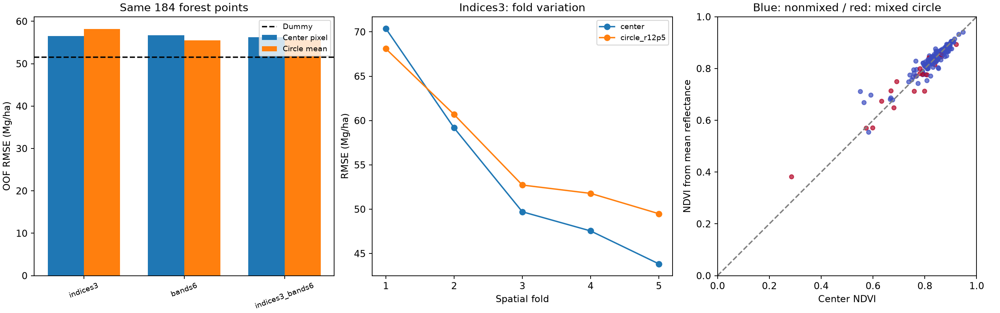

# 중심 픽셀과 반경 12.5m 평균 반사율 비교

## 결과

같은 산림 184점·공간 fold·버퍼·RF 설정을 유지하고 입력 추출 범위만 바꿨다. 원 안의 픽셀과 겹치는 면적으로 반사율을 평균한 뒤 NDVI·EVI·NDMI를 계산했다. 지수 픽셀 자체의 평균과는 다르다.

| model | n | center_rmse | circle_rmse | rmse_delta | rmse_reduction_pct | center_mae | circle_mae | center_r2 | circle_r2 |
| --- | --- | --- | --- | --- | --- | --- | --- | --- | --- |
| indices3 | 184 | 56.5677 | 58.1673 | 1.5996 | -2.8277 | 43.1428 | 46.4740 | -0.2520 | -0.3238 |
| bands6 | 184 | 56.7482 | 55.5126 | -1.2356 | 2.1773 | 43.7432 | 44.5466 | -0.2600 | -0.2057 |
| indices3_bands6 | 184 | 56.2508 | 55.5978 | -0.6530 | 1.1609 | 42.8312 | 44.1415 | -0.2380 | -0.2094 |

| sampling | model | n | rmse | mae | r2 | mean_residual | mean_agbd | mean_prediction |
| --- | --- | --- | --- | --- | --- | --- | --- | --- |
| center | indices3 | 184 | 56.5677 | 43.1428 | -0.2520 | 4.0531 | 73.4709 | 69.4178 |
| center | bands6 | 184 | 56.7482 | 43.7432 | -0.2600 | 4.2604 | 73.4709 | 69.2105 |
| center | indices3_bands6 | 184 | 56.2508 | 42.8312 | -0.2380 | 4.6305 | 73.4709 | 68.8403 |
| circle_r12p5 | indices3 | 184 | 58.1673 | 46.4740 | -0.3238 | 2.2111 | 73.4709 | 71.2598 |
| circle_r12p5 | bands6 | 184 | 55.5126 | 44.5466 | -0.2057 | 1.0332 | 73.4709 | 72.4377 |
| circle_r12p5 | indices3_bands6 | 184 | 55.5978 | 44.1415 | -0.2094 | 1.5544 | 73.4709 | 71.9165 |
| dummy_shared | dummy_mean | 184 | 51.5294 | 41.9981 | -0.0389 | 0.0164 | 73.4709 | 73.4545 |

원 평균 적용 후 밴드6 RMSE는 56.75→55.51(약 2.18% 감소), 지수+밴드는 56.25→55.60(약 1.16% 감소)였다. 지수3은 56.57→58.17로 악화됐다. 세 구성 모두 MAE가 증가하고 Dummy RMSE 51.53보다 나쁘며 R²도 음수다. 따라서 공간 평균이 일부 큰 오차를 줄였더라도 일관된 예측력 개선을 확보했다고 볼 수 없다. 고 AGBD 51점에서 밴드6의 평균 과소 예측은 약 75.19→69.83 Mg/ha로 줄었지만 여전히 크고, 원 평균 적용 후에도 48점이 과소 예측됐다.

delta는 원 평균−중심 픽셀이며 음수가 RMSE 개선이다. Dummy는 같은 산림 학습점 평균을 사용하는 기존 저장 예측을 공유했다. 세 입력군 결과를 모두 보고하며 유리한 반경이나 모델을 탐색하지 않았다.

## 추출 범위·유효성

184점 모두 원 전체에서 여섯 밴드 공통 유효성, SCL 4/5/6, CLASSI opaque/cirrus/snow=0 조건을 만족했다. 최소 공통 유효 면적 비율은 1.000000000000다. 불완전한 원이 있으면 적합을 중단하는 규칙으로 구현했으며 결측 대치·표본 탈락·작은 유효 영역만의 평균으로 대체한 점은 없다. 유효 면적 합산의 작은 부동소수 오차에는 1e-6 허용치를 사용했다.

원은 EPSG:32652에서 반경 12.5m·256선분으로 근사했으며 면적은 이론적 원의 약 0.99989960배다. 평균에 기여한 픽셀 수는 9~13개다. 픽셀 중심 포함 여부가 아닌 실제 면적 중첩을 사용했다. `footprint_pixel_weights.csv`에 모든 가중치·반사율·픽셀 ID를 저장했다.

평균에는 SCL 비식생·수역도 포함하며, 원 내부를 산림만으로 잘라 유리한 입력을 만들지 않았다. 원본 밴드 품질 마스크와 보간 유효성은 기존 GeoTIFF 처리 결과를 재사용했다. B11/B12는 원본 20m를 10m 정렬한 자료이므로 새로운 공간 해상도를 얻은 것이 아니다. 주변의 음수 반사율은 임의 클리핑하지 않았다. 평균 후 계산한 EVI 점검 규칙 해당은 0점이며 값을 삭제·클리핑하지 않았다.

## 입력값 변화

| feature | mean_center | mean_circle | mean_abs_change | max_abs_change |
| --- | --- | --- | --- | --- |
| ndvi | 0.8242 | 0.8247 | 0.0157 | 0.1598 |
| evi | 0.5697 | 0.5701 | 0.0243 | 0.1253 |
| ndmi | 0.3519 | 0.3519 | 0.0177 | 0.0835 |
| reflectance_B02 | 0.0170 | 0.0170 | 0.0024 | 0.0322 |
| reflectance_B03 | 0.0574 | 0.0574 | 0.0036 | 0.0187 |
| reflectance_B04 | 0.0349 | 0.0348 | 0.0031 | 0.0386 |
| reflectance_B08 | 0.3664 | 0.3659 | 0.0150 | 0.0606 |
| reflectance_B11 | 0.1752 | 0.1756 | 0.0029 | 0.0148 |
| reflectance_B12 | 0.0874 | 0.0877 | 0.0018 | 0.0095 |

## fold별 결과

| sampling | model | fold | n | rmse | mae | r2 | mean_residual | mean_agbd | mean_prediction |
| --- | --- | --- | --- | --- | --- | --- | --- | --- | --- |
| center | indices3 | 1 | 39 | 70.3783 | 54.0671 | -0.5547 | 29.0155 | 80.2503 | 51.2348 |
| center | bands6 | 1 | 39 | 68.8306 | 52.6827 | -0.4871 | 28.9383 | 80.2503 | 51.3121 |
| center | indices3_bands6 | 1 | 39 | 71.1633 | 54.2190 | -0.5896 | 31.3278 | 80.2503 | 48.9225 |
| center | indices3 | 2 | 51 | 59.1696 | 45.4800 | -0.1349 | 15.5904 | 84.3245 | 68.7341 |
| center | bands6 | 2 | 51 | 60.2277 | 48.0316 | -0.1759 | 13.7054 | 84.3245 | 70.6190 |
| center | indices3_bands6 | 2 | 51 | 57.6207 | 45.2967 | -0.0763 | 12.6537 | 84.3245 | 71.6708 |
| center | indices3 | 3 | 28 | 49.7101 | 36.5124 | -0.0694 | 9.8854 | 82.1663 | 72.2809 |
| center | bands6 | 3 | 28 | 48.4365 | 36.7327 | -0.0153 | 13.2228 | 82.1663 | 68.9435 |
| center | indices3_bands6 | 3 | 28 | 48.7781 | 36.3323 | -0.0297 | 13.5923 | 82.1663 | 68.5740 |
| center | indices3 | 4 | 62 | 47.5499 | 37.8038 | -0.4817 | -21.3084 | 57.1749 | 78.4833 |
| center | bands6 | 4 | 62 | 49.3826 | 38.6372 | -0.5981 | -21.2088 | 57.1749 | 78.3837 |
| center | indices3_bands6 | 4 | 62 | 47.7530 | 37.1689 | -0.4943 | -20.4740 | 57.1749 | 77.6489 |
| center | indices3 | 5 | 4 | 43.8352 | 35.9967 | -2.2529 | -34.1548 | 60.7075 | 94.8623 |
| center | bands6 | 5 | 4 | 38.3877 | 30.1239 | -1.4947 | -24.7366 | 60.7075 | 85.4440 |
| center | indices3_bands6 | 5 | 4 | 42.9231 | 33.6205 | -2.1190 | -31.5752 | 60.7075 | 92.2827 |
| circle_r12p5 | indices3 | 1 | 39 | 68.0997 | 50.9725 | -0.4557 | 35.7479 | 80.2503 | 44.5024 |
| circle_r12p5 | bands6 | 1 | 39 | 63.6418 | 49.6988 | -0.2713 | 25.2501 | 80.2503 | 55.0002 |
| circle_r12p5 | indices3_bands6 | 1 | 39 | 65.2372 | 50.4931 | -0.3359 | 30.1585 | 80.2503 | 50.0918 |
| circle_r12p5 | indices3 | 2 | 51 | 60.6804 | 49.4388 | -0.1936 | 12.8562 | 84.3245 | 71.4682 |
| circle_r12p5 | bands6 | 2 | 51 | 61.0227 | 51.5011 | -0.2071 | 14.2186 | 84.3245 | 70.1059 |
| circle_r12p5 | indices3_bands6 | 2 | 51 | 59.6153 | 49.6473 | -0.1521 | 13.6048 | 84.3245 | 70.7197 |
| circle_r12p5 | indices3 | 3 | 28 | 52.7245 | 42.0686 | -0.2031 | 10.2535 | 82.1663 | 71.9128 |
| circle_r12p5 | bands6 | 3 | 28 | 50.4104 | 39.4288 | -0.0998 | 13.7214 | 82.1663 | 68.4449 |
| circle_r12p5 | indices3_bands6 | 3 | 28 | 50.1461 | 38.8589 | -0.0883 | 11.9177 | 82.1663 | 70.2486 |
| circle_r12p5 | indices3 | 4 | 62 | 51.7849 | 43.5992 | -0.7573 | -28.5629 | 57.1749 | 85.7378 |
| circle_r12p5 | bands6 | 4 | 62 | 47.5272 | 38.5413 | -0.4802 | -28.6008 | 57.1749 | 85.7757 |
| circle_r12p5 | indices3_bands6 | 4 | 62 | 47.7623 | 38.3071 | -0.4949 | -28.3873 | 57.1749 | 85.5622 |
| circle_r12p5 | indices3 | 5 | 4 | 49.4927 | 40.2092 | -3.1468 | -39.7986 | 60.7075 | 100.5060 |
| circle_r12p5 | bands6 | 5 | 4 | 44.5779 | 34.5502 | -2.3641 | -32.6874 | 60.7075 | 93.3948 |
| circle_r12p5 | indices3_bands6 | 5 | 4 | 49.2061 | 39.4267 | -3.0989 | -39.4267 | 60.7075 | 100.1342 |
| dummy_shared | dummy_mean | 1 | 39 | 57.0949 | 47.0634 | -0.0232 | 8.6029 | 80.2503 | 71.6474 |
| dummy_shared | dummy_mean | 2 | 51 | 57.4402 | 46.3758 | -0.0696 | 14.6478 | 84.3245 | 69.6766 |
| dummy_shared | dummy_mean | 3 | 28 | 49.1514 | 38.6939 | -0.0455 | 10.2562 | 82.1663 | 71.9101 |
| dummy_shared | dummy_mean | 4 | 62 | 44.4468 | 37.8838 | -0.2946 | -21.2020 | 57.1749 | 78.3769 |
| dummy_shared | dummy_mean | 5 | 4 | 27.5850 | 23.6949 | -0.2882 | -13.0470 | 60.7075 | 73.7545 |

분할은 원래 산림 평가의 39·51·28·62·4점을 유지했다. fold5는 4점뿐이므로 특히 불안정하다. 기존 buffer_excluded 역할을 복원하거나 재배정하지 않았으며 학습/평가 최소 거리는 500m 이상이다. 전체 지표는 184점 OOF 예측에서 직접 계산했다.

## 고 AGBD와 주변 혼합 진단

| sampling | model | scope | n | rmse | mae | r2 | mean_residual | mean_agbd | mean_prediction | underprediction_n |
| --- | --- | --- | --- | --- | --- | --- | --- | --- | --- | --- |
| center | indices3 | agbd_ge100 | 51 | 86.6834 | 76.6419 | -5.6612 | 76.2049 | 140.7761 | 64.5712 | 50 |
| center | indices3 | mixed_circle | 22 | 58.2912 | 43.1411 | -0.1753 | -7.8334 | 61.6659 | 69.4993 | 6 |
| center | indices3 | nonmixed_circle | 162 | 56.3296 | 43.1430 | -0.2749 | 5.6673 | 75.0740 | 69.4067 | 73 |
| center | bands6 | agbd_ge100 | 51 | 86.0182 | 75.8166 | -5.5593 | 75.1867 | 140.7761 | 65.5894 | 50 |
| center | bands6 | mixed_circle | 22 | 51.6863 | 39.1168 | 0.0759 | -4.6734 | 61.6659 | 66.3393 | 7 |
| center | bands6 | nonmixed_circle | 162 | 57.4012 | 44.3715 | -0.3239 | 5.4736 | 75.0740 | 69.6004 | 77 |
| center | indices3_bands6 | agbd_ge100 | 51 | 86.3529 | 75.9098 | -5.6105 | 75.2778 | 140.7761 | 65.4982 | 50 |
| center | indices3_bands6 | mixed_circle | 22 | 52.0594 | 38.5288 | 0.0626 | -4.2675 | 61.6659 | 65.9334 | 7 |
| center | indices3_bands6 | nonmixed_circle | 162 | 56.7961 | 43.4154 | -0.2961 | 5.8389 | 75.0740 | 69.2351 | 75 |
| circle_r12p5 | indices3 | agbd_ge100 | 51 | 86.2060 | 76.5016 | -5.5880 | 76.2127 | 140.7761 | 64.5634 | 50 |
| circle_r12p5 | indices3 | mixed_circle | 22 | 57.0874 | 45.7373 | -0.1273 | -9.3504 | 61.6659 | 71.0164 | 7 |
| circle_r12p5 | indices3 | nonmixed_circle | 162 | 58.3124 | 46.5740 | -0.3662 | 3.7812 | 75.0740 | 71.2928 | 76 |
| circle_r12p5 | bands6 | agbd_ge100 | 51 | 80.7969 | 70.9725 | -4.7872 | 69.8310 | 140.7761 | 70.9451 | 48 |
| circle_r12p5 | bands6 | mixed_circle | 22 | 50.8133 | 40.4981 | 0.1069 | -5.2512 | 61.6659 | 66.9171 | 7 |
| circle_r12p5 | bands6 | nonmixed_circle | 162 | 56.1205 | 45.0964 | -0.2654 | 1.8866 | 75.0740 | 73.1874 | 69 |
| circle_r12p5 | indices3_bands6 | agbd_ge100 | 51 | 81.6452 | 71.3415 | -4.9094 | 70.8969 | 140.7761 | 69.8792 | 49 |
| circle_r12p5 | indices3_bands6 | mixed_circle | 22 | 48.0914 | 37.6779 | 0.2000 | -4.6427 | 61.6659 | 66.3087 | 7 |
| circle_r12p5 | indices3_bands6 | nonmixed_circle | 162 | 56.5403 | 45.0193 | -0.2844 | 2.3959 | 75.0740 | 72.6780 | 68 |
| dummy_shared | dummy_mean | agbd_ge100 | 51 | 76.7098 | 68.5903 | -4.2165 | 68.5903 | 140.7761 | 72.1858 | 51 |
| dummy_shared | dummy_mean | mixed_circle | 22 | 55.9178 | 43.7018 | -0.0816 | -11.7610 | 61.6659 | 73.4269 | 6 |
| dummy_shared | dummy_mean | nonmixed_circle | 162 | 50.9043 | 41.7667 | -0.0411 | 1.6158 | 75.0740 | 73.4582 | 73 |

고 AGBD 51점·혼합 22점·비혼합 162점은 기존 분류를 유지한 사후 진단 집단이다. 혼합 여부는 앞선 EGIS 분석의 EPSG:5186 원으로 정한 값이며 이번 반사율 원은 EPSG:32652에 정의했다. 두 투영좌표계의 미세한 축척 차이와 지도 일반화 한계가 있다. 집단별 결과를 별도 재학습 성능이나 인과 효과로 해석하지 않는다.

## 시각화



## 검증과 한계

중심 픽셀 RF 15개를 다시 적합해 기존 산림 전용 예측을 점별로 재현했다. 최대 예측 차이는 0다. 원 평균 RF 15회·fold1 지수 RF 재현 1회를 포함해 총 31회 RF를 적합했다. 평균 Dummy는 재학습하지 않았다. 모든 입력군의 평가 ID·fold가 동일하며 각 점은 한 번만 평가된다. 파라미터·버전·입력 해시는 footprint_config.json, 결과 검증은 footprint_validation.json에 기록했다.

이 원은 GEDI의 실제 footprint 모양·에너지 분포·좌표 오차를 복원한 것이 아니라 공간 범위 차이를 점검하기 위한 근사다. 원 평균이 좋아져도 공간 불일치가 유일한 원인이었다고 결론 내리지 않는다. 동일 날짜·궤도·이미 사용한 CV의 탐색 비교이며 독립 최종 일반화 검증은 아니다. EGIS 산림 분류도 현장 실측 검증을 대체하지 않는다.

## 재현

`verify_footprint.py`로 저장된 픽셀 가중치에서 184점의 평균 반사율·지수를 다시 계산했다. 별도의 실제 원 방정식 수치 적분으로 결정적 간격 표본 21점·232개 픽셀 면적을 대조했으며, 256선분 원 근사와의 최대 픽셀 면적 차이는 0.0090m²였다. 결과는 `footprint_independent_verification.json`에 있다.

```powershell
& .\week04\.venv\Scripts\python.exe .\week07\landcover\compare_footprint.py --output-dir .\week07\landcover\footprint_reproduction
```
