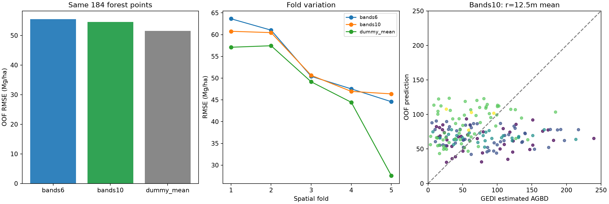

# 기존 SAFE red-edge 추가 비교 — 밴드 6개 vs 10개

## 결과

기존 B02·B03·B04·B08·B11·B12의 반경 12.5m 평균 반사율에 B05·B06·B07·B8A를 추가했다. 같은 산림 184점, 같은 공간 fold·버퍼·RF 설정을 유지했다. 밴드10의 RMSE는 **54.5469 Mg/ha**, 밴드6 대비 변화는 **-0.9657 Mg/ha (1.74% 감소)**다. MAE 변화는 **-0.5213 Mg/ha**다. 산림 학습 평균 Dummy보다 RMSE가 높아, 이번 입력 확장으로도 기준 모델을 넘지 못했다.

| model | n | rmse | mae | r2 | mean_residual | mean_agbd | mean_prediction |
| --- | --- | --- | --- | --- | --- | --- | --- |
| bands6 | 184 | 55.5126 | 44.5466 | -0.2057 | 1.0332 | 73.4709 | 72.4377 |
| bands10 | 184 | 54.5469 | 44.0254 | -0.1641 | 0.4246 | 73.4709 | 73.0462 |
| dummy_mean | 184 | 51.5294 | 41.9981 | -0.0389 | 0.0164 | 73.4709 | 73.4545 |

## 원본 처리와 품질

| band | original_resolution_m | offset | quantification | native_crop_rows | native_crop_cols | native_invalid_n | footprint_invalid_aligned_pixel_n | minimum_footprint_valid_fraction | minimum_footprint_reflectance | maximum_footprint_reflectance |
| --- | --- | --- | --- | --- | --- | --- | --- | --- | --- | --- |
| B05 | 20 | -1000.0000 | 10000.0000 | 1297 | 1171 | 5 | 0 | 1.0000 | 0.0836 | 0.1986 |
| B06 | 20 | -1000.0000 | 10000.0000 | 1297 | 1171 | 5 | 0 | 1.0000 | 0.2339 | 0.4905 |
| B07 | 20 | -1000.0000 | 10000.0000 | 1297 | 1171 | 8 | 0 | 1.0000 | 0.2606 | 0.5526 |
| B8A | 20 | -1000.0000 | 10000.0000 | 1297 | 1171 | 29 | 0 | 1.0000 | 0.2849 | 0.5703 |

새 밴드는 모두 원본 20m다. 제품 XML의 밴드별 BOA_ADD_OFFSET과 BOA_QUANTIFICATION_VALUE로 `(DN+offset)/quantification`을 적용했다. MSK_QUALIT 8개 층이 모두 0이고 검출기 ID가 1~12이며 DN이 NoData·포화가 아닌 픽셀만 사용했다. 보정·품질 마스크 후 기존 처리 함수로 bilinear 10m 정렬하고 보간 기여 원본 픽셀이 전부 유효한 경우만 인정했다. 10m 정렬은 실제 해상도를 높이지 않는다.

기존 원형 면적 가중치와 기존 6개 밴드의 공통 유효 영역(SCL 4/5/6, CLASSI clear)을 그대로 재사용했다. 184점 모두 신규 네 밴드에서도 원 전체 유효성을 만족했다. 결측 대치·점 삭제·산림 피복만 잘라 평균내기·추가 지수 생성은 하지 않았다. `rededge_pixel_values.csv`와 `rededge_coverage_audit.csv`에 근거를 저장했다. 새로운 외부 자료 다운로드는 없었다.

## 고정 비교 설계

RF는 n_estimators=100, max_depth=6, min_samples_leaf=3, max_features=0.67, random_state=42, n_jobs=1이다. max_features가 비율이므로 후보 변수 수는 6개 입력에서 4개, 10개 입력에서 6개로 달라진다. 추가 밴드와 후보 수 증가의 효과를 분리한 인과 실험은 아니다. 반경·파라미터·입력 조합을 성능에 맞춰 탐색하지 않았다.

| fold | train_n | test_n | original_buffer_excluded_n | minimum_distance_m |
| --- | --- | --- | --- | --- |
| 1 | 145 | 39 | 0 | 9377.3042 |
| 2 | 121 | 51 | 12 | 513.4145 |
| 3 | 156 | 28 | 0 | 1548.8350 |
| 4 | 105 | 62 | 17 | 513.6963 |
| 5 | 180 | 4 | 0 | 7488.7997 |

모든 점은 한 번 평가됐고 평가 ID·fold가 세 모델에서 동일하다. 기존 buffer_excluded 역할을 유지하고 제외점을 복원하지 않았다. 학습·평가 블록은 겹치지 않으며 최소 거리는 500m 이상이다. fold5는 4점뿐이어서 특히 불안정하다. 전체 점수는 pooled OOF 예측에서 계산했다.

## fold별 성능

| model | fold | n | rmse | mae | r2 | mean_residual | mean_agbd | mean_prediction |
| --- | --- | --- | --- | --- | --- | --- | --- | --- |
| bands6 | 1 | 39 | 63.6418 | 49.6988 | -0.2713 | 25.2501 | 80.2503 | 55.0002 |
| bands10 | 1 | 39 | 60.7622 | 48.3803 | -0.1589 | 16.7460 | 80.2503 | 63.5043 |
| bands6 | 2 | 51 | 61.0227 | 51.5011 | -0.2071 | 14.2186 | 84.3245 | 70.1059 |
| bands10 | 2 | 51 | 60.4602 | 50.5574 | -0.1850 | 16.5726 | 84.3245 | 67.7519 |
| bands6 | 3 | 28 | 50.4104 | 39.4288 | -0.0998 | 13.7214 | 82.1663 | 68.4449 |
| bands10 | 3 | 28 | 50.6433 | 40.0012 | -0.1100 | 14.7513 | 82.1663 | 67.4150 |
| bands6 | 4 | 62 | 47.5272 | 38.5413 | -0.4802 | -28.6008 | 57.1749 | 85.7757 |
| bands10 | 4 | 62 | 46.9443 | 38.2045 | -0.4442 | -27.2018 | 57.1749 | 84.3766 |
| bands6 | 5 | 4 | 44.5779 | 34.5502 | -2.3641 | -32.6874 | 60.7075 | 93.3948 |
| bands10 | 5 | 4 | 46.3768 | 36.6741 | -2.6411 | -36.6741 | 60.7075 | 97.3816 |
| dummy_mean | 1 | 39 | 57.0949 | 47.0634 | -0.0232 | 8.6029 | 80.2503 | 71.6474 |
| dummy_mean | 2 | 51 | 57.4402 | 46.3758 | -0.0696 | 14.6478 | 84.3245 | 69.6766 |
| dummy_mean | 3 | 28 | 49.1514 | 38.6939 | -0.0455 | 10.2562 | 82.1663 | 71.9101 |
| dummy_mean | 4 | 62 | 44.4468 | 37.8838 | -0.2946 | -21.2020 | 57.1749 | 78.3769 |
| dummy_mean | 5 | 4 | 27.5850 | 23.6949 | -0.2882 | -13.0470 | 60.7075 | 73.7545 |

밴드10의 RMSE가 밴드6보다 낮은 fold는 **3/5**개다. Dummy보다 낮은 fold는 **0/5**개다. 기술적 편차를 보는 값이며 독립 반복 검정이나 유의성을 의미하지 않는다.

## 고 AGBD와 주변 혼합 표본

| model | scope | n | rmse | mae | r2 | mean_residual | mean_agbd | mean_prediction | underprediction_n |
| --- | --- | --- | --- | --- | --- | --- | --- | --- | --- |
| bands6 | agbd_ge100 | 51 | 80.7969 | 70.9725 | -4.7872 | 69.8310 | 140.7761 | 70.9451 | 48 |
| bands6 | mixed_circle | 22 | 50.8133 | 40.4981 | 0.1069 | -5.2512 | 61.6659 | 66.9171 | 7 |
| bands6 | nonmixed_circle | 162 | 56.1205 | 45.0964 | -0.2654 | 1.8866 | 75.0740 | 73.1874 | 69 |
| bands10 | agbd_ge100 | 51 | 78.7545 | 69.4343 | -4.4983 | 68.1071 | 140.7761 | 72.6690 | 48 |
| bands10 | mixed_circle | 22 | 53.3446 | 43.0124 | 0.0157 | -6.4563 | 61.6659 | 68.1222 | 7 |
| bands10 | nonmixed_circle | 162 | 54.7081 | 44.1629 | -0.2026 | 1.3591 | 75.0740 | 73.7149 | 69 |
| dummy_mean | agbd_ge100 | 51 | 76.7098 | 68.5903 | -4.2165 | 68.5903 | 140.7761 | 72.1858 | 51 |
| dummy_mean | mixed_circle | 22 | 55.9178 | 43.7018 | -0.0816 | -11.7610 | 61.6659 | 73.4269 | 6 |
| dummy_mean | nonmixed_circle | 162 | 50.9043 | 41.7667 | -0.0411 | 1.6158 | 75.0740 | 73.4582 | 73 |

고 AGBD 51점·혼합 22점·비혼합 162점은 같은 ID로 고정했다. 이 부분집합 지표는 별도 집합만으로 재학습한 결과가 아니다.

고 AGBD 표본에서 밴드10의 평균 과소 예측은 약 68.11 Mg/ha로, 밴드6의 약 69.83보다 줄었지만 51점 중 48점이 여전히 과소 예측됐다. 입력 확장의 작은 개선을 고 AGBD 예측 문제 해결로 해석하지 않는다.

## AGBD 구간별 결과

| model | agbd_bin | n | rmse | mae | r2 | mean_residual | mean_agbd | mean_prediction |
| --- | --- | --- | --- | --- | --- | --- | --- | --- |
| bands6 | [0.0, 50.0) | 71 | 51.0732 | 43.9429 | -16.0542 | -43.7961 | 26.5283 | 70.3244 |
| bands6 | [50.0, 100.0) | 62 | 28.0802 | 23.5006 | -2.4319 | -4.2219 | 71.8636 | 76.0855 |
| bands6 | [100.0, 150.0) | 34 | 56.0308 | 50.2035 | -17.1301 | 48.4913 | 120.6072 | 72.1159 |
| bands6 | [150.0, 200.0) | 14 | 106.7070 | 104.8983 | -49.1099 | 104.8983 | 172.0114 | 67.1131 |
| bands6 | [200.0, inf) | 3 | 149.2029 | 148.0338 | -167.7234 | 148.0338 | 223.5919 | 75.5581 |
| bands10 | [0.0, 50.0) | 71 | 51.0771 | 45.0038 | -16.0568 | -44.9784 | 26.5283 | 71.5068 |
| bands10 | [50.0, 100.0) | 62 | 27.2152 | 22.0041 | -2.2237 | -3.2559 | 71.8636 | 75.1195 |
| bands10 | [100.0, 150.0) | 34 | 54.1757 | 49.4467 | -15.9494 | 47.4560 | 120.6072 | 73.1512 |
| bands10 | [150.0, 200.0) | 14 | 101.4842 | 99.7280 | -44.3247 | 99.7280 | 172.0114 | 72.2834 |
| bands10 | [200.0, inf) | 3 | 155.2838 | 154.5889 | -181.7566 | 154.5889 | 223.5919 | 69.0030 |
| dummy_mean | [0.0, 50.0) | 71 | 49.3834 | 47.6128 | -14.9444 | -47.6128 | 26.5283 | 74.1412 |
| dummy_mean | [50.0, 100.0) | 62 | 15.7180 | 13.6940 | -0.0753 | -1.8481 | 71.8636 | 73.7118 |
| dummy_mean | [100.0, 150.0) | 34 | 49.9159 | 47.9676 | -13.3888 | 47.9676 | 120.6072 | 72.6396 |
| dummy_mean | [150.0, 200.0) | 14 | 101.8504 | 100.6904 | -44.6524 | 100.6904 | 172.0114 | 71.3210 |
| dummy_mean | [200.0, inf) | 3 | 152.9281 | 152.5138 | -176.2538 | 152.5138 | 223.5919 | 71.0781 |

## 그림



## 검증과 해석

기존 밴드6 원 평균 RF를 재적합해 점별 저장 예측을 재현했으며 최대 차이는 0이다. 신규 밴드10 fold1 재실행 차이는 0이다. RF 10회+재현 1회 총 11회 적합했고 Dummy는 동일 저장 예측을 재사용했다. 새 밴드 평균을 픽셀 가중치에서 다시 계산하고 저장 예측에서 지표를 독립 재계산했다. 원본·기존 결과의 입력 해시는 보존됐다.

같은 날짜·궤도에 대한 이미 여러 번 확인한 공간 CV의 탐색 비교다. 독립 최종 일반화 성능으로 보고하지 않는다. EGIS 산림 분류·지도 시점·중분류 경계와 GEDI 추정 AGBD의 한계가 남는다. 반경 12.5m 원형 평균은 실제 footprint·에너지 가중치·위치 오차를 정확히 복원하지 않는다. 이번 결과로 밴드별 인과 기여나 지수 포화를 확정하지 않는다.

이번 비교 결과까지 week07의 입력 개선 실험으로 정리한다. 기준 모델을 넘지 못한다면 같은 CV에서 조합과 튜닝을 계속 늘리기보다 독립 관측일·궤도 확보와 학습 표본의 대표성을 다음 연구 과제로 삼는다.

## 재현

별도 `verify_rededge.py`에서 GDAL warp나 기존 처리 함수를 사용하지 않고 원본 20m 픽셀 4개의 보간 가중치를 직접 계산했다. 새 밴드별 2,036개 표본 픽셀과 모든 원형 평균이 일치했으며 최대 반사율 차이는 약 2.98e-8이었다. 보간에 기여한 원본 픽셀의 8층 품질 플래그·검출기·DN 유효성도 모두 확인했다. 결과는 `rededge_independent_verification.json`에 저장했다.

```powershell
& .\week04\.venv\Scripts\python.exe .\week07\landcover\compare_rededge.py --output-dir .\week07\landcover\rededge_reproduction
```
