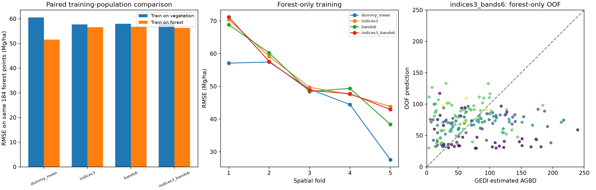

# EGIS 산림 184점 공간 교차검증

## 결과

중심점이 EGIS 산림 코드 310·320·330에 속한 **184점만 학습·평가**했다. 동일 RF 설정과 기존 fold를 유지했다. RF 중 pooled OOF RMSE 최저는 `indices3_bands6` **56.2508 Mg/ha**, R² **-0.2380**다. 산림 학습 평균 Dummy의 RMSE는 **51.5294 Mg/ha**다.

| training_population | model | n | rmse | mae | r2 | mean_residual | mean_agbd | mean_prediction |
| --- | --- | --- | --- | --- | --- | --- | --- | --- |
| forest184 | dummy_mean | 184 | 51.5294 | 41.9981 | -0.0389 | 0.0164 | 73.4709 | 73.4545 |
| forest184 | indices3 | 184 | 56.5677 | 43.1428 | -0.2520 | 4.0531 | 73.4709 | 69.4178 |
| forest184 | bands6 | 184 | 56.7482 | 43.7432 | -0.2600 | 4.2604 | 73.4709 | 69.2105 |
| forest184 | indices3_bands6 | 184 | 56.2508 | 42.8312 | -0.2380 | 4.6305 | 73.4709 | 68.8403 |

산림 전용 RF의 RMSE는 기존 동일 산림 평가점 대비 약 1.09~1.99 Mg/ha 낮아졌지만, 세 RF 모두 산림 학습 평균 Dummy보다 나쁘다. Dummy도 학습 대상의 평균이 산림 구성에 맞춰지면서 약 9.00 Mg/ha 개선됐다. 산림으로 범위를 정리한 것은 타당한 연구 대상 정의지만, 현재 지수·밴드와 RF가 산림 내 AGBD 변동을 유용하게 예측한다고 결론 내릴 수 없다. 세 RF의 전체 R²는 모두 음수다.

## 같은 산림 184점에서 기존 모델과 비교

| model | n | old_rmse | forest_rmse | rmse_delta | old_mae | forest_mae | old_r2 | forest_r2 |
| --- | --- | --- | --- | --- | --- | --- | --- | --- |
| dummy_mean | 184 | 60.5339 | 51.5294 | -9.0045 | 44.5926 | 41.9981 | -0.4337 | -0.0389 |
| indices3 | 184 | 57.6626 | 56.5677 | -1.0949 | 43.2676 | 43.1428 | -0.3009 | -0.2520 |
| bands6 | 184 | 57.9839 | 56.7482 | -1.2357 | 43.4857 | 43.7432 | -0.3155 | -0.2600 |
| indices3_bands6 | 184 | 58.2379 | 56.2508 | -1.9871 | 43.3494 | 42.8312 | -0.3270 | -0.2380 |

`old_*`는 441점 식생 후보를 대상으로 학습한 기존 모델의 저장 예측 중 동일한 산림 184점만 추린 값이다. `forest_*`는 산림 학습점만으로 재학습한 결과다. delta는 산림 재학습−기존이며 음수가 RMSE 개선이다. 두 조건은 fold별 평가 ID·AGBD가 정확히 같으며 학습 표본 구성이 다르다. 기존 전체 441점 점수와 직접 개선률을 계산하지 않았다. EVI 이상점은 피복 분류상 비산림이어서 제외됐으며 이 변화도 학습 구성 차이에 포함된다.

## 표본과 고정 분할

| fold | train_n | test_n | original_buffer_excluded_n | minimum_train_test_distance_m | train_ge100_n | test_ge100_n | train_mean_agbd | test_mean_agbd | test_mixed_circle_n |
| --- | --- | --- | --- | --- | --- | --- | --- | --- | --- |
| 1 | 145 | 39 | 0 | 9377.3042 | 36 | 15 | 71.6474 | 80.2503 | 1 |
| 2 | 121 | 51 | 12 | 513.4145 | 31 | 18 | 69.6766 | 84.3245 | 11 |
| 3 | 156 | 28 | 0 | 1548.8350 | 42 | 9 | 71.9101 | 82.1663 | 1 |
| 4 | 105 | 62 | 17 | 513.6963 | 33 | 9 | 78.3769 | 57.1749 | 9 |
| 5 | 180 | 4 | 0 | 7488.7997 | 51 | 0 | 73.7545 | 60.7075 | 0 |

원래 441점의 공간 5-fold·5km 격자·500m 버퍼 역할에서 산림 ID만 남겼다. 기존 buffer_excluded를 복원하거나 재분할하지 않았다. 따라서 비산림 평가점이 빠져 새 산림 평가점에서 멀어진 제외점도 그대로 제외될 수 있다. 모든 산림점이 한 번씩 평가되고 학습·평가 블록이 겹치지 않으며 최소 거리는 500m 이상이다.

평가점 수는 fold별 39·51·28·62·4점으로 크게 다르다. 특히 fold5는 4점뿐이고 고 AGBD 점이 없어 지표가 불안정하며 다른 fold와 동등한 독립 반복으로 취급하지 않는다. 성능을 보고 유리하게 재분할하지 않았다. 전체 OOF 지표는 184점에서 직접 계산했다.

산림 중심점 184점 중 주변 반경 12.5m 원에 비산림도 포함된 22점은 주평가에 유지했다. 주변 피복을 보고 유리한 표본만 선택하지 않았고 아래에 진단 집계만 남겼다. 이 원은 실제 GEDI footprint나 위치 불확실성을 정확히 복원하지 않는다.

## fold별 성능

| training_population | model | fold | n | rmse | mae | r2 | mean_residual | mean_agbd | mean_prediction |
| --- | --- | --- | --- | --- | --- | --- | --- | --- | --- |
| forest184 | dummy_mean | 1 | 39 | 57.0949 | 47.0634 | -0.0232 | 8.6029 | 80.2503 | 71.6474 |
| forest184 | indices3 | 1 | 39 | 70.3783 | 54.0671 | -0.5547 | 29.0155 | 80.2503 | 51.2348 |
| forest184 | bands6 | 1 | 39 | 68.8306 | 52.6827 | -0.4871 | 28.9383 | 80.2503 | 51.3121 |
| forest184 | indices3_bands6 | 1 | 39 | 71.1633 | 54.2190 | -0.5896 | 31.3278 | 80.2503 | 48.9225 |
| forest184 | dummy_mean | 2 | 51 | 57.4402 | 46.3758 | -0.0696 | 14.6478 | 84.3245 | 69.6766 |
| forest184 | indices3 | 2 | 51 | 59.1696 | 45.4800 | -0.1349 | 15.5904 | 84.3245 | 68.7341 |
| forest184 | bands6 | 2 | 51 | 60.2277 | 48.0316 | -0.1759 | 13.7054 | 84.3245 | 70.6190 |
| forest184 | indices3_bands6 | 2 | 51 | 57.6207 | 45.2967 | -0.0763 | 12.6537 | 84.3245 | 71.6708 |
| forest184 | dummy_mean | 3 | 28 | 49.1514 | 38.6939 | -0.0455 | 10.2562 | 82.1663 | 71.9101 |
| forest184 | indices3 | 3 | 28 | 49.7101 | 36.5124 | -0.0694 | 9.8854 | 82.1663 | 72.2809 |
| forest184 | bands6 | 3 | 28 | 48.4365 | 36.7327 | -0.0153 | 13.2228 | 82.1663 | 68.9435 |
| forest184 | indices3_bands6 | 3 | 28 | 48.7781 | 36.3323 | -0.0297 | 13.5923 | 82.1663 | 68.5740 |
| forest184 | dummy_mean | 4 | 62 | 44.4468 | 37.8838 | -0.2946 | -21.2020 | 57.1749 | 78.3769 |
| forest184 | indices3 | 4 | 62 | 47.5499 | 37.8038 | -0.4817 | -21.3084 | 57.1749 | 78.4833 |
| forest184 | bands6 | 4 | 62 | 49.3826 | 38.6372 | -0.5981 | -21.2088 | 57.1749 | 78.3837 |
| forest184 | indices3_bands6 | 4 | 62 | 47.7530 | 37.1689 | -0.4943 | -20.4740 | 57.1749 | 77.6489 |
| forest184 | dummy_mean | 5 | 4 | 27.5850 | 23.6949 | -0.2882 | -13.0470 | 60.7075 | 73.7545 |
| forest184 | indices3 | 5 | 4 | 43.8352 | 35.9967 | -2.2529 | -34.1548 | 60.7075 | 94.8623 |
| forest184 | bands6 | 5 | 4 | 38.3877 | 30.1239 | -1.4947 | -24.7366 | 60.7075 | 85.4440 |
| forest184 | indices3_bands6 | 5 | 4 | 42.9231 | 33.6205 | -2.1190 | -31.5752 | 60.7075 | 92.2827 |

Dummy 대비 RF RMSE 개선 fold 수: {'indices3': 0, 'bands6': 1, 'indices3_bands6': 1}. fold는 독립 반복이 아니며 편차와 음의 R²를 함께 해석해야 한다.

## 고 AGBD와 주변 혼합 표본

| training_population | model | scope | n | rmse | mae | r2 | mean_residual | mean_agbd | mean_prediction | underprediction_n |
| --- | --- | --- | --- | --- | --- | --- | --- | --- | --- | --- |
| forest184 | dummy_mean | agbd_ge100 | 51 | 76.7098 | 68.5903 | -4.2165 | 68.5903 | 140.7761 | 72.1858 | 51 |
| forest184 | dummy_mean | mixed_circle | 22 | 55.9178 | 43.7018 | -0.0816 | -11.7610 | 61.6659 | 73.4269 | 6 |
| forest184 | dummy_mean | nonmixed_circle | 162 | 50.9043 | 41.7667 | -0.0411 | 1.6158 | 75.0740 | 73.4582 | 73 |
| forest184 | indices3 | agbd_ge100 | 51 | 86.6834 | 76.6419 | -5.6612 | 76.2049 | 140.7761 | 64.5712 | 50 |
| forest184 | indices3 | mixed_circle | 22 | 58.2912 | 43.1411 | -0.1753 | -7.8334 | 61.6659 | 69.4993 | 6 |
| forest184 | indices3 | nonmixed_circle | 162 | 56.3296 | 43.1430 | -0.2749 | 5.6673 | 75.0740 | 69.4067 | 73 |
| forest184 | bands6 | agbd_ge100 | 51 | 86.0182 | 75.8166 | -5.5593 | 75.1867 | 140.7761 | 65.5894 | 50 |
| forest184 | bands6 | mixed_circle | 22 | 51.6863 | 39.1168 | 0.0759 | -4.6734 | 61.6659 | 66.3393 | 7 |
| forest184 | bands6 | nonmixed_circle | 162 | 57.4012 | 44.3715 | -0.3239 | 5.4736 | 75.0740 | 69.6004 | 77 |
| forest184 | indices3_bands6 | agbd_ge100 | 51 | 86.3529 | 75.9098 | -5.6105 | 75.2778 | 140.7761 | 65.4982 | 50 |
| forest184 | indices3_bands6 | mixed_circle | 22 | 52.0594 | 38.5288 | 0.0626 | -4.2675 | 61.6659 | 65.9334 | 7 |
| forest184 | indices3_bands6 | nonmixed_circle | 162 | 56.7961 | 43.4154 | -0.2961 | 5.8389 | 75.0740 | 69.2351 | 75 |
| vegetation441 | indices3 | agbd_ge100 | 51 | 94.9060 | 86.2288 | -6.9848 | 86.2288 | 140.7761 | 54.5472 | 51 |
| vegetation441 | indices3 | mixed_circle | 22 | 59.4501 | 39.3935 | -0.2225 | 19.7674 | 61.6659 | 41.8985 | 14 |
| vegetation441 | indices3 | nonmixed_circle | 162 | 57.4156 | 43.7938 | -0.3245 | 14.5393 | 75.0740 | 60.5347 | 90 |
| vegetation441 | bands6 | agbd_ge100 | 51 | 95.2953 | 87.0588 | -7.0505 | 87.0588 | 140.7761 | 53.7173 | 51 |
| vegetation441 | bands6 | mixed_circle | 22 | 54.3307 | 36.6993 | -0.0210 | 12.6789 | 61.6659 | 48.9870 | 14 |
| vegetation441 | bands6 | nonmixed_circle | 162 | 58.4624 | 44.4073 | -0.3733 | 15.9589 | 75.0740 | 59.1151 | 87 |
| vegetation441 | indices3_bands6 | agbd_ge100 | 51 | 96.4310 | 88.2540 | -7.2435 | 88.2540 | 140.7761 | 52.5221 | 51 |
| vegetation441 | indices3_bands6 | mixed_circle | 22 | 55.5059 | 36.2644 | -0.0657 | 13.5499 | 61.6659 | 48.1160 | 14 |
| vegetation441 | indices3_bands6 | nonmixed_circle | 162 | 58.5991 | 44.3116 | -0.3797 | 16.3215 | 75.0740 | 58.7524 | 90 |
| vegetation441 | dummy_mean | agbd_ge100 | 51 | 105.9175 | 100.3717 | -8.9452 | 100.3717 | 140.7761 | 40.4044 | 51 |
| vegetation441 | dummy_mean | mixed_circle | 22 | 58.8979 | 38.6331 | -0.1999 | 23.9089 | 61.6659 | 37.7571 | 13 |
| vegetation441 | dummy_mean | nonmixed_circle | 162 | 60.7527 | 45.4019 | -0.4830 | 34.7430 | 75.0740 | 40.3310 | 112 |

고 AGBD 51점, 주변 혼합 22점, 비혼합 162점의 저장 OOF 예측 진단이다. 비혼합 표본만으로 재학습한 결과가 아니며 집단별 AGBD 분포가 달라 점수 차이를 혼합 피복의 인과 효과로 해석하지 않는다.

## AGBD 구간별 성능

| training_population | model | agbd_bin | n | rmse | mae | r2 | mean_residual | mean_agbd | mean_prediction |
| --- | --- | --- | --- | --- | --- | --- | --- | --- | --- |
| forest184 | dummy_mean | [0.0, 50.0) | 71 | 49.3834 | 47.6128 | -14.9444 | -47.6128 | 26.5283 | 74.1412 |
| forest184 | dummy_mean | [50.0, 100.0) | 62 | 15.7180 | 13.6940 | -0.0753 | -1.8481 | 71.8636 | 73.7118 |
| forest184 | dummy_mean | [100.0, 150.0) | 34 | 49.9159 | 47.9676 | -13.3888 | 47.9676 | 120.6072 | 72.6396 |
| forest184 | dummy_mean | [150.0, 200.0) | 14 | 101.8504 | 100.6904 | -44.6524 | 100.6904 | 172.0114 | 71.3210 |
| forest184 | dummy_mean | [200.0, inf) | 3 | 152.9281 | 152.5138 | -176.2538 | 152.5138 | 223.5919 | 71.0781 |
| forest184 | indices3 | [0.0, 50.0) | 71 | 49.5214 | 41.0186 | -15.0336 | -39.9205 | 26.5283 | 66.4489 |
| forest184 | indices3 | [50.0, 100.0) | 62 | 22.5225 | 18.0196 | -1.2079 | -4.9407 | 71.8636 | 76.8044 |
| forest184 | indices3 | [100.0, 150.0) | 34 | 61.3858 | 55.8696 | -20.7612 | 55.2140 | 120.6072 | 65.3932 |
| forest184 | indices3 | [150.0, 200.0) | 14 | 113.1048 | 109.4915 | -55.2989 | 109.4915 | 172.0114 | 62.5199 |
| forest184 | indices3 | [200.0, inf) | 3 | 159.1616 | 158.7632 | -190.9984 | 158.7632 | 223.5919 | 64.8287 |
| forest184 | bands6 | [0.0, 50.0) | 71 | 49.9666 | 40.8812 | -15.3232 | -40.3923 | 26.5283 | 66.9206 |
| forest184 | bands6 | [50.0, 100.0) | 62 | 24.7330 | 20.6377 | -1.6625 | -2.9477 | 71.8636 | 74.8113 |
| forest184 | bands6 | [100.0, 150.0) | 34 | 59.3533 | 53.6299 | -19.3440 | 52.6850 | 120.6072 | 67.9222 |
| forest184 | bands6 | [150.0, 200.0) | 14 | 116.6375 | 114.1323 | -58.8707 | 114.1323 | 172.0114 | 57.8791 |
| forest184 | bands6 | [200.0, inf) | 3 | 149.5767 | 148.4594 | -168.5700 | 148.4594 | 223.5919 | 75.1324 |
| forest184 | indices3_bands6 | [0.0, 50.0) | 71 | 48.7108 | 39.6286 | -14.5130 | -38.5167 | 26.5283 | 65.0451 |
| forest184 | indices3_bands6 | [50.0, 100.0) | 62 | 23.2244 | 19.2887 | -1.3476 | -4.0720 | 71.8636 | 75.9356 |
| forest184 | indices3_bands6 | [100.0, 150.0) | 34 | 59.2253 | 53.6678 | -19.2563 | 52.7198 | 120.6072 | 67.8874 |
| forest184 | indices3_bands6 | [150.0, 200.0) | 14 | 115.7425 | 112.8733 | -57.9554 | 112.8733 | 172.0114 | 59.1381 |
| forest184 | indices3_bands6 | [200.0, inf) | 3 | 156.5142 | 155.4900 | -184.6644 | 155.4900 | 223.5919 | 68.1019 |
| vegetation441 | indices3 | [0.0, 50.0) | 71 | 41.1075 | 33.8000 | -10.0481 | -31.0419 | 26.5283 | 57.5703 |
| vegetation441 | indices3 | [50.0, 100.0) | 62 | 22.8792 | 18.7706 | -1.2783 | 9.6219 | 71.8636 | 62.2417 |
| vegetation441 | indices3 | [100.0, 150.0) | 34 | 71.0469 | 66.0983 | -28.1498 | 66.0983 | 120.6072 | 54.5089 |
| vegetation441 | indices3 | [150.0, 200.0) | 14 | 117.9096 | 115.8445 | -60.1838 | 115.8445 | 172.0114 | 56.1669 |
| vegetation441 | indices3 | [200.0, inf) | 3 | 176.1692 | 176.1689 | -234.2237 | 176.1689 | 223.5919 | 47.4230 |
| vegetation441 | bands6 | [0.0, 50.0) | 71 | 41.1713 | 33.1680 | -10.0824 | -31.0925 | 26.5283 | 57.6209 |
| vegetation441 | bands6 | [50.0, 100.0) | 62 | 23.8076 | 19.4586 | -1.4670 | 10.1911 | 71.8636 | 61.6725 |
| vegetation441 | bands6 | [100.0, 150.0) | 34 | 71.2520 | 66.6575 | -28.3184 | 66.6575 | 120.6072 | 53.9497 |
| vegetation441 | bands6 | [150.0, 200.0) | 14 | 120.7566 | 119.1597 | -63.1741 | 119.1597 | 172.0114 | 52.8517 |
| vegetation441 | bands6 | [200.0, inf) | 3 | 169.6840 | 168.4696 | -217.2242 | 168.4696 | 223.5919 | 55.1223 |
| vegetation441 | indices3_bands6 | [0.0, 50.0) | 71 | 40.6672 | 32.6250 | -9.8127 | -30.0564 | 26.5283 | 56.5847 |
| vegetation441 | indices3_bands6 | [50.0, 100.0) | 62 | 22.8591 | 18.6931 | -1.2743 | 9.2780 | 71.8636 | 62.5856 |
| vegetation441 | indices3_bands6 | [100.0, 150.0) | 34 | 71.8565 | 67.6037 | -28.8180 | 67.6037 | 120.6072 | 53.0035 |
| vegetation441 | indices3_bands6 | [150.0, 200.0) | 14 | 122.3748 | 120.5424 | -64.9055 | 120.5424 | 172.0114 | 51.4690 |
| vegetation441 | indices3_bands6 | [200.0, inf) | 3 | 172.2730 | 171.6122 | -223.9340 | 171.6122 | 223.5919 | 51.9797 |
| vegetation441 | dummy_mean | [0.0, 50.0) | 71 | 18.1424 | 15.4594 | -1.1520 | -13.4235 | 26.5283 | 39.9519 |
| vegetation441 | dummy_mean | [50.0, 100.0) | 62 | 35.6343 | 32.0721 | -4.5268 | 32.0721 | 71.8636 | 39.7915 |
| vegetation441 | dummy_mean | [100.0, 150.0) | 34 | 81.5439 | 80.3526 | -37.3998 | 80.3526 | 120.6072 | 40.2546 |
| vegetation441 | dummy_mean | [150.0, 200.0) | 14 | 132.6917 | 131.5286 | -76.4864 | 131.5286 | 172.0114 | 40.4828 |
| vegetation441 | dummy_mean | [200.0, inf) | 3 | 182.1769 | 181.8564 | -250.5403 | 181.8564 | 223.5919 | 41.7355 |

## 시각화



## 설정·검증·해석의 한계

지수3·밴드6·지수+밴드9를 기존 구성 그대로 비교했다. RF는 n_estimators=100, max_depth=6, min_samples_leaf=3, max_features=0.67, random_state=42, n_jobs=1로 고정했다. max_features가 비율이므로 변수 수에 따라 실제 후보 수는 2·4·6개다. 튜닝·변수 선택·스케일링·결측 대치는 없다. Dummy 5회·RF 15회·지수 RF fold1 재실행 1회로 총 21회 적합했다. 재실행 예측 차이는 0이다. 저장 예측에서 RMSE·MAE·R²를 재계산하고 입력 해시 보존을 검증했다.

EGIS 산림 코드와 일치하는 표본이지 독립 현장 실측 산림 AGBD 정답은 아니다. 지도 시점·일반화·경계·GEDI 위치 오차와 같은 날짜·궤도에 한정된다는 제약이 남는다. 이번 산림 재학습은 이미 진단한 공간 CV를 재사용한 탐색 비교이며, 모델 선택 이후의 독립 최종 성능이나 통계적 유의성을 입증하지 않는다. 모델 객체를 배포하거나 기존 441점 결과를 덮어쓰지 않았다.

## 재현

```powershell
& .\week04\.venv\Scripts\python.exe .\week07\landcover\evaluate_forest.py --output-dir .\week07\landcover\forest_reproduction
```
