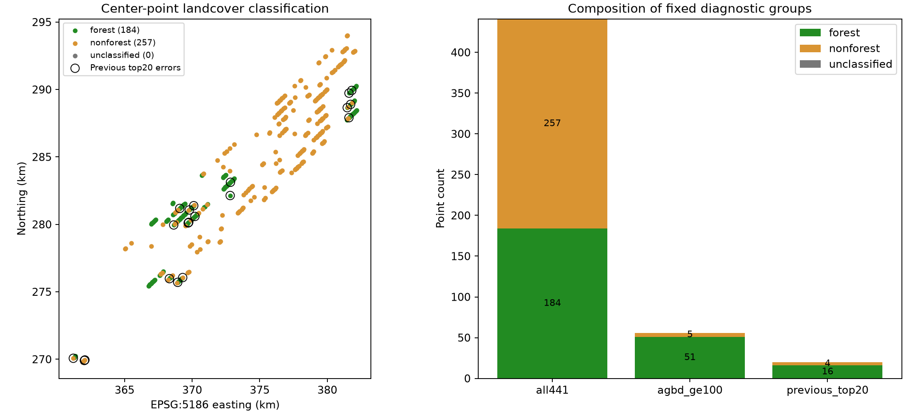

# EGIS 중분류 토지피복과 GEDI 441점 결합

## 결과

6개 도엽의 원본 좌표계 EPSG:5186으로 441점 좌표를 변환하고 실제 polygon과 결합했다. 중심점 기준 **산림 184점, 비산림 257점, 판정 불가 0점**이다. 여기서 산림은 토지피복 코드 310·320·330에 포함되는 점이며 법적 산림 범위 또는 독립 현장 검증을 의미하지 않는다.

| scope | status | n | mean_agbd | circle_mixed_n | mean_forest_circle_fraction |
| --- | --- | --- | --- | --- | --- |
| all441 | forest | 184 | 73.471 | 22 | 0.981 |
| all441 | nonforest | 257 | 20.755 | 17 | 0.014 |
| all441 | unclassified | 0 | nan | 0 | nan |
| agbd_ge100 | forest | 51 | 140.776 | 3 | 0.993 |
| agbd_ge100 | nonforest | 5 | 169.508 | 2 | 0.080 |
| agbd_ge100 | unclassified | 0 | nan | 0 | nan |
| previous_top20 | forest | 16 | 181.345 | 3 | 0.977 |
| previous_top20 | nonforest | 4 | 178.686 | 1 | 0.086 |
| previous_top20 | unclassified | 0 | nan | 0 | nan |

| landcover_status | L2_CODE | L2_NAME | n | high_agbd_n | top20_n | mean_agbd |
| --- | --- | --- | --- | --- | --- | --- |
| forest | 310 | 활엽수림 | 36 | 9 | 3 | 67.867 |
| forest | 320 | 침엽수림 | 116 | 34 | 12 | 73.948 |
| forest | 330 | 혼효림 | 32 | 8 | 1 | 78.046 |
| nonforest | 110 | 주거지역 | 1 | 0 | 0 | 24.320 |
| nonforest | 120 | 공업지역 | 1 | 0 | 0 | 9.351 |
| nonforest | 150 | 교통지역 | 4 | 0 | 0 | 37.922 |
| nonforest | 160 | 공공시설지역 | 2 | 0 | 0 | 37.058 |
| nonforest | 210 | 논 | 44 | 0 | 0 | 10.554 |
| nonforest | 220 | 밭 | 48 | 0 | 0 | 19.075 |
| nonforest | 230 | 시설재배지 | 7 | 0 | 0 | 11.355 |
| nonforest | 240 | 과수원 | 1 | 0 | 0 | 16.163 |
| nonforest | 250 | 기타재배지 | 1 | 0 | 0 | 9.780 |
| nonforest | 420 | 인공초지 | 90 | 3 | 2 | 26.681 |
| nonforest | 510 | 내륙습지 | 23 | 0 | 0 | 17.428 |
| nonforest | 610 | 자연나지 | 2 | 2 | 2 | 164.103 |
| nonforest | 620 | 인공나지 | 29 | 0 | 0 | 13.820 |
| nonforest | 710 | 내륙수 | 4 | 0 | 0 | 14.505 |

식생 후보 중 257/441점(58.3%)이 토지피복 비산림으로 분류됐다. 비산림에는 인공초지 90점, 밭 48점, 논 44점 등이 포함된다. SCL 식생 분류와 산림 분류를 구분할 필요가 실제 자료에서 확인됐다. 고 AGBD 56점 중 산림은 51점, 비산림은 5점이며, 기존 오차 상위 20점 중 산림은 16점이다. 따라서 비산림 혼입을 정리하는 것만으로 높은 AGBD 과소 예측이 해결된다고 볼 수 없다. 산림 중심점 184점 중 22점은 반경 12.5m 근사 원에 비산림 면적도 포함돼 주변 혼합 플래그가 남는다.

## 고 AGBD 및 큰 오차점

고 AGBD(100 Mg/ha 이상) 56점과 기존 개선 RF 절대오차 상위 20점은 고정한 동일 ID로 살폈다. 피복 분류에 평가 AGBD나 예측 오차를 사용하지 않았다.

| error_rank | agbd | landcover_status | L2_NAME | circle_r12p5_forest_fraction | circle_r12p5_nonforest_fraction |
| --- | --- | --- | --- | --- | --- |
| 1.000 | 206.455 | nonforest | 인공초지 | 0.000 | 1.000 |
| 2.000 | 239.693 | forest | 침엽수림 | 1.000 | 0.000 |
| 3.000 | 217.404 | forest | 침엽수림 | 0.983 | 0.017 |
| 4.000 | 213.678 | forest | 활엽수림 | 1.000 | 0.000 |
| 5.000 | 197.161 | forest | 침엽수림 | 1.000 | 0.000 |
| 6.000 | 180.085 | nonforest | 인공초지 | 0.000 | 1.000 |
| 7.000 | 172.632 | nonforest | 자연나지 | 0.343 | 0.657 |
| 8.000 | 181.420 | forest | 침엽수림 | 1.000 | 0.000 |
| 9.000 | 155.573 | nonforest | 자연나지 | 0.000 | 1.000 |
| 10.000 | 165.686 | forest | 침엽수림 | 1.000 | 0.000 |
| 11.000 | 174.378 | forest | 침엽수림 | 1.000 | 0.000 |
| 12.000 | 191.801 | forest | 침엽수림 | 1.000 | 0.000 |
| 13.000 | 187.077 | forest | 침엽수림 | 1.000 | 0.000 |
| 14.000 | 173.529 | forest | 침엽수림 | 1.000 | 0.000 |
| 15.000 | 144.175 | forest | 활엽수림 | 0.984 | 0.016 |
| 16.000 | 184.286 | forest | 혼효림 | 1.000 | 0.000 |
| 17.000 | 167.990 | forest | 활엽수림 | 1.000 | 0.000 |
| 18.000 | 151.372 | forest | 침엽수림 | 1.000 | 0.000 |
| 19.000 | 176.775 | forest | 침엽수림 | 0.664 | 0.336 |
| 20.000 | 135.102 | forest | 침엽수림 | 1.000 | 0.000 |

## 기존 예측의 피복별 진단

| feature_set | status | n | rmse | mae | r2 | mean_residual | mean_agbd |
| --- | --- | --- | --- | --- | --- | --- | --- |
| bands6 | forest | 184 | 57.984 | 43.486 | -0.315 | 15.567 | 73.471 |
| bands6 | nonforest | 257 | 30.445 | 17.888 | -0.418 | -7.418 | 20.755 |
| indices3 | forest | 184 | 57.663 | 43.268 | -0.301 | 15.164 | 73.471 |
| indices3 | nonforest | 257 | 31.615 | 18.923 | -0.529 | -8.356 | 20.755 |
| indices3_bands6 | forest | 184 | 58.238 | 43.349 | -0.327 | 15.990 | 73.471 |
| indices3_bands6 | nonforest | 257 | 31.309 | 18.309 | -0.499 | -8.004 | 20.755 |

위 값은 **전체 식생 후보를 학습한 기존 모델의 저장 OOF 예측을 피복별로 나눈 기술적 지표**다. 산림 표본만으로 재학습한 모델의 성능이 아니다. 피복별 AGBD 분포와 표본 수가 달라 지표를 단순 비교해 피복 효과라고 해석하지 않는다. 기존 모델 선택에 사용한 CV를 다시 진단한 것이며 최종 외부 성능으로 보고하지 않는다.

## 결합 규칙과 주변 피복

DBF `L2_CODE`를 사용하고 CP949로 읽은 `L2_NAME`이 중분류 코드명과 일치하는지 전체 레코드에서 확인했다. 원본 파일·CPG는 수정하지 않았다. SHP 링 방향에 따라 외곽·홀을 구성하고 Shapely 2.2.0로 유효성을 확인했다. 총 64663개 도형 중 유효하지 않거나 구성할 수 없는 도형은 0개다. 도형을 임의 수정하지 않고, 해당 bbox에 걸리는 점은 판정 불가로 처리한다.

중심점이 단일 유효 도형 내부에 있을 때만 코드로 판정한다. 다중 도형 중첩, 경계에서 1mm 이내, 무자료는 별도 사유로 남긴다. 도형 경계까지 거리는 동일 피복 사이 경계나 도엽 경계도 포함하므로 산림 경계 거리로 해석하지 않는다.

반경 12.5m 원형 근사 영역을 실제 polygon과 교차하여 산림·비산림 면적 비율, 무자료·서로 다른 피복의 중첩 비율을 계산했다. 원은 128개 선분으로 근사했다. 중첩은 union으로 중복 면적을 제거하며 산림/비산림 상충 면적은 따로 보존한다. 가까운 무효 도형 bbox도 표시했다. 이는 실제 GEDI footprint 모양·에너지 가중치·위치 오차를 복원한 값이 아니다. 중심점 산림 판정이 관측 영역 전체 산림임을 보장하지 않는다. 혼합 플래그는 양쪽 면적 비율이 각각 1e-6보다 클 때이며 필터링에 사용하지 않았다.

## 자료 시점과 한계

사용자가 신청 화면에서 선택한 2025년 중분류 자료다. 원본 `IMG_DATE`의 값은 geometry_audit.csv와 개별점 CSV에 그대로 남겼다. `20241231` 같은 연말 일자는 메타데이터 필드값이며 실제 각 도형의 정확한 촬영일이라고 단정하지 않는다. 2025-04-25 GEDI 관측 당시 피복과의 일치를 독립 검증하지 않았다. 중분류 일반화와 경계·위치 오차를 고려해야 한다.

## 지도



## 다음 분석의 기준

이번 단계에서는 441점을 유지하고 피복 판정 열만 추가했다. 산림 표본만의 평가를 진행하려면 기존 분할을 유지할지와 학습 표본 수를 먼저 고정하고, 산림/비산림·주변 혼합 조건별 표본 수를 보고해야 한다. 현재 저장 예측의 부분집합 점수를 산림 전용 학습 결과로 바꿔 부르지 않는다.

## 재현

```powershell
& .\week04\.venv\Scripts\python.exe .\week07\landcover\classify_points.py --output-dir .\week07\landcover\reproduction_outputs
```

기존 Python 환경에 Shapely 2.2.0를 추가했다. 원본 토지피복 파일의 보존 해시와 이번 분석 입력 해시를 확인했으며, 판정과 저장 결과를 validation.json에 기록했다. 모델 재학습·추가 다운로드·원본 수정은 하지 않았다.
