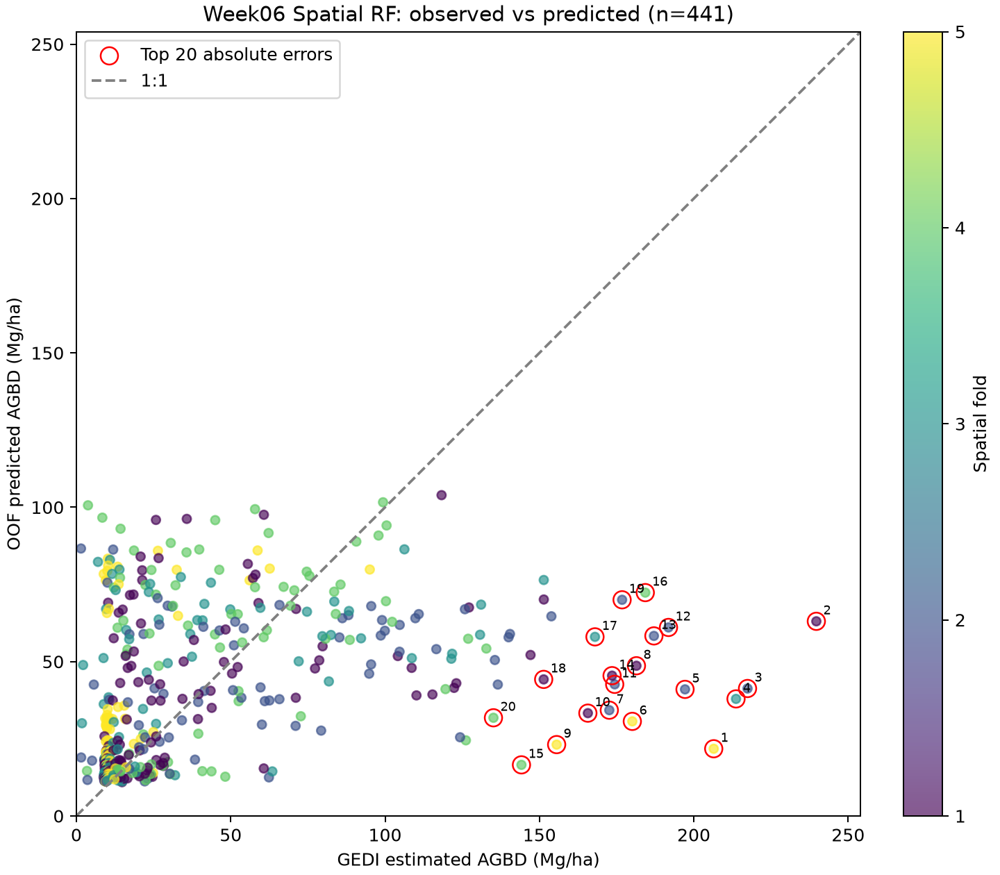
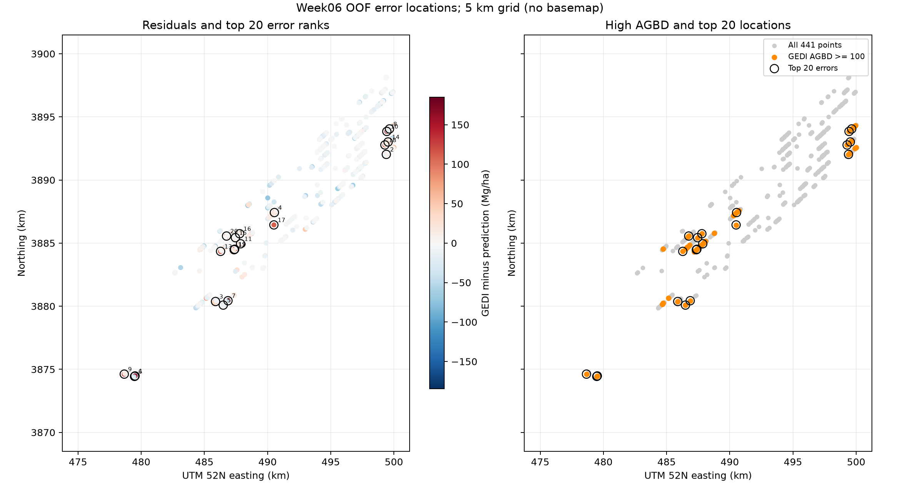

# Week07 Step 1 — week06 예측 오차 진단

## 분석 조건

Week06 `main_all441` / `week05_spatial_B_fixed`의 저장된 공간 OOF 예측 441점만 분석했다. 각 점은 학습에 포함되지 않은 fold에서 얻은 예측이다. 기존 5km 격자·500m 버퍼 설정을 그대로 사용하며 재학습·튜닝·데이터 수정은 하지 않았다. 잔차 = GEDI AGBD − 예측값이며, 양수는 과소 예측이다. 절대오차 내림차순으로 상위 20점을 선택했고 동률은 point_id로 정렬했다.

## 주요 결과

- 전체 RMSE 44.38 Mg/ha, MAE 29.08 Mg/ha로 week06 기본 결과와 일치한다.
- 절대오차 상위 20점 중 AGBD 100 Mg/ha 이상은 20점, 과소 예측은 20점이다.
- 상위 20점은 전체 표본의 4.5%이며 전체 제곱오차의 44.6%를 차지한다. 이는 MSE 기여율이며 RMSE의 가산 기여율이 아니다.
- 상위 20점은 전체 10개 격자 중 5개에 분포한다. 아래 표의 표본 수·고 AGBD 수·상위 20점 비율을 함께 보아야 한다.
- AGBD 100 이상 전체 56점 중 56점이 과소 예측되며, 이 고 AGBD 표본은 6개 격자에 있다. 100 기준은 기술적 진단 구간이며 모델 선택 기준이 아니다.

- 상위 20점이 가장 많은 격자는 `X97_Y776`로 7점이다(전체 79점, 고 AGBD 19점). 단일 격자에만 국한된 현상은 아니며, 지도에서도 여러 위치에서 고 AGBD 표본과 큰 과소 예측이 겹친다.

## 관측값과 예측값



빨간 원은 절대오차 상위 20점이며 숫자는 오차 순위다. 점선 아래는 과소 예측이다.

## 위치와 공간 격자별 오차



원은 상위 20점, 왼쪽 숫자는 오차 순위이며 오른쪽 주황색 점은 고 AGBD 표본이다. 배경지도 없이 EPSG:32652 좌표와 기존 5km 격자를 표시했다. 행정구역·산림 경계 판정은 하지 않았다.

| spatial_group | fold | n | high_agbd_n | top20_n | mean_agbd | mean_prediction | mean_residual | mae | rmse |
| --- | --- | --- | --- | --- | --- | --- | --- | --- | --- |
| X97_Y776 | 2 | 79 | 19 | 7 | 67.05 | 44.35 | 22.70 | 40.23 | 56.67 |
| X99_Y778 | 1 | 119 | 15 | 5 | 39.27 | 36.88 | 2.39 | 25.64 | 41.42 |
| X95_Y774 | 5 | 10 | 3 | 3 | 88.24 | 64.19 | 24.05 | 72.30 | 92.89 |
| X97_Y777 | 4 | 54 | 7 | 3 | 54.72 | 50.76 | 3.96 | 29.84 | 43.97 |
| X98_Y777 | 3 | 66 | 9 | 2 | 42.79 | 41.18 | 1.61 | 27.83 | 41.44 |
| X96_Y775 | 4 | 4 | 0 | 0 | 32.87 | 82.61 | -49.74 | 49.74 | 50.32 |
| X96_Y776 | 4 | 22 | 3 | 0 | 46.45 | 59.28 | -12.84 | 30.56 | 39.92 |
| X99_Y779 | 5 | 30 | 0 | 0 | 13.39 | 33.68 | -20.28 | 21.07 | 30.84 |
| X99_Y777 | 3 | 21 | 0 | 0 | 13.97 | 32.47 | -18.50 | 19.19 | 28.46 |
| X98_Y778 | 5 | 36 | 0 | 0 | 10.35 | 24.72 | -14.37 | 14.37 | 21.09 |

격자별 `top20_rate`는 CSV에 0~1 비율로 저장했다. 표본이 적은 격자의 RMSE와 비율은 불안정할 수 있다. 고 AGBD 표본의 지역 분포와 오차 분포가 겹치는지만 기술하며, 지역 자체가 오차의 원인이라는 결론이나 공간 군집의 통계적 유의성을 주장하지 않는다.

## AGBD 구간별 오차

| agbd_bin | n | mean_agbd | mean_prediction | mean_residual | mae | rmse |
| --- | --- | --- | --- | --- | --- | --- |
| [0,50) | 311 | 17.85 | 34.87 | -17.03 | 19.91 | 29.07 |
| [100,150) | 35 | 120.96 | 54.50 | 66.45 | 66.45 | 71.27 |
| [150,200) | 17 | 171.56 | 51.43 | 120.12 | 120.12 | 122.15 |
| [200,inf) | 4 | 219.31 | 41.01 | 178.30 | 178.30 | 178.34 |
| [50,100) | 74 | 71.29 | 59.71 | 11.58 | 20.96 | 25.26 |

## 상위 20점

| error_rank | spatial_group | fold | latitude | longitude | agbd | prediction | residual | absolute_error |
| --- | --- | --- | --- | --- | --- | --- | --- | --- |
| 1 | X95_Y774 | 5 | 35.01 | 128.78 | 206.45 | 21.77 | 184.68 | 184.68 |
| 2 | X99_Y778 | 1 | 35.17 | 128.99 | 239.69 | 63.06 | 176.64 | 176.64 |
| 3 | X97_Y776 | 2 | 35.07 | 128.85 | 217.40 | 41.29 | 176.12 | 176.12 |
| 4 | X98_Y777 | 3 | 35.13 | 128.90 | 213.68 | 37.93 | 175.75 | 175.75 |
| 5 | X97_Y776 | 2 | 35.06 | 128.85 | 197.16 | 41.01 | 156.15 | 156.15 |
| 6 | X95_Y774 | 5 | 35.01 | 128.78 | 180.08 | 30.64 | 149.44 | 149.44 |
| 7 | X97_Y776 | 2 | 35.07 | 128.86 | 172.63 | 34.27 | 138.36 | 138.36 |
| 8 | X99_Y778 | 1 | 35.19 | 129.00 | 181.42 | 48.66 | 132.76 | 132.76 |
| 9 | X95_Y774 | 5 | 35.01 | 128.77 | 155.57 | 23.11 | 132.46 | 132.46 |
| 10 | X99_Y778 | 1 | 35.19 | 128.99 | 165.69 | 33.31 | 132.38 | 132.38 |
| 11 | X97_Y776 | 2 | 35.11 | 128.87 | 174.38 | 42.64 | 131.74 | 131.74 |
| 12 | X97_Y776 | 2 | 35.10 | 128.86 | 191.80 | 61.07 | 130.73 | 130.73 |
| 13 | X97_Y776 | 2 | 35.10 | 128.85 | 187.08 | 58.33 | 128.75 | 128.75 |
| 14 | X99_Y778 | 1 | 35.18 | 128.99 | 173.53 | 45.46 | 128.07 | 128.07 |
| 15 | X97_Y777 | 4 | 35.11 | 128.86 | 144.17 | 16.56 | 127.62 | 127.62 |
| 16 | X97_Y777 | 4 | 35.11 | 128.87 | 184.29 | 72.35 | 111.94 | 111.94 |
| 17 | X98_Y777 | 3 | 35.12 | 128.90 | 167.99 | 58.02 | 109.97 | 109.97 |
| 18 | X99_Y778 | 1 | 35.18 | 128.99 | 151.37 | 44.24 | 107.13 | 107.13 |
| 19 | X97_Y776 | 2 | 35.10 | 128.86 | 176.78 | 70.02 | 106.75 | 106.75 |
| 20 | X97_Y777 | 4 | 35.11 | 128.85 | 135.10 | 31.81 | 103.30 | 103.30 |

위 표의 좌표는 표시 자리수를 줄였다. `top20_absolute_errors.csv`에는 정확한 좌표, point_id, NDVI/EVI/NDMI, AGBD 표준오차, EVI 점검 플래그를 함께 보존했다.

## 해석과 다음 확인

고 AGBD에서의 과소 예측과 격자별 편차를 먼저 진단한다. 산점도와 격자 집계만으로 반사율 오류·혼합 피복·지수 포화·GEDI 추정 불확실성 중 어느 것이 원인인지 확정할 수 없다. 다음 단계에서는 상위 오차점의 원본 반사율·주변 픽셀 및 피복을 검토한다. 오차가 크다는 이유로 표본을 삭제하거나, 이미 확인한 OOF 점수에 맞춰 최종 검증 성능을 주장하지 않는다.

대상은 산림 미검증 SCL 식생 후보이며 GEDI L4A 모델 추정치를 비교 기준으로 사용한다. 같은 날짜·궤도 자료의 공간 CV로 독립 현장 검증이나 시간·궤도 일반화를 입증하지 않는다.

## 재현

저장소 루트에서 기존 Python 환경으로 실행한다. 출력 폴더가 비어 있지 않으면 중단하므로 재실행에는 새 폴더를 지정한다.

```powershell
& .\week04\.venv\Scripts\python.exe .\week07\step1\analyze_errors.py --output-dir .\week07\step1\reproduction_outputs
```
