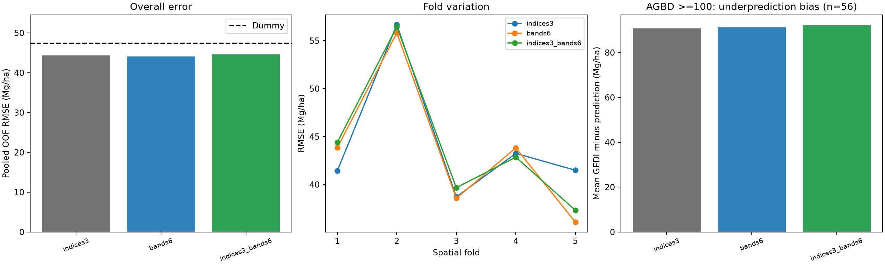
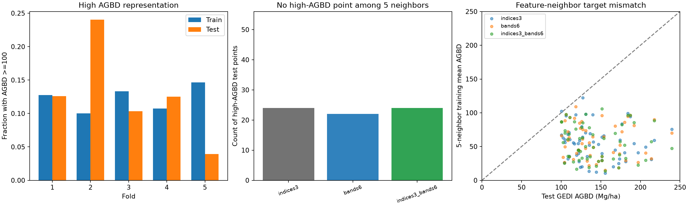

# Week07 Step 3 — 기존 밴드 추가 효과 비교

## 결과

새 자료 없이 기존 Sentinel-2 SAFE에서 추출·검증한 반사율 6개만 사용했다. 동일한 441점, 공간 5-fold·5km 격자·500m 버퍼, 동일 RF 설정을 유지하고 입력변수만 비교했다. 최저 pooled OOF RMSE는 `bands6`의 **44.0790 Mg/ha**다. 이는 이번 고정 비교 내 관측 결과이며 외부 일반화 검증은 아니다.

| feature_set | n | rmse | mae | r2 | mean_residual | rmse_delta_vs_indices3 | rmse_reduction_pct_vs_indices3 | rmse_delta_vs_dummy |
| --- | --- | --- | --- | --- | --- | --- | --- | --- |
| indices3 | 441 | 44.3820 | 29.0806 | 0.0722 | 1.4576 | 0.0000 | 0.0000 | -3.0532 |
| bands6 | 441 | 44.0790 | 28.5682 | 0.0849 | 2.1721 | -0.3030 | 0.6827 | -3.3562 |
| indices3_bands6 | 441 | 44.5688 | 28.7568 | 0.0644 | 2.0073 | 0.1868 | -0.4210 | -2.8664 |

밴드만 사용하면 RMSE는 기존보다 약 0.30 Mg/ha(0.68%) 낮지만, 지수에 밴드를 추가하면 약 0.19 Mg/ha 높다. 입력 추가만으로 뚜렷하고 일관된 개선을 확보하지 못했다. bands6의 fold5 RMSE는 약 5.41 낮아진 반면 fold1은 약 2.42 높아져 지역별 결과가 다르다. 고 AGBD 56점은 세 입력군 모두 과소 예측하며 평균 과소 예측은 약 90.74→91.22(밴드만) 또는 92.22(지수+밴드) Mg/ha로 줄지 않았다. 따라서 이 결과만으로 기존 모델을 대체할 근거는 부족하다.

Dummy는 week06의 동일 평가점별 저장 예측을 재사용했다: RMSE 47.4352, MAE 36.5294, R² -0.0598. delta는 신규−기존이며 음수가 RMSE 개선이다. pooled 지표는 전체 OOF 예측에서 직접 계산했으며 fold 평균과 다르다.

## 입력과 통제

- `indices3`: NDVI·EVI·NDMI.
- `bands6`: B02·B03·B04·B08·B11·B12 반사율.
- `indices3_bands6`: 위 지수 3개 + 반사율 6개.
- RF: n_estimators=100, max_depth=6, min_samples_leaf=3, max_features=0.67, random_state=42, n_jobs=1. 전체 파라미터와 라이브러리 버전은 experiment_config.json에 기록했다.
- 전역 스케일링·결측 대치·변수 선택·하이퍼파라미터 탐색은 없다. point_id 기준으로 반사율을 결합하고 기존 지수·AGBD 값 일치를 검증했다.
- 기존 EVI 점검 대상 1점도 모든 입력군의 동일 441점에 유지했다. 이번에는 추가 민감도 실험으로 유리한 조건을 선택하지 않았다.
- B11/B12는 원본 20m에서 기존 방식으로 10m 정렬한 반사율이며 실제 해상도가 높아진 것은 아니다.

`max_features=0.67`은 비율이므로 분할 후보 변수 수는 입력군에 따라 2·4·6개로 달라진다. 같은 설정을 사용한 입력 구성 비교이며, 변수 추가의 순수 효과와 후보 수 증가의 효과를 분리한 인과 실험은 아니다.

## 공간 fold별 결과

| fold | feature_set | train_n | n | rmse | mae | r2 | mean_residual |
| --- | --- | --- | --- | --- | --- | --- | --- |
| 1 | indices3 | 321 | 119 | 41.4221 | 25.6412 | 0.1323 | 2.3915 |
| 1 | bands6 | 321 | 119 | 43.8380 | 26.3208 | 0.0282 | 3.9916 |
| 1 | indices3_bands6 | 321 | 119 | 44.4049 | 26.4513 | 0.0029 | 5.1406 |
| 2 | indices3 | 349 | 79 | 56.6692 | 40.2307 | -0.0625 | 22.7003 |
| 2 | bands6 | 349 | 79 | 55.8260 | 40.3311 | -0.0311 | 17.7675 |
| 2 | indices3_bands6 | 349 | 79 | 56.4450 | 40.5091 | -0.0541 | 18.3262 |
| 3 | indices3 | 353 | 87 | 38.7081 | 25.7474 | 0.1782 | -3.2456 |
| 3 | bands6 | 353 | 87 | 38.5631 | 25.4045 | 0.1843 | -1.6696 |
| 3 | indices3_bands6 | 353 | 87 | 39.6673 | 25.8881 | 0.1369 | -2.7519 |
| 4 | indices3 | 344 | 80 | 43.2449 | 31.0316 | -0.2756 | -3.3428 |
| 4 | bands6 | 344 | 80 | 43.8220 | 31.5118 | -0.3099 | -2.9095 |
| 4 | indices3_bands6 | 344 | 80 | 42.8539 | 30.6184 | -0.2527 | -3.3415 |
| 5 | indices3 | 362 | 76 | 41.4888 | 24.6374 | -0.3808 | -11.6489 |
| 5 | bands6 | 362 | 76 | 36.0809 | 20.3831 | -0.0443 | -7.1407 |
| 5 | indices3_bands6 | 362 | 76 | 37.3184 | 21.4746 | -0.1171 | -8.7838 |

기존 지수 대비 RMSE가 낮은 fold 수: bands6 **3/5**, 지수+밴드 **3/5**. fold는 독립 반복 실험이 아니며 유의성·신뢰구간을 계산하지 않았다.

## 고 AGBD 및 기존 상위 오차점

| feature_set | scope | n | rmse | mae | r2 | mean_residual | underprediction_n |
| --- | --- | --- | --- | --- | --- | --- | --- |
| indices3 | agbd_ge100 | 56 | 99.8807 | 90.7352 | -7.6861 | 90.7352 | 56 |
| indices3 | previous_top20 | 20 | 139.2203 | 137.0367 | -30.0359 | 137.0367 | 20 |
| bands6 | agbd_ge100 | 56 | 99.6543 | 91.2202 | -7.6467 | 91.2202 | 56 |
| bands6 | previous_top20 | 20 | 137.0744 | 135.1444 | -29.0866 | 135.1444 | 20 |
| indices3_bands6 | agbd_ge100 | 56 | 100.5236 | 92.2182 | -7.7982 | 92.2182 | 56 |
| indices3_bands6 | previous_top20 | 20 | 138.4608 | 136.5276 | -29.6982 | 136.5276 | 20 |

`agbd_ge100`은 같은 고 AGBD 56점, `previous_top20`은 step1에서 고정한 동일 20점이다. mean_residual 양수는 과소 예측이다. 기존 오차가 큰 점을 사후 선택한 진단 집합이므로 이 부분집합의 개선을 독립 검증 성능으로 해석하지 않는다.

## AGBD 구간별 결과

| feature_set | agbd_bin | n | rmse | mae | r2 | mean_residual | mean_prediction |
| --- | --- | --- | --- | --- | --- | --- | --- |
| indices3 | [0,50) | 311 | 29.0684 | 19.9112 | -6.4524 | -17.0264 | 34.8723 |
| indices3 | [50,100) | 74 | 25.2590 | 20.9589 | -1.7925 | 11.5791 | 59.7106 |
| indices3 | [150,200) | 17 | 122.1522 | 120.1227 | -71.1967 | 120.1227 | 51.4332 |
| indices3 | [100,150) | 35 | 71.2725 | 66.4543 | -28.4756 | 66.4543 | 54.5011 |
| indices3 | [200,inf) | 4 | 178.3351 | 178.2967 | -205.4862 | 178.2967 | 41.0108 |
| bands6 | [0,50) | 311 | 28.5131 | 19.1283 | -6.1703 | -16.1499 | 33.9957 |
| bands6 | [50,100) | 74 | 25.4336 | 20.8293 | -1.8312 | 11.7864 | 59.5033 |
| bands6 | [150,200) | 17 | 123.9295 | 122.4141 | -73.3129 | 122.4141 | 49.1417 |
| bands6 | [100,150) | 35 | 71.7336 | 67.2252 | -28.8582 | 67.2252 | 53.7302 |
| bands6 | [200,inf) | 4 | 169.5139 | 168.6028 | -185.5640 | 168.6028 | 50.7048 |
| indices3_bands6 | [0,50) | 311 | 29.1929 | 19.3988 | -6.5164 | -16.3604 | 34.2062 |
| indices3_bands6 | [50,100) | 74 | 24.6793 | 20.0607 | -1.6658 | 10.9333 | 60.3564 |
| indices3_bands6 | [150,200) | 17 | 125.3072 | 123.6347 | -74.9743 | 123.6347 | 47.9212 |
| indices3_bands6 | [100,150) | 35 | 72.2204 | 68.0623 | -29.2649 | 68.0623 | 52.8931 |
| indices3_bands6 | [200,inf) | 4 | 170.5837 | 170.0622 | -187.9262 | 170.0622 | 49.2454 |

## 시각화



## 검증과 한계

기존 지수 모델 441점의 week06 예측 재현 최대 차이 0. 지수+밴드 fold1 재실행 차이 0. 모든 입력군에서 평가 ID·fold가 동일하고 각 점은 한 번만 평가되며, 학습/평가 블록 불일치와 최소 500m 거리를 확인했다. 저장 예측으로 지표를 독립 재계산했고 입력 해시는 실행 전후 동일하다. 총 16회 RF 적합이며 Dummy는 재학습하지 않았다.

상위 오차 진단에 사용한 기존 공간 CV를 다시 비교한 탐색 실험이다. 새 독립 관측일·궤도·현장 표본을 추가하지 않았으므로 모델 선택 후 최종 일반화 성능으로 보고하지 않는다. 산림 미검증 식생 후보와 GEDI 추정 AGBD라는 기존 한계가 유지된다. 이번 밴드 비교에는 새 자료가 필요 없지만, 산림/농경지 구분에는 별도 피복 자료가, 시간·궤도 일반화 확인에는 독립 관측이 필요하다.

## 재현

```powershell
& .\week04\.venv\Scripts\python.exe .\week07\step3\compare_features.py --output-dir .\week07\step3\reproduction_outputs
```

<!-- support-diagnostics -->

## 고 AGBD 과소 예측의 학습 표본·입력 구분력 진단

추가 학습이나 튜닝 없이 동일한 평가점과 그 fold의 학습점만 사용했다. 100 Mg/ha 이상 기준은 기존 진단 구간을 유지했다. 전체 고 AGBD는 56/441점(12.7%)이며, 150 이상은 21점, 200 이상은 4점이다.

### fold별 고 AGBD 학습 지원

| fold | train_n | train_mean | train_ge100_n | train_ge100_fraction | train_ge150_n | train_ge200_n | train_max | test_n | test_ge100_n | test_ge100_fraction | test_max | test_above_train_max_n |
| --- | --- | --- | --- | --- | --- | --- | --- | --- | --- | --- | --- | --- |
| 1 | 321 | 44.141 | 41 | 0.128 | 15 | 3 | 217.404 | 119 | 15 | 0.126 | 239.693 | 1 |
| 2 | 349 | 36.533 | 35 | 0.100 | 13 | 3 | 239.693 | 79 | 19 | 0.241 | 217.404 | 0 |
| 3 | 353 | 44.532 | 47 | 0.133 | 18 | 3 | 239.693 | 87 | 9 | 0.103 | 213.678 | 0 |
| 4 | 344 | 37.791 | 37 | 0.108 | 18 | 4 | 239.693 | 80 | 10 | 0.125 | 184.286 | 0 |
| 5 | 362 | 47.407 | 53 | 0.146 | 18 | 3 | 239.693 | 76 | 3 | 0.039 | 206.455 | 0 |

고 AGBD 평가점 56점 중 해당 fold 학습 최대 AGBD를 넘는 점은 1점이다. 따라서 학습 최댓값을 넘어선 외삽 제약만으로 56점 전체의 과소 예측을 설명할 수 없다. 표본 수·구성, 입력의 구분력, 모델 제약이 함께 작용할 가능성이 있으며 이 분석만으로 각각의 기여를 확정하지 않는다.

### 입력이 비슷한 학습점 5개와 비교

각 평가점에서 **그 fold 학습점만** 대상으로 입력별 median/IQR 표준화 후 유클리드 거리상 가까운 5점을 찾았다. IQR=0이면 학습 표준편차, 그것도 0이면 1을 사용했다. 모든 중심·척도는 학습점에서만 계산했으며 RF 입력이나 기존 예측에는 적용하지 않았다. k=5는 이번 기술적 진단을 위한 고정값이며 성능으로 탐색하지 않았다. 이웃 평균은 별도 예측 모델의 성능으로 평가하지 않는다.

| feature_set | scope | n | above_train_max_n | outside_any_feature_range_n | no_high_agbd_in_neighbor5_n | neighbor5_high_agbd_fraction | mean_neighbor5_agbd | mean_agbd | mean_prediction | mean_neighbor5_agbd_gap |
| --- | --- | --- | --- | --- | --- | --- | --- | --- | --- | --- |
| indices3 | agbd_ge100 | 56 | 1 | 0 | 24 | 0.161 | 54.894 | 143.341 | 52.606 | 88.448 |
| bands6 | agbd_ge100 | 56 | 1 | 2 | 22 | 0.164 | 57.813 | 143.341 | 52.121 | 85.528 |
| indices3_bands6 | agbd_ge100 | 56 | 1 | 2 | 24 | 0.161 | 55.518 | 143.341 | 51.123 | 87.823 |

`no_high_agbd_in_neighbor5_n`은 고 AGBD 평가점의 이웃 5개가 모두 100 미만인 경우의 수다. `outside_any_feature_range_n`은 하나 이상의 입력이 해당 학습 입력의 최솟값~최댓값 밖인 점 수이며, 범위 안이라고 다변량 지원이 충분하다는 의미는 아니다. 거리 크기는 입력 차원이 달라 입력군 사이 직접 비교하지 않는다.

이번 결과에서 고 AGBD 56점의 평균은 143.34 Mg/ha인데 가까운 학습점 5개의 평균은 입력군별 54.89·57.81·55.52 Mg/ha였다. 56점 중 22~24점은 가까운 5개 안에 고 AGBD 학습점이 하나도 없었다. 고 AGBD 이웃 비율은 약 16%로 전체 평가점 이웃의 약 11%보다는 높아, 입력에 구분 정보가 전혀 없다는 뜻은 아니다. 다만 고 AGBD 예측을 지지하는 학습점이 충분히 모이지 않는 패턴이다. fold2는 학습 고 AGBD 비율 10.0%, 평가 24.1%로 구성 차이도 컸다. 현재 정보의 구분력 부족과 표본 구성 불균형을 함께 점검할 근거이며, 어느 하나를 단독 원인으로 확정하지 않는다.

### 기존 오차 상위 5점의 사례: 지수 3개 기준

| error_rank | agbd | prediction | train_max | neighbor5_mean_agbd | neighbor5_min_agbd | neighbor5_max_agbd | neighbor5_ge100_n |
| --- | --- | --- | --- | --- | --- | --- | --- |
| 1.000 | 206.455 | 21.774 | 239.693 | 49.167 | 13.963 | 119.564 | 1 |
| 2.000 | 239.693 | 63.056 | 217.404 | 75.579 | 40.889 | 110.908 | 1 |
| 3.000 | 217.404 | 41.288 | 239.693 | 59.280 | 13.704 | 151.401 | 1 |
| 4.000 | 213.678 | 37.925 | 239.693 | 31.045 | 18.668 | 62.646 | 0 |
| 5.000 | 197.161 | 41.009 | 239.693 | 40.778 | 12.147 | 127.186 | 1 |

이웃 선택은 AGBD를 보지 않고 입력값으로만 수행했다. 가까운 입력에서 다른 AGBD가 나타나는 것은 현재 표현의 구분력 한계와 일치하는 관측이지만, 식생지수 포화나 오표기·공간 위치 오차를 직접 입증하지 않는다. 고 AGBD 표본이 적다는 구성 효과도 섞여 있다. 상대적으로 가까운 5개라는 뜻이며 절대적으로 유사한 반사율·동일 피복임을 보증하지 않는다. 이웃이 여러 평가점에서 재사용되므로 독립 표본 검정으로 해석하지 않는다.



### 이번 결과의 활용

기존 밴드 추가만으로 성능 개선이 작고 고 AGBD 과소 예측이 유지된다는 결과와 함께 해석한다. 이웃 표본의 AGBD 구성은 후속 자료 확보·모델 설계의 점검 근거로 사용하며, 이웃 평균이나 평가점 AGBD를 모델 입력으로 추가하지 않는다. 표본 재가중·고 AGBD 복제·타깃 변환 등 추가 조정을 현재 CV에 반복 적용해 최종 성능으로 주장하지 않는다.

새 자료 없이 할 수 있는 원인 진단을 진행했지만 원인을 확정하지는 못했다. 연구의 다음 우선순위는 별도 토지피복 자료로 산림·비산림을 구분하고 고 AGBD 표본의 피복 및 공간 대응을 확인하는 것이다. 독립 날짜·궤도 관측은 이후 일반화 검증에 필요하다. 이번 작업에서는 다운로드·신청·모델 변경을 하지 않았다.

### 재현과 검증

`support_*.csv`에 fold별 표본 수, 이웃 ID·거리·AGBD, 개별점 진단, 학습 스케일을 저장했다. 이웃은 기존 분할의 학습점에만 속하고 500m 버퍼를 충족한다. 3개 입력군 모두 441점이 정확히 한 번 포함되며, 저장 이웃표로 이웃 평균을 독립 재계산했다. 분석 입력과 기존 성능표·예측은 변경하지 않았다.

```powershell
& .\week04\.venv\Scripts\python.exe .\week07\step3\diagnose_support.py --output-dir .\week07\step3\support_reproduction
```
