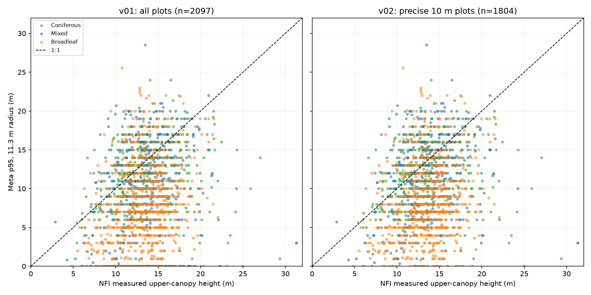
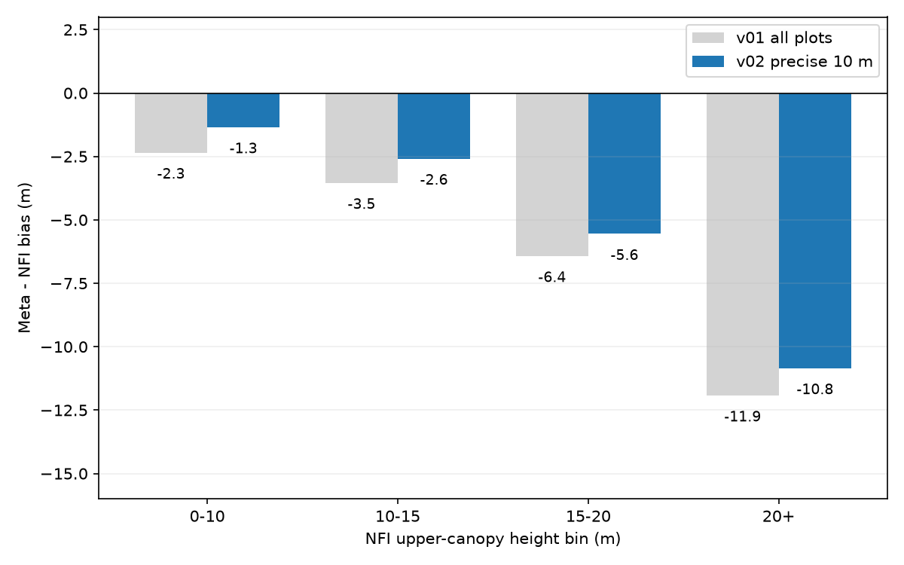
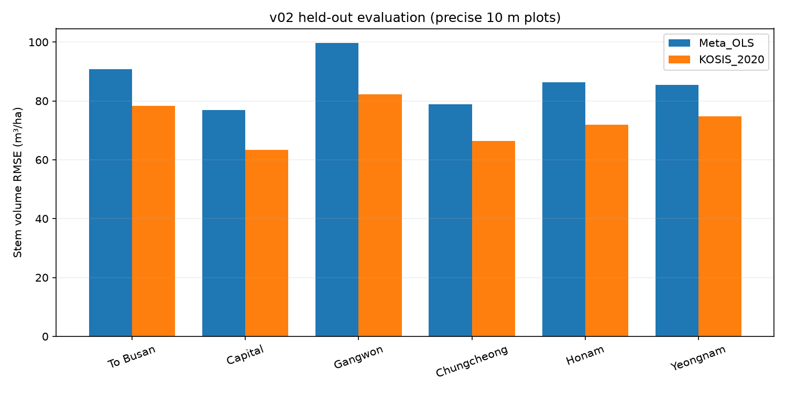
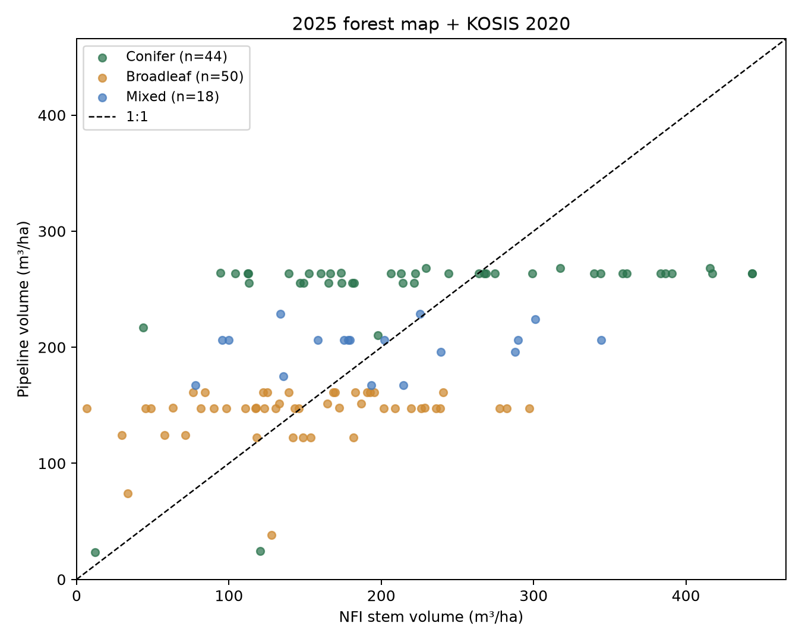
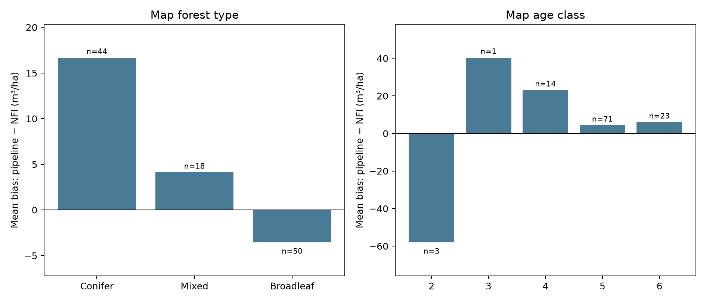

# 국내 NFI 표본점으로 본 Meta 높이 지도와 국가 재적표

결론

- Meta 높이 지도는 국내 NFI 표본점에서 높이를 평균 3.4m 낮게 추정했고, 숲마다 다른 높이를 거의 구분하지 못했음(상관 0.22). NFI 좌표 해석을 바로잡아 다시 계산한 결과임
- 파이프라인의 국가 재적표는 NFI 실측 재적과 평균 3% 이내로 맞았음. 다만 표본점 하나하나로는 오차가 커서, 넓은 지역 합계에는 맞고 작은 지역에는 부족함

---

## 1. 지금까지의 흐름

| 주차 | 한 일 | 결과 |
| --- | --- | --- |
| 6주차 | 조사구 평균 높이로 AGB 회귀 (미국 NEON) | 나무 탐지보다 오차가 작음 (RMSE 138 vs 162 Mg/ha) |
| 7주차 | ① Meta 높이를 NEON 라이다와 비교 ② 국가기준 저장량 파이프라인 구축 | Meta는 20m까지 잘 맞고 그 위에서 포화. 금정산 63.2만 tC |
| 8주차 | ① Meta 높이를 국내 NFI 표본점과 비교 ② NFI로 파이프라인 검산 | Meta 편향 −3.4m·상관 0.22 / 국가 재적표 평균비 1.03 |

- 7주차에 "국내 숲은 대부분 20m 이하라 Meta가 잘 맞을 것"이라고 예상했음
- 이번 주에는 7차 국가산림자원조사(NFI) 표본점으로 국내에서 직접 확인했음

---

## 2. 실험 1

국내 NFI 7차 vs Meta 높이 지도

### 2-1. 목적

- 국내에는 공개 라이다가 없어서, 국내에서 쓸 수 있는 높이 자료는 Meta 높이 지도뿐임
- 질문: Meta 높이는 국내 숲의 실측 높이와 얼마나 맞는가? Meta 높이로 재적을 국가 재적표보다 잘 예측할 수 있는가?

### 2-2. 방법

- **자료**: 7차 NFI 마이크로데이터(2016~2020, 산림청 공개). 표본점 좌표, 나무별 수종·흉고직경·실측 수고(표준목 약 20%), 표본점별 재적
- **표본**: 부표본점 2,097곳(집락 578개) = 부산 전체 284곳 + 전국 층화 표본(집락 500개)
- **비교**
    - 높이: NFI 상층 실측 높이(우세목·준우세목 실측 수고 평균) vs Meta 상위 높이(p95, 반경 11.3m 원)
    - 재적: Meta 평균 높이 하나로 만든 회귀식 vs 국가 재적표(KOSIS 2020). 한 권역씩 빼고 학습한 뒤 뺀 권역에서 평가
- **좌표계 확인**: 좌표계가 명시되지 않아 후보 3개를 공개 고도(DEM)와 NFI 해발고로 비교함 → EPSG:5174 선택 (중앙값 오차 10.0m vs 49.6m, 61.5m). 실험 2에서 다른 방법으로도 같은 결과가 나와 확정함
- **좌표 해석 두 번 계산함 (3-6 참고)**
    - v01(처음): 모든 좌표를 `앞 숫자 × 10 + 5`로 읽음
    - **v02(최종)**: 좌표 형식(자릿수)에 따라 다시 읽고, 위치가 10m 정밀도로 확실한 1,804곳만 비교함. 100m 정밀도 181곳, 판단 불가 34곳, 해석 불가 10곳, 제주 68곳은 제외
    - v02 비교 표본점은 같은 집락 부표본점 간 거리가 지침(50m)대로 나오는 비율이 95%로, 위치 해석이 맞다는 근거가 됨
- 표본점 위치는 공개하지 않는 조건이라 결과는 집계표와 그림으로만 정리함

### 2-3. 결과 (v02, 괄호는 v01)

**높이 비교 (Meta − NFI)**

| 범위 | 표본점 | 편향 | RMSE | 상관 | Meta ÷ NFI |
| --- | --- | --- | --- | --- | --- |
| **전체** | 1,725 (1,924) | **−3.4m** (−4.3) | 6.3m (7.3) | **0.22** (0.21) | **0.75** (0.68) |
| 부산 | 228 (271) | −2.2m (−4.0) | 5.3m (7.4) | 0.35 (0.19) | 0.83 (0.70) |
| 침엽수림 | 451 (501) | −1.9m (−3.0) | 5.6m (6.9) | 0.13 (0.10) | 0.86 (0.78) |
| 혼효림 | 514 (568) | −2.6m (−3.6) | 5.6m (6.8) | 0.28 (0.22) | 0.81 (0.74) |
| 활엽수림 | 760 (855) | −4.9m (−5.6) | 7.1m (7.8) | 0.23 (0.27) | 0.64 (0.58) |

**높이 구간별 편향**

| NFI 상층 높이 | 0–10m | 10–15m | 15–20m | 20m 이상 |
| --- | --- | --- | --- | --- |
| **v02** | **−1.3m** | **−2.6m** | **−5.6m** | **−10.8m** |
| v01 | −2.3m | −3.5m | −6.4m | −11.9m |

- 참고: 미국 NEON(7주차)은 0–10m +3.7m, 10–20m −1.2m, 20–30m −6.9m, 30m 이상 −14.4m

**Meta 값이 0m인 숲**

- v01에서는 산림 표본점의 12%(269곳)에서 반경 11.3m 원 안의 Meta 값이 전부 0m였음
- 이 중 197곳이 좌표를 잘못 해석한 표본점이었음 (제주 67곳, 100m 정밀도 108곳 등) → 바다 등 엉뚱한 위치에 놓였던 것
- v02에서는 4%(72곳)만 남음

**재적 예측 (v02, ㎥/ha)**

| 평가 권역 | Meta 회귀 RMSE | 국가 재적표 RMSE | Meta 회귀 상관 | 국가 재적표 상관 |
| --- | --- | --- | --- | --- |
| 부산 | 91 | **78** | 0.39 | **0.64** |
| 수도권 | 77 | **63** | 0.58 | **0.72** |
| 강원 | 100 | **82** | 0.29 | **0.59** |
| 충청 | 79 | **66** | 0.45 | **0.65** |
| 호남 | 86 | **72** | 0.39 | **0.61** |
| 영남 | 85 | **75** | 0.35 | **0.57** |

- 제주는 v02에서 제외되어 평가하지 않음. v01에서도 모든 권역에서 국가 재적표가 나았음

### 2-4. 해석

- **좌표를 바로잡자 0m 문제는 대부분 사라졌고 편향도 작아졌음** (−4.3m → −3.4m, 부산 −4.0m → −2.2m)
- **그래도 구분력은 그대로임**: 상관 0.21 → 0.22. 위치가 확실한 표본점만으로도 Meta는 높은 숲과 낮은 숲을 거의 구분하지 못함 → "Meta v1은 국내 숲에서 표본점 단위로 쓰기 어렵다"는 결론이 더 확실해짐
- **7주차 예상은 절반만 맞았음**: 편향 크기는 NEON(−7.1m)보다 작았지만, 높을수록 더 낮게 추정하는 경향은 국내에서도 같음(0–10m −1.3m → 20m 이상 −10.8m). 국내 숲은 대부분 10~20m로 높이 범위가 좁아서 몇 m의 오차에도 구분력이 쉽게 사라짐
- **활엽수림에서 가장 나쁨**(−4.9m, 0.64배). NEON에서도 활엽수림(GRSM)이 더 낮게 나왔던 것과 같은 방향
- **파이프라인에 주는 의미**: Meta v1 높이로 재적을 예측하면 국가 재적표보다 나쁨 → 파이프라인 재적 단계는 국가 재적표를 유지함

### 2-5. 한계

- 좌표가 약 10m 칸 정밀도라 반경 11.3m 원과 Meta 픽셀 사이에 위치 오차가 섞임
- NFI 실측 수고는 표준목 약 20%뿐이고, 현장 측정에도 오차가 있음
- Meta 촬영일을 확인하지 못함 (NFI 2016~2020과의 시점 차이 모름)
- 국가 재적표는 NFI 표본점으로 만든 통계라, 같은 자료로 평가하면 유리한 면이 있음. 다만 차이가 커서 결론은 바뀌지 않음
- 표본(부산 + 전국 500개 집락)은 전국 전체가 아니고, v02는 100m 정밀도·제주 표본점을 뺀 1,804곳임
- 남은 Meta 0m 72곳의 원인(실제 공백, 벌채, 위치 오차 등)은 확인하지 않음

---

## 3. 실험 2

NFI로 파이프라인 검산

### 3-1. 목적

- 파이프라인은 시도 평균 재적표를 쓰기 때문에 금정산 숲의 실제 재적과 다를 수 있음
- 질문: 표본점이 떨어지는 임상도 구획에서, 파이프라인이 붙인 ha당 재적과 표본점 실측 재적은 얼마나 다른가?

### 3-2. 방법

- **대상**: 임상도가 있는 금정구·북구·양산시의 산림 표본점 140곳 → 비교 가능한 112곳
    - 제외: 좌표 형식 이상 24곳(3-6 참고), 임상도 범위 밖 3곳, 무립목지 구획 1곳 (삭제하지 않고 표시만 함)
- **비교**: 표본점이 떨어지는 임상도 구획에 파이프라인이 붙인 ha당 재적(2025 임상도 + KOSIS 2020 재적표, NFI와 같은 시기) vs 표본점 실측 재적(7차 NFI)
- **좌표계 재확인**: DEM 대신 "표본점이 임상도 산림 구획에 떨어지는 비율"과 "현장 임상과 임상도 임상이 같은 비율"로 판별함 → EPSG:5174 (산림 포함률 80.7% vs 74.3%, 67.1% / 임상 일치율 67.0% vs 53.9%, 44.7%). 실험 1의 DEM 판별과 같은 결과라 좌표계를 확정함
- 파이프라인 코드를 그대로 불러 써서 같은 규칙(1영급 0, 6영급 이상, 대체 순서)으로 재적을 붙임

### 3-3. 결과

**평균 비교 (파이프라인 − NFI, ㎥/ha)**

| 범위 | 표본점 | NFI 평균 | 파이프라인 평균 | 평균 편향 | 평균비 |
| --- | --- | --- | --- | --- | --- |
| **전체** | 112 | 188.5 | 194.1 | **+5.6** | **1.03** |
| 침엽수림 | 44 | 232.5 | 249.1 | +16.7 | 1.07 |
| 활엽수림 | 50 | 147.0 | 143.4 | −3.6 | 0.98 |
| 혼효림 | 18 | 196.2 | 200.3 | +4.1 | 1.02 |
| 금정구 | 19 | 186.1 | 182.7 | −3.5 | 0.98 |
| 북구 | 14 | 174.0 | 191.4 | +17.5 | 1.10 |
| 양산시 | 79 | 191.6 | 197.3 | +5.7 | 1.03 |

- 표본점 하나하나로 보면 차이가 큼: MAE 69㎥/ha, RMSE 83㎥/ha(평균의 약 44%), 상관 0.51

**임상도 분류와 현장 기록의 일치율**

| 항목 | 일치율 |
| --- | --- |
| 임상 (침엽·활엽·혼효) | 67.0% |
| 영급 (같은 영급) | 68.8% |
| 영급 (±1영급 이내) | 93.8% |

**민감도**

| 바꾼 것 | 평균비 | 해석 |
| --- | --- | --- |
| 기준 (2025 임상도 + 2020 재적표) | 1.03 | |
| 임상도만 2013년판으로 | 0.85 | 옛 임상도는 영급이 낮게 적혀 있어 재적이 작게 붙음 |
| 재적표만 2025년판으로 | 1.18 | 2025 재적표에는 NFI 조사(2016~2020) 이후 5년 성장이 들어 있음 |
| 구획 경계 5m 이내 표본점 제외 | 1.01 | 위치 오차 영향은 작음 |

### 3-4. 해석

- **넓은 지역 합계로는 국가 재적표가 실제 숲과 잘 맞음**: 평균 3% 이내(평균비 1.03). 금정산처럼 수천 ha 단위의 총량을 계산하는 파이프라인 방식이 현장 기준으로도 타당함
- **같은 시점끼리 맞춰야 함**: 2020 재적표를 쓰면 1.03, 2025 재적표를 쓰면 1.18. NFI 조사 시점과 재적표 시점이 같아야 맞음
- **작은 지역에는 맞지 않음**: 재적표는 임상·영급마다 값이 하나라(그림의 가로줄), 같은 "침엽수림 5영급"이라도 실제 재적이 100~450㎥/ha로 다른 것을 반영하지 못함. 표본점 단위 오차가 평균의 약 44%
- **침엽수림은 약간 많게(+7%)** 잡힘. 임상도 분류가 현장과 3곳 중 1곳꼴로 다른 것(임상 일치율 67%)도 오차 원인
- 실험 1과 연결: 이 개별 오차를 줄이려고 Meta 높이를 써 봤지만, Meta 높이 회귀는 재적표보다 더 나빴음 → 지금은 국가 재적표가 가장 나은 선택

### 3-5. 한계

- 표본점 하나(0.04~0.08ha)와 임상도 구획 평균은 크기가 달라 개별 차이가 큼. 평균 편향 위주로 해석함
- NFI 재적도 흉고직경 실측에 국가 재적식을 적용한 추정값임
- KOSIS 2020 재적표는 7차 NFI 표본점으로 만든 통계라 완전히 독립된 비교는 아님. 시도 평균과 그 자리 숲의 차이를 보는 데 의미가 있음
- 임상도가 있는 3개 시군구 112곳만 대상 (부산 전체 아님)

### 3-6. 작업 중 발견: NFI 좌표 형식 문제

- 7차 NFI 좌표 중 약 13%(전국 2,030곳, 부산 49곳)는 보통 형식(숫자 5자리 + xx)이 아니라 숫자 4자리 + xx 등으로 적혀 있음
- 원래 값에 소수점이 없던 좌표는 가린 뒤 자릿수가 하나 줄어드는 것으로 보임 → 이 경우 100m 단위 정밀도로 따로 해석해야 함
- 제주는 563곳 대부분이 이 형식이고, 다른 좌표 원점(제주 원점)을 쓰는 것으로 보임
- 실험 2는 이 표본점(24곳)을 제외했고, 실험 1은 처음(v01)에 모든 좌표를 같은 규칙으로 읽어 일부 표본점이 엉뚱한 위치(바다 등)에 놓였음 → 같은 집락 이웃 좌표로 다시 해석해 v02로 다시 계산함 (2-2, 2-3)

---

## 4. 결론과 다음 단계

- Meta v1 높이 지도는 국내 숲에서 표본점 단위로 쓰기 어려움 (좌표를 바로잡은 v02에서도 편향 −3.4m, 상관 0.22)
- 국가 재적표는 넓은 지역 평균으로는 실제 숲과 3% 이내로 맞았음 → 파이프라인은 국가 재적표를 기본으로 유지함
- 다만 작은 지역(공원, 캠퍼스 등)에서는 개별 오차가 커서 재적표만으로는 부족함 → 부산시가 관심 있는 도시숲에는 다른 방법이 필요함
- 다음 단계
    - 제외한 표본점 되살리기: 100m 정밀도 181곳의 올바른 위치에서 Meta 다시 읽기, 제주 좌표 원점 확인
    - Meta v2(2026년 공개) 비교: 같은 노트북에서 제품 경로만 바꿔 공백·포화가 개선됐는지 확인
    - **부산시 요청 사항(사이드)**: 부산시는 법정 산림뿐 아니라 부산시민공원, 부산대 캠퍼스 같은 **도시숲**의 탄소량에 관심이 많음 → 도시숲 식생을 정리한 기존 자료나 시도가 있는지 조사 (시간이 남으면 이번 주, 아니면 다음 주)
