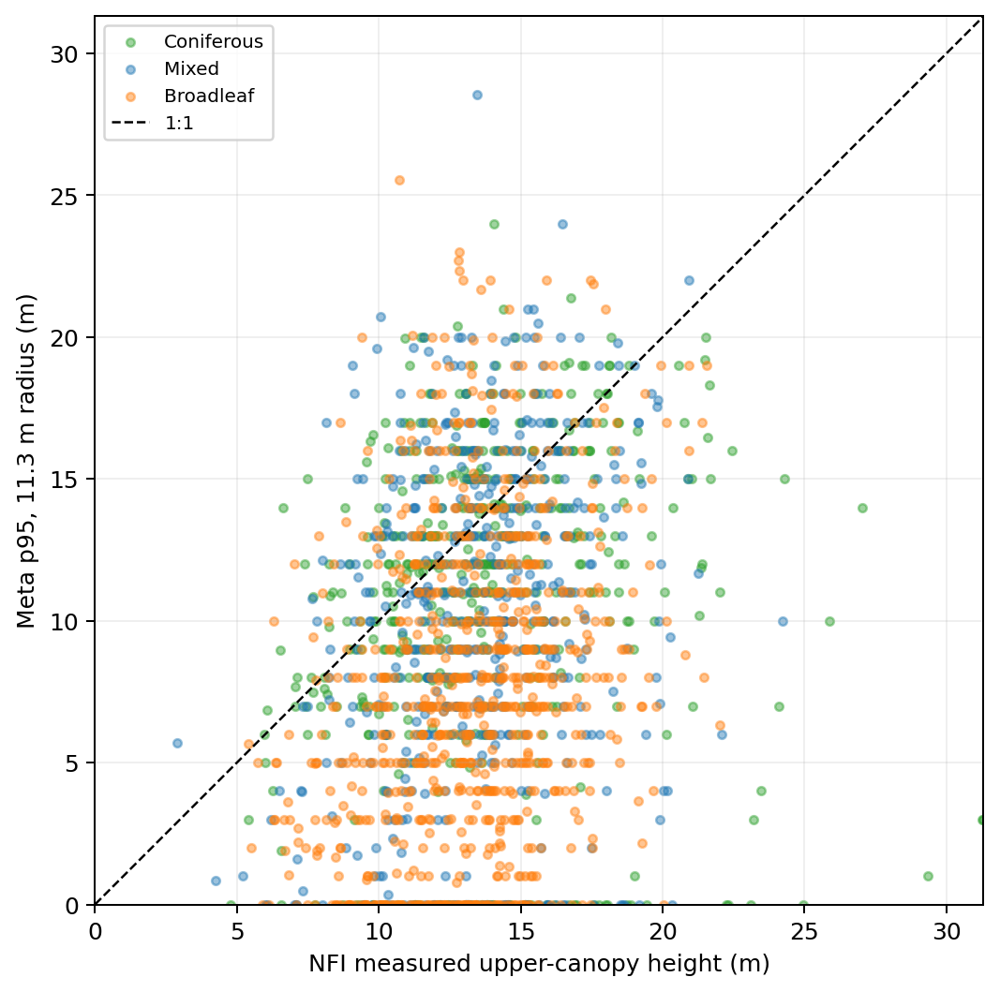
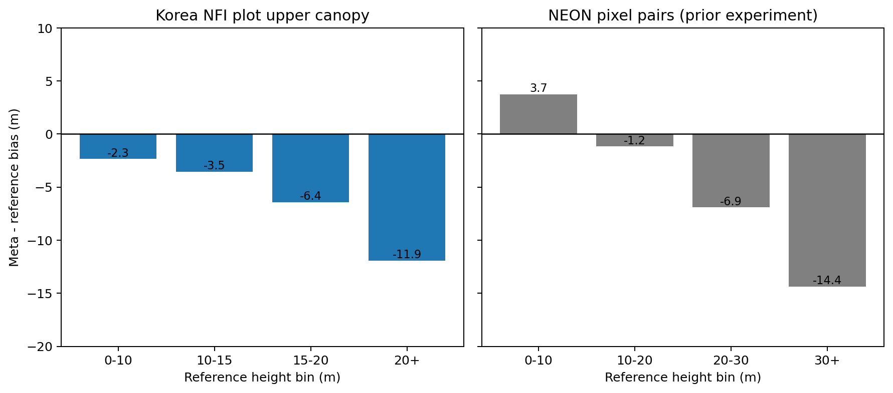
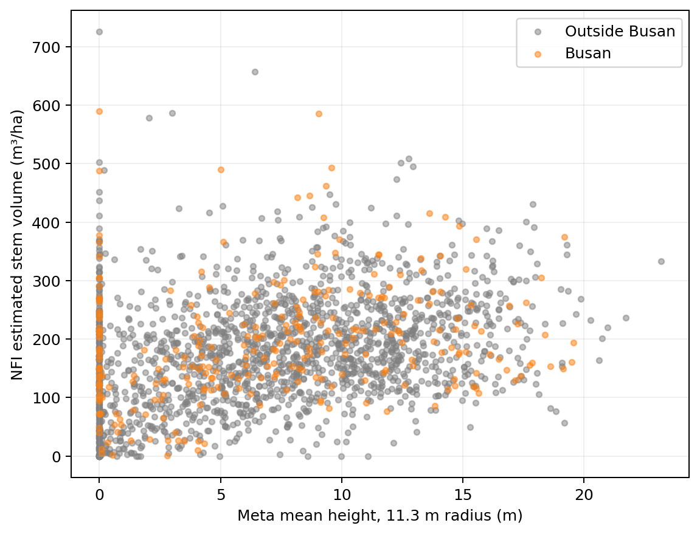
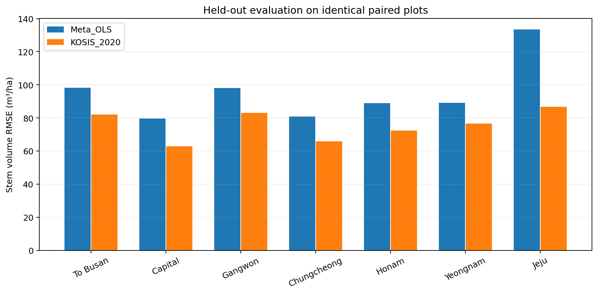

# Meta/WRI v1 × NFI7 국내 비교

## 1. 확인할 질문

Meta 높이가 NFI 상층 실측·로리 높이와 얼마나 맞는지, 고정 높이 회귀가 KOSIS 기준선보다 재적을 더 잘 설명하는지 확인했음.

## 2. 입력자료

제7차 NFI 정리 CSV, 제공된 조사점별 재적, KOSIS 2020 시도×임상×영급 재적표, Meta/WRI v1, Copernicus GLO-30을 사용했음.

## 3. 실행 환경과 순서

CPU Colab에서 설치→마운트·경로→NFI 읽기·표본→좌표계 판별→NFI 높이·재적→Meta 예상량→Meta 읽기→관측일→표시→높이 비교→재적 비교→그림→저장을 수행했음.

좌표 해석은 앞 숫자 ×10+5m임. 소수 첫째 자리 원본에서 뒤 두 자리가 가려진 10m 칸 중심을 사용했음. 초안 ×100+50은 사용자 확인 후 정정했음.

층화는 집락 내 최빈 시도×임상(동률 사전순), 비례 배분·최대잔여법, seed=42로 고정했음. 집락의 대상 부표본점을 모두 포함했음.

좌표계 선택: EPSG:5174. 2026-11-20 1차 DEM 판별(판별점 300, 공통 288): 중앙값 절대오차 EPSG:5174 10.0m, 2097 49.6m, 5181 61.5m, MAD 8.3 / 43.0 / 54.5m로 5174가 뚜렷하게 가장 작았고, 다른 후보 대비 RMSE 개선의 집락 bootstrap 95% 하한도 5.2m, 7.5m로 0보다 컸음. 세 후보 모두 RMSE가 약 200m인 것은 공통된 일부 이상점 때문이라 RMSE≤30m 기준만 통과하지 못했음. 중앙값 오차 10m는 DSM(수관 포함)과 지면 해발고 차이 수준임 (근거 표: run_20261120_013423/crs_check.csv, DEM은 다시 받지 않음)

|   epsg |   n_sample |   n_valid |   n_common |   bias_m |   median_absolute_error_m |   mad_m |   rmse_m |   rmse_improvement_vs_best_m |   bootstrap_improvement_ci_low_m | selected   | decision_reason                                                                                                                                                                                                                                                                                                                                                                                                                                                           |   nearest_40_60m_fraction |
|-------:|-----------:|----------:|-----------:|---------:|--------------------------:|--------:|---------:|-----------------------------:|---------------------------------:|:-----------|:--------------------------------------------------------------------------------------------------------------------------------------------------------------------------------------------------------------------------------------------------------------------------------------------------------------------------------------------------------------------------------------------------------------------------------------------------------------------------|--------------------------:|
|   5174 |        300 |       289 |        288 | -55.7253 |                   9.97363 |  8.2879 |  198.9   |                      0       |                        nan       | True       | 2026-11-20 1차 DEM 판별(판별점 300, 공통 288): 중앙값 절대오차 EPSG:5174 10.0m, 2097 49.6m, 5181 61.5m, MAD 8.3 / 43.0 / 54.5m로 5174가 뚜렷하게 가장 작았고, 다른 후보 대비 RMSE 개선의 집락 bootstrap 95% 하한도 5.2m, 7.5m로 0보다 컸음. 세 후보 모두 RMSE가 약 200m인 것은 공통된 일부 이상점 때문이라 RMSE≤30m 기준만 통과하지 못했음. 중앙값 오차 10m는 DSM(수관 포함)과 지면 해발고 차이 수준임 (근거 표: run_20261120_013423/crs_check.csv, DEM은 다시 받지 않음) |                  0.844712 |
|   2097 |        300 |       289 |        288 | -61.7375 |                  49.5911  | 42.9868 |  206.361 |                      7.46123 |                          5.15196 | False      | 2026-11-20 1차 DEM 판별(판별점 300, 공통 288): 중앙값 절대오차 EPSG:5174 10.0m, 2097 49.6m, 5181 61.5m, MAD 8.3 / 43.0 / 54.5m로 5174가 뚜렷하게 가장 작았고, 다른 후보 대비 RMSE 개선의 집락 bootstrap 95% 하한도 5.2m, 7.5m로 0보다 컸음. 세 후보 모두 RMSE가 약 200m인 것은 공통된 일부 이상점 때문이라 RMSE≤30m 기준만 통과하지 못했음. 중앙값 오차 10m는 DSM(수관 포함)과 지면 해발고 차이 수준임 (근거 표: run_20261120_013423/crs_check.csv, DEM은 다시 받지 않음) |                  0.844712 |
|   5181 |        300 |       290 |        288 | -66.7443 |                  61.5148  | 54.5451 |  209.725 |                     10.825   |                          7.47617 | False      | 2026-11-20 1차 DEM 판별(판별점 300, 공통 288): 중앙값 절대오차 EPSG:5174 10.0m, 2097 49.6m, 5181 61.5m, MAD 8.3 / 43.0 / 54.5m로 5174가 뚜렷하게 가장 작았고, 다른 후보 대비 RMSE 개선의 집락 bootstrap 95% 하한도 5.2m, 7.5m로 0보다 컸음. 세 후보 모두 RMSE가 약 200m인 것은 공통된 일부 이상점 때문이라 RMSE≤30m 기준만 통과하지 못했음. 중앙값 오차 10m는 DSM(수관 포함)과 지면 해발고 차이 수준임 (근거 표: run_20261120_013423/crs_check.csv, DEM은 다시 받지 않음) |                  0.844712 |

최근접 집락 내 거리 40~60m 비율: 0.845임.

## 4. 주요 결과

표본점 2,097곳, 집락 578개임. 부산 284곳을 포함했음.

| sample_scope   | province       | forest_type   |   n_plots |   n_clusters | kind                       |
|:---------------|:---------------|:--------------|----------:|-------------:|:---------------------------|
| Busan          | 부산광역시     | 침엽수림      |        81 |           39 | selected_plot_distribution |
| Busan          | 부산광역시     | 혼효림        |       103 |           55 | selected_plot_distribution |
| Busan          | 부산광역시     | 활엽수림      |       100 |           45 | selected_plot_distribution |
| Outside Busan  | 강원도         | 침엽수림      |        67 |           32 | selected_plot_distribution |
| Outside Busan  | 강원도         | 혼효림        |        91 |           56 | selected_plot_distribution |
| Outside Busan  | 강원도         | 활엽수림      |       198 |           74 | selected_plot_distribution |
| Outside Busan  | 경기도         | 침엽수림      |        16 |            8 | selected_plot_distribution |
| Outside Busan  | 경기도         | 혼효림        |        29 |           17 | selected_plot_distribution |
| Outside Busan  | 경기도         | 활엽수림      |        74 |           32 | selected_plot_distribution |
| Outside Busan  | 경상남도       | 침엽수림      |        75 |           33 | selected_plot_distribution |
| Outside Busan  | 경상남도       | 혼효림        |        51 |           27 | selected_plot_distribution |
| Outside Busan  | 경상남도       | 활엽수림      |        67 |           33 | selected_plot_distribution |
| Outside Busan  | 경상북도       | 침엽수림      |       121 |           58 | selected_plot_distribution |
| Outside Busan  | 경상북도       | 혼효림        |       114 |           72 | selected_plot_distribution |
| Outside Busan  | 경상북도       | 활엽수림      |       147 |           70 | selected_plot_distribution |
| Outside Busan  | 광주광역시     | 침엽수림      |         4 |            4 | selected_plot_distribution |
| Outside Busan  | 광주광역시     | 혼효림        |         4 |            3 | selected_plot_distribution |
| Outside Busan  | 광주광역시     | 활엽수림      |         2 |            1 | selected_plot_distribution |
| Outside Busan  | 대구광역시     | 침엽수림      |        15 |            6 | selected_plot_distribution |
| Outside Busan  | 대구광역시     | 혼효림        |        11 |            5 | selected_plot_distribution |
| Outside Busan  | 대구광역시     | 활엽수림      |        16 |            7 | selected_plot_distribution |
| Outside Busan  | 대전광역시     | 침엽수림      |         5 |            5 | selected_plot_distribution |
| Outside Busan  | 대전광역시     | 혼효림        |         7 |            6 | selected_plot_distribution |
| Outside Busan  | 대전광역시     | 활엽수림      |        13 |            7 | selected_plot_distribution |
| Outside Busan  | 서울특별시     | 혼효림        |         2 |            1 | selected_plot_distribution |
| Outside Busan  | 서울특별시     | 활엽수림      |         6 |            3 | selected_plot_distribution |
| Outside Busan  | 세종특별자치시 | 활엽수림      |         7 |            2 | selected_plot_distribution |
| Outside Busan  | 울산광역시     | 침엽수림      |        13 |            5 | selected_plot_distribution |
| Outside Busan  | 울산광역시     | 혼효림        |         9 |            6 | selected_plot_distribution |
| Outside Busan  | 울산광역시     | 활엽수림      |        17 |            6 | selected_plot_distribution |
| Outside Busan  | 인천광역시     | 침엽수림      |         2 |            1 | selected_plot_distribution |
| Outside Busan  | 인천광역시     | 혼효림        |         6 |            4 | selected_plot_distribution |
| Outside Busan  | 인천광역시     | 활엽수림      |        14 |            6 | selected_plot_distribution |
| Outside Busan  | 전라남도       | 침엽수림      |        53 |           24 | selected_plot_distribution |
| Outside Busan  | 전라남도       | 혼효림        |        45 |           28 | selected_plot_distribution |
| Outside Busan  | 전라남도       | 활엽수림      |        75 |           30 | selected_plot_distribution |
| Outside Busan  | 전라북도       | 침엽수림      |        31 |           16 | selected_plot_distribution |
| Outside Busan  | 전라북도       | 혼효림        |        28 |           17 | selected_plot_distribution |
| Outside Busan  | 전라북도       | 활엽수림      |        65 |           25 | selected_plot_distribution |
| Outside Busan  | 제주특별자치도 | 침엽수림      |        15 |            8 | selected_plot_distribution |
| Outside Busan  | 제주특별자치도 | 혼효림        |        10 |            6 | selected_plot_distribution |
| Outside Busan  | 제주특별자치도 | 활엽수림      |        43 |           16 | selected_plot_distribution |
| Outside Busan  | 충청남도       | 침엽수림      |        33 |           18 | selected_plot_distribution |
| Outside Busan  | 충청남도       | 혼효림        |        33 |           19 | selected_plot_distribution |
| Outside Busan  | 충청남도       | 활엽수림      |        51 |           24 | selected_plot_distribution |
| Outside Busan  | 충청북도       | 침엽수림      |        19 |           12 | selected_plot_distribution |
| Outside Busan  | 충청북도       | 혼효림        |        45 |           28 | selected_plot_distribution |
| Outside Busan  | 충청북도       | 활엽수림      |        64 |           28 | selected_plot_distribution |

상층 실측 결측 92곳, 로리 결측 31곳, KOSIS 결측 0곳임.

### 높이 비교

| pair                | role    |   radius_m | scope_kind   | scope         |   n_total |   n_pairs |   n_missing |      bias |      rmse |       mae |           r |   mean_ratio |
|:--------------------|:--------|-----------:|:-------------|:--------------|----------:|----------:|------------:|----------:|----------:|----------:|------------:|-------------:|
| measured_top_vs_p95 | primary |       11.3 | overall      | all           |      2097 |      1924 |         173 |  -4.32624 |   7.25833 |   5.74086 |   0.209878  |     0.677437 |
| measured_top_vs_p95 | primary |       11.3 | disturbance  | excluded      |      1473 |      1387 |          86 |  -4.12434 |   7.03666 |   5.56692 |   0.217587  |     0.692777 |
| measured_top_vs_p95 | primary |       11.3 | height_bin   | 0-10          |       245 |       229 |          16 |  -2.34896 |   5.3112  |   4.37289 |   0.228941  |     0.719878 |
| measured_top_vs_p95 | primary |       11.3 | height_bin   | 10-15         |      1224 |      1172 |          52 |  -3.54129 |   6.54095 |   5.24323 |   0.112286  |     0.721492 |
| measured_top_vs_p95 | primary |       11.3 | height_bin   | 15-20         |       484 |       473 |          11 |  -6.42551 |   8.56276 |   6.97826 |   0.104523  |     0.613768 |
| measured_top_vs_p95 | primary |       11.3 | height_bin   | 20+           |        52 |        50 |           2 | -11.9223  |  14.1981  |  11.9647  |  -0.332978  |     0.464563 |
| measured_top_vs_p95 | primary |       11.3 | height_bin   | negative      |         0 |         0 |           0 | nan       | nan       | nan       | nan         |   nan        |
| measured_top_vs_p95 | primary |       11.3 | height_bin   | missing       |        92 |         0 |          92 | nan       | nan       | nan       | nan         |   nan        |
| measured_top_vs_p95 | primary |       11.3 | forest_type  | 침엽수림      |       550 |       501 |          49 |  -3.00656 |   6.85699 |   4.75297 |   0.100664  |     0.781173 |
| measured_top_vs_p95 | primary |       11.3 | forest_type  | 혼효림        |       588 |       568 |          20 |  -3.5605  |   6.77843 |   5.26958 |   0.218915  |     0.735178 |
| measured_top_vs_p95 | primary |       11.3 | forest_type  | 활엽수림      |       959 |       855 |         104 |  -5.60823 |   7.77676 |   6.63281 |   0.267426  |     0.575087 |
| measured_top_vs_p95 | primary |       11.3 | geography    | Busan         |       284 |       271 |          13 |  -3.95813 |   7.36487 |   5.90912 |   0.194724  |     0.695875 |
| measured_top_vs_p95 | primary |       11.3 | geography    | Outside Busan |      1813 |      1653 |         160 |  -4.38659 |   7.24072 |   5.71327 |   0.212904  |     0.674518 |
| lorey_vs_mean       | primary |       11.3 | overall      | all           |      2097 |      1984 |         113 |  -6.6135  |   8.52674 |   7.11613 |   0.218402  |     0.522227 |
| lorey_vs_mean       | primary |       11.3 | disturbance  | excluded      |      1473 |      1405 |          68 |  -6.19114 |   8.10321 |   6.73228 |   0.235397  |     0.550988 |
| lorey_vs_mean       | primary |       11.3 | height_bin   | 0-10          |       245 |       228 |          17 |  -4.91651 |   6.39864 |   5.56988 |   0.300719  |     0.481381 |
| lorey_vs_mean       | primary |       11.3 | height_bin   | 10-15         |      1224 |      1168 |          56 |  -5.84797 |   7.78715 |   6.48281 |   0.0587507 |     0.561021 |
| lorey_vs_mean       | primary |       11.3 | height_bin   | 15-20         |       484 |       469 |          15 |  -8.08994 |   9.68661 |   8.30793 |   0.122971  |     0.515489 |
| lorey_vs_mean       | primary |       11.3 | height_bin   | 20+           |        52 |        49 |           3 | -13.3636  |  15.2136  |  13.3636  |  -0.305448  |     0.382819 |
| lorey_vs_mean       | primary |       11.3 | height_bin   | negative      |         0 |         0 |           0 | nan       | nan       | nan       | nan         |   nan        |
| lorey_vs_mean       | primary |       11.3 | height_bin   | missing       |        92 |        70 |          22 | -10.2972  |  11.1723  |  10.3617  |   0.142712  |     0.152043 |
| lorey_vs_mean       | primary |       11.3 | forest_type  | 침엽수림      |       550 |       516 |          34 |  -5.39966 |   8.03711 |   6.01865 |   0.0676593 |     0.617172 |
| lorey_vs_mean       | primary |       11.3 | forest_type  | 혼효림        |       588 |       565 |          23 |  -5.93796 |   8.02242 |   6.57497 |   0.199199  |     0.575604 |
| lorey_vs_mean       | primary |       11.3 | forest_type  | 활엽수림      |       959 |       903 |          56 |  -7.72982 |   9.08634 |   8.08186 |   0.318704  |     0.431594 |
| lorey_vs_mean       | primary |       11.3 | geography    | Busan         |       284 |       276 |           8 |  -6.3099  |   8.46273 |   7.14795 |   0.195711  |     0.530097 |
| lorey_vs_mean       | primary |       11.3 | geography    | Outside Busan |      1813 |      1708 |         105 |  -6.66256 |   8.53703 |   7.11099 |   0.222152  |     0.520999 |
| measured_top_vs_p95 | primary |       16   | overall      | all           |      2097 |      1924 |         173 |  -3.97521 |   7.09721 |   5.5695  |   0.20077   |     0.70361  |
| measured_top_vs_p95 | primary |       16   | disturbance  | excluded      |      1473 |      1387 |          86 |  -3.7855  |   6.87775 |   5.39606 |   0.210415  |     0.718018 |
| measured_top_vs_p95 | primary |       16   | height_bin   | 0-10          |       245 |       229 |          16 |  -1.91682 |   5.21165 |   4.27819 |   0.216204  |     0.771412 |
| measured_top_vs_p95 | primary |       16   | height_bin   | 10-15         |      1224 |      1172 |          52 |  -3.17705 |   6.39087 |   5.08834 |   0.110088  |     0.750139 |
| measured_top_vs_p95 | primary |       16   | height_bin   | 15-20         |       484 |       473 |          11 |  -6.1397  |   8.36201 |   6.74122 |   0.100865  |     0.630948 |
| measured_top_vs_p95 | primary |       16   | height_bin   | 20+           |        52 |        50 |           2 | -11.6354  |  13.9648  |  11.6778  |  -0.338886  |     0.477451 |
| measured_top_vs_p95 | primary |       16   | height_bin   | negative      |         0 |         0 |           0 | nan       | nan       | nan       | nan         |   nan        |
| measured_top_vs_p95 | primary |       16   | height_bin   | missing       |        92 |         0 |          92 | nan       | nan       | nan       | nan         |   nan        |
| measured_top_vs_p95 | primary |       16   | forest_type  | 침엽수림      |       550 |       501 |          49 |  -2.66779 |   6.76205 |   4.6572  |   0.0916376 |     0.805829 |
| measured_top_vs_p95 | primary |       16   | forest_type  | 혼효림        |       588 |       568 |          20 |  -3.26387 |   6.65946 |   5.14384 |   0.216245  |     0.757241 |
| measured_top_vs_p95 | primary |       16   | forest_type  | 활엽수림      |       959 |       855 |         104 |  -5.21387 |   7.55597 |   6.38686 |   0.252659  |     0.604966 |
| measured_top_vs_p95 | primary |       16   | geography    | Busan         |       284 |       271 |          13 |  -3.63026 |   7.27798 |   5.78337 |   0.178772  |     0.721067 |
| measured_top_vs_p95 | primary |       16   | geography    | Outside Busan |      1813 |      1653 |         160 |  -4.03176 |   7.06713 |   5.53444 |   0.204902  |     0.700847 |
| lorey_vs_mean       | primary |       16   | overall      | all           |      2097 |      1984 |         113 |  -6.65673 |   8.51294 |   7.1153  |   0.216736  |     0.519104 |
| lorey_vs_mean       | primary |       16   | disturbance  | excluded      |      1473 |      1405 |          68 |  -6.2392  |   8.08738 |   6.72828 |   0.236523  |     0.547503 |
| lorey_vs_mean       | primary |       16   | height_bin   | 0-10          |       245 |       228 |          17 |  -4.87888 |   6.34116 |   5.49726 |   0.301088  |     0.48535  |
| lorey_vs_mean       | primary |       16   | height_bin   | 10-15         |      1224 |      1168 |          56 |  -5.89739 |   7.7648  |   6.47526 |   0.0615324 |     0.557311 |
| lorey_vs_mean       | primary |       16   | height_bin   | 15-20         |       484 |       469 |          15 |  -8.1655  |   9.70221 |   8.35626 |   0.120053  |     0.510964 |
| lorey_vs_mean       | primary |       16   | height_bin   | 20+           |        52 |        49 |           3 | -13.5418  |  15.291   |  13.5418  |  -0.291847  |     0.374587 |
| lorey_vs_mean       | primary |       16   | height_bin   | negative      |         0 |         0 |           0 | nan       | nan       | nan       | nan         |   nan        |
| lorey_vs_mean       | primary |       16   | height_bin   | missing       |        92 |        70 |          22 | -10.1893  |  11.0752  |  10.2522  |   0.14442   |     0.160931 |
| lorey_vs_mean       | primary |       16   | forest_type  | 침엽수림      |       550 |       516 |          34 |  -5.47779 |   8.04387 |   6.03969 |   0.0639192 |     0.611633 |
| lorey_vs_mean       | primary |       16   | forest_type  | 혼효림        |       588 |       565 |          23 |  -6.01821 |   8.03554 |   6.5957  |   0.197366  |     0.569867 |
| lorey_vs_mean       | primary |       16   | forest_type  | 활엽수림      |       959 |       903 |          56 |  -7.72993 |   9.04715 |   8.05505 |   0.318765  |     0.431586 |
| lorey_vs_mean       | primary |       16   | geography    | Busan         |       284 |       276 |           8 |  -6.30932 |   8.44633 |   7.12043 |   0.184591  |     0.530141 |
| lorey_vs_mean       | primary |       16   | geography    | Outside Busan |      1813 |      1708 |         105 |  -6.71287 |   8.52365 |   7.11448 |   0.222307  |     0.517382 |

편향은 Meta−NFI, 평균비는 평균(Meta)/평균(NFI)임. 결측은 각 지표의 유효 짝에서만 제외했으며 모든 표본점 행은 유지했음.

### 재적 비교

| evaluation       | method     | status   |   n_train |   n_test_total |   n_test_common |   n_test_meta_available |   n_test_kosis_available |   n_test_excluded_missing |       a |       b |   rmse_difference_meta_minus_kosis |   n_total |   n_pairs |   n_missing |       bias |     rmse |      mae |           r |   mean_ratio |
|:-----------------|:-----------|:---------|----------:|---------------:|----------------:|------------------------:|-------------------------:|--------------------------:|--------:|--------:|-----------------------------------:|----------:|----------:|------------:|-----------:|---------:|---------:|------------:|-------------:|
| Outside_to_Busan | Meta_OLS   | ok       |      1729 |            284 |             279 |                     279 |                      284 |                         5 | 136.695 | 5.77223 |                            16.1565 |       279 |       279 |           0 | -15.3777   |  98.2923 |  72.4748 | 0.25156     |     0.920573 |
| Outside_to_Busan | KOSIS_2020 | ok       |      1729 |            284 |             279 |                     279 |                      284 |                         5 | 136.695 | 5.77223 |                            16.1565 |       279 |       279 |           0 | -21.9273   |  82.1358 |  61.7124 | 0.613332    |     0.886744 |
| LORO_Capital     | Meta_OLS   | ok       |      1865 |            149 |             146 |                     146 |                      149 |                         3 | 143.886 | 5.26207 |                            16.9707 |       146 |       146 |           0 |  17.1469   |  79.7226 |  65.4094 | 0.544289    |     1.10589  |
| LORO_Capital     | KOSIS_2020 | ok       |      1865 |            149 |             146 |                     146 |                      149 |                         3 | 143.886 | 5.26207 |                            16.9707 |       146 |       146 |           0 |   0.196909 |  62.7518 |  50.7194 | 0.712857    |     1.00122  |
| LORO_Gangwon     | Meta_OLS   | ok       |      1663 |            356 |             346 |                     346 |                      356 |                        10 | 137.368 | 5.63898 |                            14.9479 |       346 |       346 |           0 | -15.1659   |  97.9374 |  73.4429 | 0.28588     |     0.922001 |
| LORO_Gangwon     | KOSIS_2020 | ok       |      1663 |            356 |             346 |                     346 |                      356 |                        10 | 137.368 | 5.63898 |                            14.9479 |       346 |       346 |           0 |   8.62978  |  82.9895 |  64.0017 | 0.575752    |     1.04438  |
| LORO_Chungcheong | Meta_OLS   | ok       |      1735 |            277 |             273 |                     273 |                      277 |                         4 | 144.565 | 5.35297 |                            14.9157 |       273 |       273 |           0 |  19.0315   |  80.8287 |  64.9802 | 0.425906    |     1.1146   |
| LORO_Chungcheong | KOSIS_2020 | ok       |      1735 |            277 |             273 |                     273 |                      277 |                         4 | 144.565 | 5.35297 |                            14.9157 |       273 |       273 |           0 |   6.03633  |  65.9129 |  51.2102 | 0.646842    |     1.03635  |
| LORO_Honam       | Meta_OLS   | ok       |      1733 |            307 |             277 |                     277 |                      307 |                        30 | 146.484 | 5.31475 |                            16.685  |       277 |       277 |           0 |  31.0497   |  89.0011 |  73.4945 | 0.368442    |     1.20551  |
| LORO_Honam       | KOSIS_2020 | ok       |      1733 |            307 |             277 |                     277 |                      307 |                        30 | 146.484 | 5.31475 |                            16.685  |       277 |       277 |           0 |   9.78828  |  72.3161 |  56.0005 | 0.598629    |     1.06479  |
| LORO_Yeongnam    | Meta_OLS   | ok       |      1103 |            940 |             902 |                     902 |                      940 |                        38 | 133.221 | 5.80055 |                            12.7122 |       902 |       902 |           0 | -12.2279   |  89.2128 |  68.0324 | 0.277904    |     0.935716 |
| LORO_Yeongnam    | KOSIS_2020 | ok       |      1103 |            940 |             902 |                     902 |                      940 |                        38 | 133.221 | 5.80055 |                            12.7122 |       902 |       902 |           0 | -10.7694   |  76.5006 |  59.5495 | 0.567049    |     0.943384 |
| LORO_Jeju        | Meta_OLS   | ok       |      1944 |             68 |              67 |                      67 |                       68 |                         1 | 134.307 | 6.13727 |                            46.6045 |        67 |        67 |           0 | -61.596    | 133.403  | 102.179  | 3.90753e-16 |     0.685579 |
| LORO_Jeju        | KOSIS_2020 | ok       |      1944 |             68 |              67 |                      67 |                       68 |                         1 | 134.307 | 6.13727 |                            46.6045 |        67 |        67 |           0 |  -6.65356  |  86.7986 |  59.9042 | 0.682028    |     0.966036 |

RMSE 차이=Meta 회귀−KOSIS임. 음수이면 Meta 회귀 오차가 더 작음. 두 방법이 모두 가능한 동일 평가 표본에서 비교했음.

회귀의 독립변수는 Meta 11.3m 평균 하나임. 평가 집락은 학습에서 전부 제외했음. 전국 가중 추정이나 설정 탐색은 하지 않았음.

### 교란·품질 표시

|                         |   n_flagged |
|:------------------------|------------:|
| coordinate_missing_flag |           0 |
| lorey_incomplete_flag   |          31 |
| volume_missing_flag     |           0 |
| disturbance_flag        |         624 |
| edge_flag               |          41 |
| edge_unknown_flag       |           0 |
| meta_nodata_flag        |          86 |
| meta_r16_nodata_flag    |          86 |
| no_measured_top_flag    |          92 |
| kosis_missing_flag      |           0 |

### 관측일

| meta_observation_status   |   n_plots |
|:--------------------------|----------:|
| 미확인                    |      2097 |

날짜가 하나로 확인된 점의 관측연도−NFI 조사연도 차이를 meta_year_gap으로 남겼음. 복수 날짜는 범위만 남기고 차이는 결측임.

### 전송량

Meta TIFF 예상 2741.98MB, 실제 2449.97MB; metadata 실제 999.98MB; DEM 예상 0.00MB, 실제 0.00MB임.

예상량은 저장 블록 기준이며 실제량과 다름. HTTP payload만 계수했음. metadata는 TIFF와 합쳐 3GB 이내이며 파일당 300MB·전체 1GB도 적용했음.

### 그림

NEON 편향 패널은 이전 ALL_23 픽셀 결과이며 NFI의 표본점 상층 비교와 정의·구간·표본 단위가 다름. 두 패널의 y축은 −20~10m로 통일했음.

## 5. 확인한 내용과 남은 한계

- NFI 실측 수고는 표준목 약 20%만 있음. 추정수고·추정간재적은 국가 재적식으로 계산한 값이라 독립 실측이 아님

- 좌표는 약 10m 칸 정밀도임. 원(반경 11.3m)과 Meta 픽셀의 위치 오차가 섞임

- 시점 차이: NFI 2016~2020 vs Meta 관측일(확인값 또는 미확인)

- Meta는 숲 위에서 본 높이, NFI는 나무별 측정이라 정의가 다름. 상층 높이로 맞췄지만 완전히 같은 양이 아님

- 표본(부산 + 전국 500개 집락)은 전국 전체가 아님

- KOSIS 표는 NFI 표본점으로 만든 통계라 기준선이 같은 자료에서 나온 값임

- Copernicus GLO-30은 지면 DEM이 아닌 식생·시설을 포함한 DSM임. NFI 해발고와 차이가 날 수 있어 좌표계 판별에 한계가 있음

공개 파일에는 표본점번호·집락번호·좌표·시군구·읍면동·지도·점별 타일 연결이 없음. 위치를 가진 자료는 Drive 비공개 CSV에만 보관했음.

단순 상관·RMSE는 이 표본 내 비교임. 모델 보정이나 재적의 독립 실측 검증으로 해석하지 않음.

### 참고

- https://github.com/facebookresearch/HighResCanopyHeight

- https://copernicus-dem-30m.s3.amazonaws.com/readme.html

- https://kosis.kr/statHtml/statHtml.do?orgId=136&tblId=DT_136014_10210&conn_path=I3

완료 UTC: 2026-11-20T02:53:33.624844+00:00
